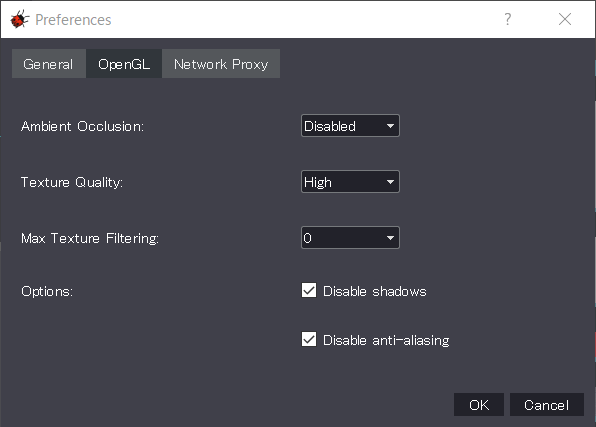

## Installation Guide
1. Install pip3 & required libraries
    1. Open the terminal window.
    2. Run the following command to install pip:  
    `sudo apt install python3-pip`
    3. Run the following command to install libraries:  
    `python3 -m pip install numpy termcolor requests overrides pillow opencv-python`

1. Download & Install the Webots version **R2023b**
    1. Open the terminal window.
    2. Run the following command to download the installation package:  
      `wget https://github.com/cyberbotics/webots/releases/download/R2023b/webots_2023b_amd64.deb`
    3. Run the following command to install it:  
      `sudo apt install ./webots_2023b_amd64.deb`

1. Download and **unzip** the latest Erebus release. On the [Releases page](https://github.com/robocup-junior/erebus/releases), open **Assets** and choose **Source code (zip)**.

## Run the environment
Run the world1.wbt file from the terminal. If the file is located in `/home/USER_NAME/EREBUS_FOLDER/game/worlds/world1.wbt`, just run the following command:  
`webots '/home/USER_NAME/EREBUS_FOLDER/game/worlds/world1.wbt'`  

Webots opens the Competition Supervisor (the Erebus control window) automatically, in your web browser. If it does not appear, please check the troubleshooting section.

The first time you run the simulator, it automatically installs some Python libraries it needs, which may take some time. When it is ready, the control window shows the 08:00 game timer. Continue with [Getting Started](/docs/tutorials/getting-started/).

## Troubleshooting
### The Competition Supervisor does not appear
The control window is a web page. If your browser has blocked it, open <http://localhost:1234/robot_windows/MainSupervisorWindow/MainSupervisorWindow.html?name=robot> while the world is open. Otherwise:

1. If the Scene Tree is not displayed, go to Tools --> Scene Tree in the top menu to display it.
2. Find "DEF MAINSUPERVISOR Robot" in the Scene Tree and right-click it. Click on "Show Robot Window".


### If your Webots screen comes up blank/black
Copy the download and unzip it to a separate folder before opening the world. It should then work.

### The simulation runs too slowly
This is probably due to the low performance of your computer. This may be improved by adjusting the "accuracy" of the graphics according to the following procedure. The competition uses [its own settings](/docs/installation/#opengl-settings), so check your program with those too.
1. Open Tools -> Preferences in the top navigation bar.
2. Open the OpenGL tab
3. Set the various parameters appropriately.

### `No module named 'cv2'`
OpenCV is not installed in the Python used by Webots. Run the pip command in step 1 again.
