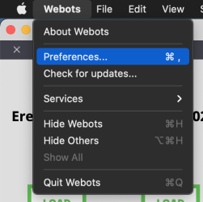
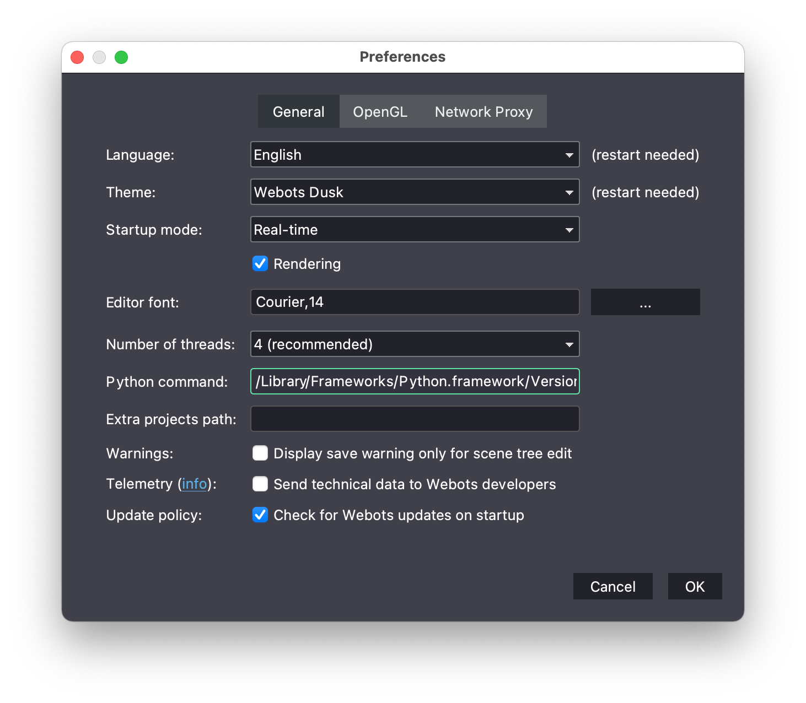
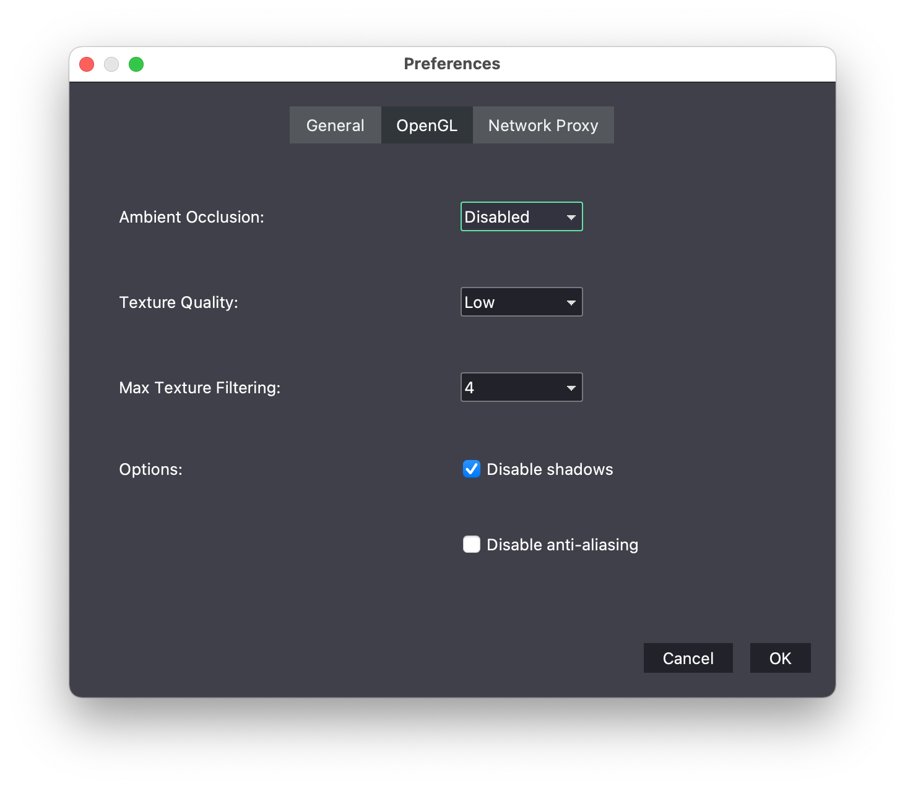

## Installation & Setup Guide
1. Download & Install Python **3.9 or later** from the [official website](https://www.python.org/downloads/macos/).  **Even if you have Python installed on your system via brew, anaconda, etc., we recommend that you install it afresh. Otherwise, the simulation may not work properly.**

1. Open the terminal and install the required libraries:  
`python3 -m pip install numpy termcolor requests overrides pillow opencv-python`

1. Download & Install the Webots version **R2023b** from their [official repository](https://github.com/cyberbotics/webots/releases/download/R2023b/webots-R2023b.dmg).   

1. Download and **unzip** the latest Erebus release. On the [Releases page](https://github.com/robocup-junior/erebus/releases), open **Assets** and choose **Source code (zip)**.

## Run the environment
Double click the world file `game/worlds/world1.wbt` to open it in Webots. Webots opens the Competition Supervisor (the Erebus control window) automatically, in your web browser. If it does not appear, please check the troubleshooting section.

The first time you run the simulator, it automatically installs some Python libraries it needs, which may take some time. When it is ready, the control window shows the 08:00 game timer. Continue with [Getting Started](/docs/tutorials/getting-started/).

## Troubleshooting
First of all, please check the console window. If you see any errors, you will need to try to resolve them.
### The Competition Supervisor does not appear
The control window is a web page. If your browser has blocked it, open <http://localhost:1234/robot_windows/MainSupervisorWindow/MainSupervisorWindow.html?name=robot> while the world is open. Otherwise:

1. If the Scene Tree is not displayed, go to Tools --> Scene Tree in the top menu to display it.
2. Find "DEF MAINSUPERVISOR Robot" in the Scene Tree and right-click it. Click on "Show Robot Window".


### Common Errors
#### `WARNING: Python was not found`
1. Open the terminal and execute the following command  
`which python3`
2. Open Webots -> Preferences.  

1. Set the path found in step 1 in the "Python command" field.  

#### `No module named 'cv2'`
OpenCV is not installed in the Python used by Webots. Check that the "Python command" field points to the same Python where you ran the pip command.

### The simulation runs too slowly
This is probably due to the low performance of your computer. This may be improved by adjusting the "accuracy" of the graphics according to the following procedure. The competition uses [its own settings](/docs/installation/#opengl-settings), so check your program with those too.
1. Open Webots -> Preferences.
2. Open the OpenGL tab
3. Set the various parameters appropriately.

