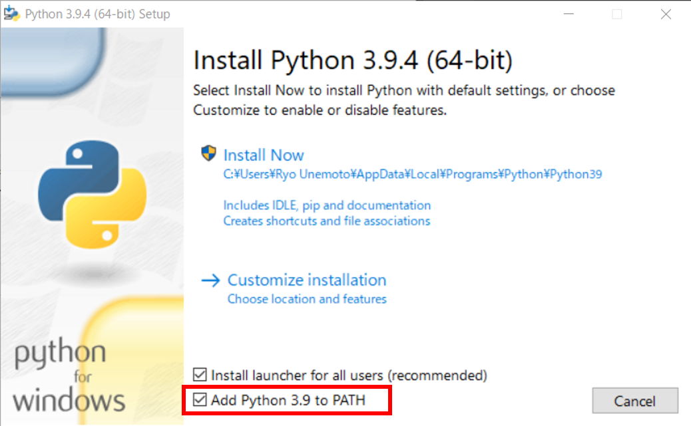
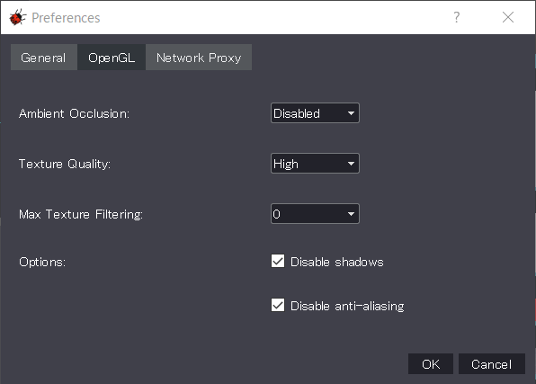

## Quick Installation Guide
1. Download & Install Python **3.9 or later**, 64 bit, from the [official website](https://www.python.org/downloads/windows/). During the installation, please make sure Python is added to your PATH (see picture below!)

1. Open PowerShell and install the required libraries:  
`python -m pip install numpy termcolor requests overrides pillow opencv-python`

1. Download & Install the Webots version **R2023b** from their [official repository](https://github.com/cyberbotics/webots/releases/download/R2023b/webots-R2023b_setup.exe).

1. Download and **unzip** the latest Erebus release. On the [Releases page](https://github.com/robocup-junior/erebus/releases), open **Assets** and choose **Source code (zip)**.

## Run the environment
Double click the world file `game/worlds/world1.wbt` to open it in Webots. Webots opens the Competition Supervisor (the Erebus control window) automatically, in your web browser. If it does not appear, please check the troubleshooting section.

The first time you run the simulator, it automatically installs some Python libraries it needs, which may take some time. When it is ready, the control window shows the 08:00 game timer. Continue with [Getting Started](/docs/tutorials/getting-started/).

## Troubleshooting
### The Competition Supervisor does not appear
The control window is a web page. If your browser has blocked it, open <http://localhost:1234/robot_windows/MainSupervisorWindow/MainSupervisorWindow.html?name=robot> while the world is open. Otherwise:

1. If the Scene Tree is not displayed, go to Tools --> Scene Tree in the top menu to display it.
2. Find "DEF MAINSUPERVISOR Robot" in the Scene Tree and right-click it. Click on "Show Robot Window".


### The game timer does not appear
1. First of all, please check the console window. If you see any errors, you will need to try to resolve them.
2. If you see `No module named 'cv2'`, or the automatic installation of the required libraries is not working properly, start PowerShell and run the following command.
  `python -m pip install numpy termcolor requests overrides pillow opencv-python`

### If your Webots screen comes up blank/black
Copy the download and unzip it to a separate folder before opening the world. It should then work.

### Can't load a controller
This most likely means that Python has not been added to the Path correctly. To address this:

1. Check to see if Python is in your path. Open Command Prompt and type `PATH`. You will get some file locations returned. Is Python in this? If not, the easiest fix is to install Python again, ticking the option shown in the picture above.
1. To check this has worked, open a new Command Prompt window and type `python`. Python should now open.
1. Now tell Webots where Python is. In Webots, go to Tools --> Preferences --> Python command, and enter `python`, the same word used in your path.

Paths are messy and frustrating, and it can take a bit of work to iron out all the issues!

### The simulation runs too slowly
This is probably due to the low performance of your computer. This may be improved by adjusting the "accuracy" of the graphics according to the following procedure. The competition uses [its own settings](/docs/installation/#opengl-settings), so check your program with those too.
1. Open Tools -> Preferences in the top navigation bar.
2. Open the OpenGL tab
3. Set the various parameters appropriately.

