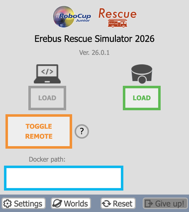

# Running the game server and controller programs on the same computer
First, let's try to run the game server and controller programs on the same computer. This is not the same as a real competition setup, but it will help you when you are debugging locally.

## Toggle Remote Mode
Open the world and press "TOGGLE REMOTE" in the control window. The button color should turn orange to indicate that it is enabled.



If the control window is not displayed, right-click on "DEF MAINSUPERVISOR Robot" in the Scene Tree and press "Show Robot Window".

## Execute Your Program
Open a terminal and run the following commands, replacing `<Your controller path>` with the path to your controller program.

```bash
export WEBOTS_HOME=/usr/local/webots
"$WEBOTS_HOME/webots-controller" "<Your controller path>"
```

This assumes Webots was installed with the `.deb` package in `/usr/local/webots`. If you installed it elsewhere, change `WEBOTS_HOME` accordingly.

The controller connects to Webots and waits until the game starts.

## Start the Game
Press the start button in the control window. The robot appears, and your program starts running.

## Terminate the Game
To interrupt the game, press Ctrl+C in the terminal.

Once the simulation is terminated, the Erebus game management system is terminated at the same time. If you want to run the game again, reload the world.

# Running the game server on a different computer
This is the setup used for official competitions. The computer running your controller (client) and the game server (server) must be connected to the same network.

1. (Server) Start Webots on the server, open the world and turn on remote mode in the control window.
1. (Server) Find out the IP address of the server. You can use the `ip addr` command.
1. (Client) Run the following commands, replacing `<Your controller path>` with the path to your controller program and `<Server IP address>` with the IP address you found in the previous step.

    ```bash
    export WEBOTS_HOME=/usr/local/webots
    "$WEBOTS_HOME/webots-controller" --protocol=tcp --ip-address=<Server IP address> "<Your controller path>"
    ```
1. (Server) Start the game by pressing the start button.

## Troubleshooting
- **The controller cannot connect:** check that both computers can reach each other, for example with `ping`, that the firewall of the server allows TCP port 1234, and that the list of allowed IPs in the Network tab of the Webots preferences is empty or includes the client.
- **`No robot name provided` is displayed:** this message is normal while it waits. If it keeps being displayed, remote mode is not on, so check the TOGGLE REMOTE button.
- **The controller does not find a Python library:** the program runs with the Python of the client, so install it there.

# Official Document
If you want to know about the setup in more detail, you can find it in the [Official Guide](https://cyberbotics.com/doc/guide/running-extern-robot-controllers?version=R2023b).
