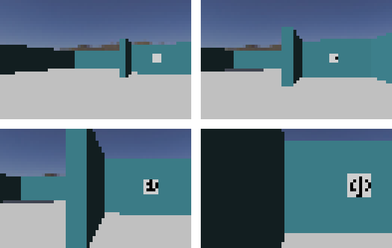
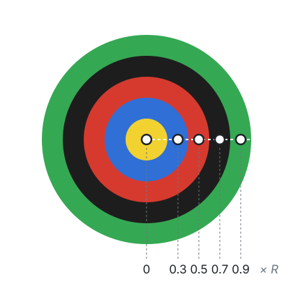
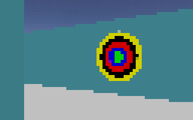

import CodeTabs from '@/components/CodeTabs.astro';

## Was der Roboter tun muss \{#what-the-robot-has-to-do\}
Wandmarkierungen (Wall tokens) bringen den Großteil deiner Punkte, und jede falsche Meldung kostet 5 Punkte. Für jede Markierung, die du findest, musst du also entscheiden:

| Es ist ... | Was zu tun ist |
|---|---|
| ein Buchstabenopfer (Letter victim: Φ, Ψ, Ω) | `H`, `S` oder `U` melden |
| ein gefälschtes Opfer (Fake victim: dieselben Symbole, dreidimensional) | Nicht melden und nicht in die Karte eintragen |
| ein kognitives Ziel (Cognitive target) mit einer Summe von 0 bis 3 | `F`, `P`, `C` oder `O` melden |
| ein kognitives Ziel mit einer anderen Summe | Es ist eine Fälschung: nicht melden und nicht in die Karte eintragen |

Die genauen Definitionen stehen in den [Regeln](/docs/rules/#wall-tokens), und wie du die Meldung sendest, steht unter [Kommunikation](/docs/programming/communication/#scoring-wall-tokens).

## Was die Kamera sieht \{#what-the-camera-sees\}
Die Kamera des Starter-Roboters hat 64 × 40 Pixel. Bei dieser Auflösung ist eine Markierung nur wenige Pixel groß, bis der Roboter nah dran ist. Am besten suchst du also aus der Entfernung nach Kandidaten und fährst dann näher heran, um sie zu lesen. Denk daran, dass der Roboter für eine Meldung höchstens eine halbe Kachel von der Markierung entfernt sein darf und dass eigene Kameras gegen Aufpreis eine höhere Auflösung haben können.

Buchstabenopfer sind schwarze Symbole auf einem weißen Quadrat, und sie können in jedem Winkel gedreht sein. Deine Methode darf also nicht von der Ausrichtung abhängen.

## Ein kognitives Ziel lesen \{#reading-a-cognitive-target\}
Ein kognitives Ziel besteht aus fünf konzentrischen Teilen, du musst seine Form also nicht erkennen: Sobald du seinen Mittelpunkt und seinen äußeren Radius gefunden hast, kannst du die Farbe in der Mitte jedes Teils abtasten. Die Teile haben Radien von 0,5, 1, 1,5, 2 und 2,5 cm, ihre Mittelpunkte liegen also bei 0, 0,3, 0,5, 0,7 und 0,9 des äußeren Radius.

Diese Funktion macht das mit OpenCV in Python. Um Mittelpunkt und Radius zu finden, kannst du zum Beispiel die Kontur des Ziels verwenden, wie in [Durch das Labyrinth navigieren](/docs/programming/navigate-the-maze/).

<CodeTabs file="readRings" />

In einem echten Lauf siehst du das Ziel vielleicht schräg, dann sieht es wie eine Ellipse aus. Wenn du dich davorstellst, unplausible Farben als Warnung nutzt oder mehrere Bilder liest, wird das Ergebnis zuverlässiger.

## Den Typ berechnen \{#calculating-the-type\}
Sobald du die fünf Farben hast, ergibt sich der zu meldende Code aus ihrer Summe. Jeder der fünf Teile zählt immer, auch wenn benachbarte Farben gleich sind.

<CodeTabs file="targetCode" />

Zum Beispiel ergibt `['Y', 'B', 'R', 'K', 'G']` zusammen 0, also ist es `F`, und `['B', 'Y', 'K', 'K', 'K']` ergibt -4, also ist es eine Fälschung.

## Gefälschte Opfer erkennen \{#detecting-fake-victims\}
Gefälschte Opfer zeigen dieselben Symbole wie echte, aber die Buchstaben sind dreidimensional. Von vorne kann eine Kamera allein sie eventuell nicht unterscheiden:

Laut den Regeln kann die Tiefe mit einem der Sensoren erkannt werden, die im Robot Customizer verfügbar sind. Einige Ideen zum Ausprobieren:

- Vergleiche Abstandsmessungen quer über die Markierung, mit einem Lidar oder mit Abstandssensoren, um einen Höhenunterschied zu finden.
- Betrachte die Markierung schräg, denn ein Relief verändert dann die Form des Symbols.

Die Welten `world3.wbt` und `world4.wbt` enthalten gefälschte Opfer, und mit dem [World Editor](/docs/tools/world-editor/#victims-and-cognitive-targets) kannst du sie zu deinen eigenen Karten hinzufügen. Erebus enthält außerdem das Skript `scripts/update_maps_with_fakes.py`, das Opfer bestehender Welten zufällig in Fälschungen umwandelt.

Eine Fälschung zu melden kostet als Fehlerkennung 5 Punkte, während ein echtes Opfer auf einer linearen Kachel in Bereich 1 mit richtigem Typ 15 Punkte wert ist, in anderen Bereichen sogar mehr. Behalte das im Kopf, wenn du entscheidest, wie sicher sich dein Roboter sein muss, bevor er meldet.
