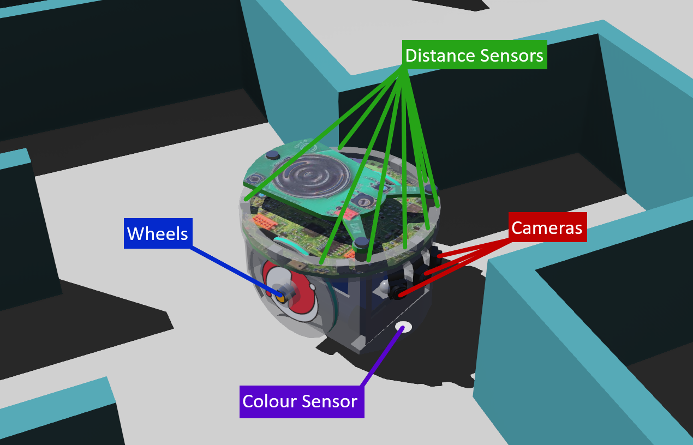

## Introducing Your Robot

By default the robot will be a standard e-puck robot, which is a representation of a real robot.
Alternatively, teams may customize the robot to change the position, type or number of sensors and wheels.

### Default Robot
>If no custom robot design is loaded this default e-puck will be used.

By default the e-puck robot has the following components:
* Wheels - One left and one right, with a motor each, controlled independently to control speed and turning.
* Distance Sensors - Eight distance sensors around the robot to detect walls and objects.
* Cameras - Three RGB cameras on the front of the robot (64 × 40 pixels) to provide visual recognition, and one 1 × 1 pixel camera pointing downwards to act as a colour sensor.
* Gyroscope - Which can be used to measure the rotational speed of the robot.
* Accelerometer - Which can be used to measure the acceleration (or change in speed) of the robot.
* GPS - Which can be used to get an absolute position value of the robot.

More information regarding this robot may be found here: https://cyberbotics.com/doc/guide/epuck?version=R2023b

### Custom Robots
Before the game begins, a custom robot may be loaded from a `.json` file, which you make with the [Robot Customizer](/docs/tools/robot-customizer/). The basic structure stays the same, but you decide which components to use and where to place them, within a budget of **3000**.

## Components

### Motors
By default there are two motors, one connected to each wheel. Which are located on the left and right sides of the robot.
The motors can be independently controlled in both speed and direction to allow for detailed movement control.

> The number of motors and wheels and their placement can be changed in a custom robot.

They are simulations of stepper motors, with 20 steps per revolution with a 50:1 gear ratio. See [Movement](/docs/robot/movement/) for how to control them.

### Sensors
Here is a list of all the sensors available on the robot with a short description of their function.

### Distance sensor
Infrared sensors capable of gathering information regarding the distance to nearby objects directly in front of them, up to 0.8 meters.
There are eight total sensors, six are spaced evenly around the front of the robot and two are spaced apart on the rear of the robot.

> The number of distance sensors and their placement can be different when using a custom robot.

### Colour sensor
The colour sensor is placed on the bottom side at the front of the robot. It allows the robot to gather information about the colour of the floor below it, for example to detect holes, swamps, checkpoints and passages. See [Colour Sensor](/docs/robot/sensors/colour-sensor/).

> Using a custom robot the position of this sensor may be changed.

### Cameras
The three cameras are placed on the front of the robot, one straight ahead and the others angled to the left and right.
These allow for visual recognition of wall tokens, floors and obstacles. Their device names are `camera_centre`, `camera_left` and `camera_right`.

> A custom robot may have fewer cameras and they may be placed differently.

### Accelerometer
The accelerometer allows the robot to gather information about changes to its own velocity in the three axes.

### LIDAR Sensor
The lidar sensor measures the distance to surrounding walls and objects in all directions around the robot. See [LIDAR](/docs/robot/sensors/lidar/).

> By default there is not a LIDAR sensor on the robot, one must be added with the customiser before it can be used.

### Gyroscope
The gyroscope allows the robot to gather information about changes to its own rotation, regardless of its position.

### GPS
The GPS sensor allows the robot to gather information about its current absolute position. It is needed to report wall tokens. Since v26 its readings have noise. See [Location Sensor](/docs/robot/sensors/location-sensor/).
