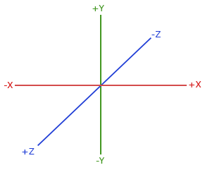

import CodeTabs from '@/components/CodeTabs.astro';

## Basics

The location sensor, also called the **GPS**, is used to retrieve the absolute x, y, and z position of the robot, useful for localizing the robot within the field. The units returned are in **meters.**

:::note
Since v26 the GPS has noise, with an accuracy of 0.0025 m. The values change slightly even when the robot is standing still, so avoid comparing positions for exact equality.
:::

There are 4 basic steps to using this sensor:

1. Start by importing or including the appropriate class for the location sensor.
2. Retrieve the sensor by name from the robot.
3. Enable the sensor by passing in the update rate of the sensor. (Usually the timestep) 
4. Finally, retrieve values from the sensor.

:::note
The horizontal plane of the sensor's coordinate system is defined by the X and Z axes. The Y axis is therefore the vertical axis:
:::

<CodeTabs file="basics" />

## Example

This sample gives an example application of the location sensor. It continuously prints the distance, calculated using the distance formula, from the starting position of the robot. 

<CodeTabs file="example" />
