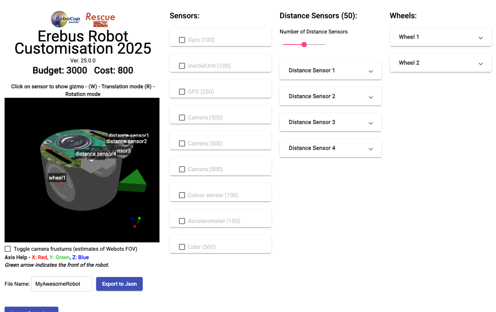

The [Robot Customizer](https://robot.erebus.rcj.cloud/) lets you change the sensors and wheels of your robot. Its current version is 25.0.0, which also works with Erebus v26.

## Designing a robot

1. **Pick the components.** Tick the sensors you want, set the number of distance sensors, and configure the wheels. Each component shows its cost.
2. **Keep within the budget.** The top left shows the cost and the budget of 3000.
3. **Place them.** Click a component in the 3D view to show its handles. Press `W` to move it and `R` to rotate it, or type the values in its panel. The green arrow marks the front of the robot.
4. **Name them.** Each component has a name that your program uses with `getDevice()`. Choose clear names, like `leftDist`. Wheels get two devices: `<name> motor` and `<name> sensor`.
5. **Check the cameras.** Tick **Toggle camera frustums** to see an estimate of what each camera sees.
6. **Export it.** Enter a file name and press **Export to Json**. **Import from Json** brings a design back to continue working on it, so keep the file.

## Using it in Erebus

Press the right LOAD button of the [control window](/docs/getting-started/#the-control-window) and choose your `.json` file. Erebus checks the budget and generates the robot. If it does not fit the budget or the limits, the Webots console shows why.

Load your robot first, then your program.

## Costs

| Component | Cost |
|---|---|
| Wheel | 300 |
| Distance sensor | 50 |
| Gyro | 100 |
| Inertial unit | 100 |
| Accelerometer | 100 |
| Colour sensor | 100 |
| GPS | 250 |
| Lidar | 500 |
| Camera | 500, plus the resolution cost |

The resolution cost of a camera is added for its width and for its height: 32 or 40 pixels cost 0, 64 pixels cost 100, 128 pixels cost 200 and 256 pixels cost 300. For example, a 256 × 128 camera costs 500 + 300 + 200 = 1000.

There can be up to 3 cameras and 8 distance sensors.

## Design tips

- **GPS:** you need a position to report tokens, and this is the simple way to get it.
- **Cameras:** higher resolutions read tokens from further away, but they cost more and are slower to process.
- **Lidar:** it sees all around the robot, which helps a lot for mapping. Place it outside the body, or the robot blocks it.
- **Colour sensor:** place it in front of the wheels, so that the robot sees a hole before falling into it.

The [Navigate the maze](/docs/programming/navigate-the-maze/) tutorial has a sample robot you can import.
