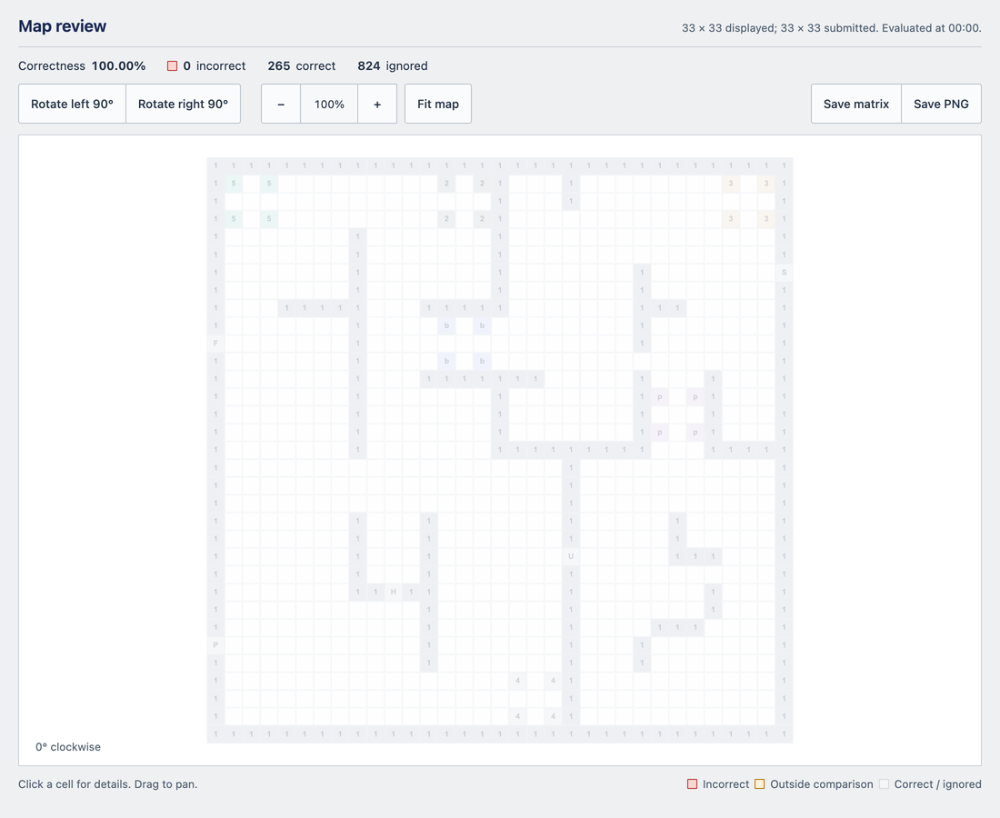

import CodeTabs from '@/components/CodeTabs.astro';

La bonificación por mapa (mapping bonus) multiplica tu puntuación hasta por 2,2, así que vale mucho. Para conseguirla:

1. Pon el mapa en una matriz, como se explica en las [Reglas del mapa](/docs/rules/mapping/).
1. Envía el tamaño de la matriz, seguido de la matriz aplanada como texto UTF-8 separado por comas.
1. Envía `M` para pedir la evaluación del mapa.
1. Termina la partida. Erebus aplica la bonificación a tu puntuación cuando termina la partida.

## Lo que debes saber \{#things-to-know\}

- Puedes enviar el mapa en cualquier momento de la partida, pero **solo se evalúa una vez**. Los mensajes `M` posteriores se ignoran, así que envíalo cuando el mapa esté todo lo completo que vaya a estar.
- Asegúrate de que queda tiempo. Si la partida termina antes de que envíes `M`, no hay mapa que evaluar.
- No tienes que enviar `E` para conseguir la bonificación: también se aplica si se acaba el tiempo. Pero `E` es la forma de conseguir la bonificación de salida (Exit bonus), y esa bonificación se suma antes de aplicar la bonificación por mapa.
- El mapa debe contener la baldosa de salida (`5`), que se usa para alinearlo con la respuesta correcta. Sin ella, el mapa no se puede evaluar.
- El resultado aparece como `Map Correctness` en los eventos de la partida de la ventana de control. Si recibes un `Map scoring error` en la consola de Webots, revisa tu formato.

El ejemplo siguiente envía la respuesta correcta para `world1.wbt`, lo que es útil para comprobar tu código de comunicación. Si lo ejecutas al inicio de la partida, la termina inmediatamente y la puntuación se queda en 0, ya que un multiplicador no tiene nada que multiplicar.

<CodeTabs file="basics" />

## Revisar tu mapa \{#reviewing-your-map\}
Pulsa **Save map** en la ventana de control para ver cómo se puntuó tu mapa. Erebus guarda el resultado en la carpeta `map` de la partida, dentro de `match-results`, y lo abre en tu navegador. Con **Automatic map result** en **Advanced setup**, se abre en cuanto se evalúa el mapa.

Las celdas incorrectas se marcan en rojo. Haz clic en una celda para ver lo que envió tu robot y cuál es la respuesta correcta. **Save matrix** guarda el mapa que envió tu robot, y **Save PNG** guarda la imagen.

El ejemplo `MapScorerExample.py` de la carpeta `player_controllers` de la versión de Erebus funciona de la misma forma.
