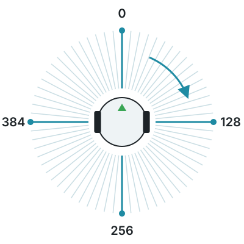
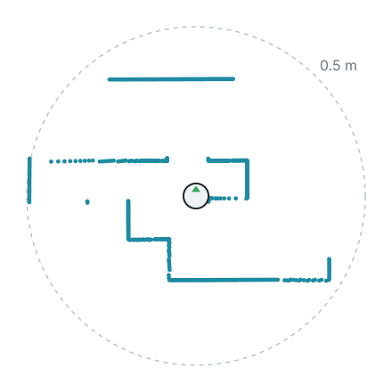

import CodeTabs from '@/components/CodeTabs.astro';

El lidar mide distancias en **metros** alrededor de todo el robot, como muchos sensores de distancia a la vez. En el robot inicial se llama `lidar` y está encima del robot.

Mide 512 puntos alrededor del robot, en 4 capas apiladas una encima de otra, hasta 1 m de distancia. Un punto que no alcanza nada devuelve `inf`.

## Leer distancias \{#reading-distances\}

`getLayerRangeImage(0)` da las 512 distancias de una capa. La primera está delante del robot, y van en el **sentido de las agujas del reloj**: a un cuarto del recorrido está la derecha, a la mitad está detrás, y a tres cuartos está la izquierda.

<CodeTabs file="read" />

Esta es una capa medida por el robot inicial en `world1.wbt`, dibujada desde arriba con el robot en el centro. Las paredes que lo rodean aparecen como líneas de puntos.

## Nube de puntos \{#point-cloud\}

El lidar también puede dar cada punto como una posición relativa al lidar, lo que es útil para dibujar un mapa de lo que ve el robot. Calcularlo lleva tiempo extra, así que actívalo solo si lo usas.

<CodeTabs file="pointcloud" />

:::caution[Colocar un lidar]
En tus propios robots, coloca el lidar encima, con la rotación del [robot inicial](/docs/robot/build/), para que quede plano. Dentro del cuerpo, o inclinado, mide el propio robot.
:::
