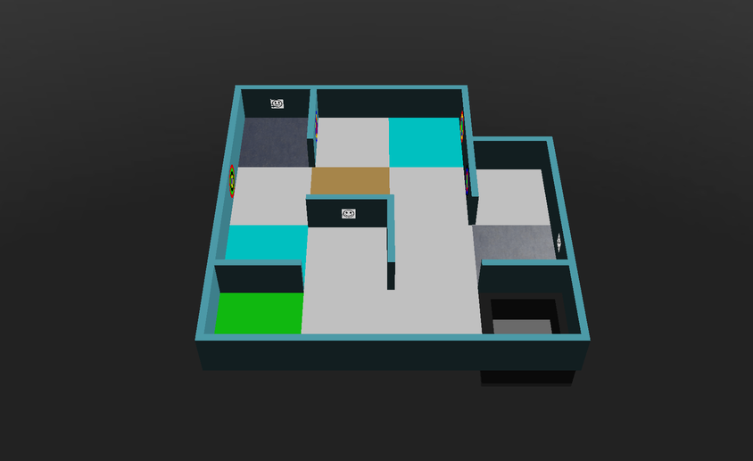

## Idea general {#general-idea}
El mapeo puntúa como un multiplicador de la puntuación de la ejecución. Para conseguirlo, el robot debe enviar una matriz al Main Supervisor de la partida. La matriz enviada se compara con la "solución" para obtener un valor de exactitud, y el multiplicador es:

**multiplicador de la bonificación por mapa = exactitud × 1,2 + 1**

Así que un mapa perfecto multiplica tu puntuación por 2,2. Para aprender a enviar la matriz, consulta el [tutorial Enviar el mapa](/docs/programming/map-bonus/).

## Reglas del mapeo {#rules-for-mapping}
* Cada cuarto de baldosa, cada borde y cada vértice se representa con una celda (valor). Un mapa de W × H baldosas es, por tanto, una matriz de (4 × H + 1) filas y (4 × W + 1) columnas.
* Cada elemento del mundo se representa así:

| Elemento | Valor |
|---|---|
| Paredes | `1` |
| Agujeros | `2` |
| Pantanos | `3` |
| Puntos de control | `4` |
| Baldosa de salida | `5` |
| Baldosa con un obstáculo | `x` |
| Baldosa de contacto (cian) | `k` |
| Paso entre las áreas 1 y 2 (azul) | `b` |
| Paso entre las áreas 1 y 3 (amarillo) | `y` |
| Paso entre las áreas 1 y 4 (verde) | `g` |
| Paso entre las áreas 2 y 3 (morado) | `p` |
| Paso entre las áreas 2 y 4 (naranja) | `o` |
| Paso entre las áreas 3 y 4 (rojo) | `r` |
| Marcas en las paredes | El código correspondiente (`H`, `S`, `U`, `F`, `P`, `C`, `O`) |
| Todas las baldosas, bordes y vértices del área 4, incluido su borde exterior | `*` |
| Cualquier otra baldosa, borde y vértice | `0` |

* Los elementos del suelo (`2`, `3`, `4`, `5`, `x`, `k` y los pasos) se escriben en la celda central de cada uno de los cuatro cuartos de baldosa de la baldosa, como puedes ver en los ejemplos de abajo.
* Ninguna baldosa es a la vez más de una de estas cosas: pantano, agujero, punto de control, baldosa de contacto, baldosa de salida, baldosa con un obstáculo o paso entre áreas.
* En las paredes curvas del área 3, el vértice se representa con un `0`.
* Una marca en la pared se escribe en la celda de la pared en la que está. Si hay varias marcas en la misma pared, por ejemplo en sus dos caras, concatena sus códigos en una sola celda, en el orden de su posición absoluta en el mapa: primero de arriba abajo, después de izquierda a derecha.
* Las marcas falsas no deben incluirse en el mapa: ni las víctimas falsas ni los objetivos cognitivos con una suma no válida.
* Las marcas en baldosas completas (no cuartos de baldosa) pueden estar en cualquier punto de la pared. Se escriben en la celda del cuarto de baldosa al que estén más cerca, o en la celda central si están cerca del centro del lado de la baldosa.
* Los mapas se pueden enviar con cualquier rotación, siempre que sea un múltiplo de 90°. Erebus alinea tu matriz con la solución usando la baldosa de salida, prueba cada orientación y se queda con el mejor resultado.

## Cómo se calcula la exactitud {#how-correctness-is-calculated}
1. Las matrices se alinean por la baldosa de salida. Esto significa que **tu mapa debe contener la baldosa de salida**.
1. Se compara cada posición en la que la matriz enviada o la solución tienen un valor distinto de cero. Si los valores coinciden, sube el recuento de aciertos; si no, sube el recuento de errores. Las posiciones que son `0` en ambas se ignoran.
1. La exactitud es aciertos / (aciertos + errores).

Como solo cuentan las posiciones en las que hay algo, marcar algo que no existe baja tu exactitud tanto como no marcar algo que sí existe.

## Casos límite ambiguos {#ambiguous-edge-cases}
Para los casos ambiguos que no se tratan abajo, ponte en contacto con el comité internacional de RoboCupJunior Rescue y/o con el equipo de desarrollo de la plataforma.
### Una pared con una pared normal en ángulo recto a un lado y una pared curva al otro {#one-wall-with-a-normal-right-angled-wall-and-a-curved-wall-on-each-side}
Las reglas dicen que los vértices de una pared curva se representan con ceros.
La excepción es el caso siguiente, en el que un lado de la pared es un ángulo recto normal y el otro es curvo. Se representa como si ambos lados fueran paredes normales.


## Ejemplos {#examples}
Estas son las soluciones correctas de algunos de los mundos incluidos en Erebus v27, generadas por el propio Erebus.

Los mundos de la carpeta `game/worlds` cambian entre versiones, así que si tu versión de Erebus es distinta, puede que tu solución sea diferente. `MapScorerExample.py`, en la carpeta `player_controllers`, también tiene matrices de ejemplo.

### mapping_example_1.wbt {#mapping_example_1wbt}
Un mundo pequeño con una sola área. La baldosa de salida es la baldosa verde de abajo a la izquierda.


```
[
['1', '1', 'S', '1', '1', '1', '1', '1', '1', '1', '1', '1', '1', '0', '0', '0', '0'],
['1', '4', '0', '4', '1', '0', '0', '0', '0', '0', '0', '0', '1', '0', '0', '0', '0'],
['1', '0', '0', '0', 'C', '0', '0', '0', '0', '0', '0', '0', 'O', '0', '0', '0', '0'],
['1', '4', '0', '4', '1', '0', '0', '0', '0', '0', '0', '0', '1', '0', '0', '0', '0'],
['1', '0', '0', '0', '1', '0', '0', '0', '0', '0', '0', '0', '1', '1', '1', '1', '1'],
['1', '0', '0', '0', '0', '3', '0', '3', '0', '0', '0', '0', '1', '0', '0', '0', '1'],
['F', '0', '0', '0', '0', '0', '0', '0', '0', '0', '0', '0', 'P', '0', '0', '0', '1'],
['1', '0', '0', '0', '0', '3', '0', '3', '0', '0', '0', '0', '1', '0', '0', '0', '1'],
['1', '0', '0', '0', '1', '1', 'U', '1', '1', '0', '0', '0', '1', '0', '0', '0', '1'],
['1', '0', '0', '0', '0', '0', '0', '0', '1', '0', '0', '0', '0', '4', '0', '4', '1'],
['1', '0', '0', '0', '0', '0', '0', '0', '1', '0', '0', '0', '0', '0', '0', '0', 'H'],
['1', '0', '0', '0', '0', '0', '0', '0', '1', '0', '0', '0', '0', '4', '0', '4', '1'],
['1', '1', '1', '1', '1', '0', '0', '0', '1', '0', '0', '0', '1', '1', '1', '1', '1'],
['1', '5', '0', '5', '0', '0', '0', '0', '0', '0', '0', '0', '0', '2', '0', '2', '1'],
['1', '0', '0', '0', '0', '0', '0', '0', '0', '0', '0', '0', '0', '0', '0', '0', '1'],
['1', '5', '0', '5', '0', '0', '0', '0', '0', '0', '0', '0', '0', '2', '0', '2', '1'],
['1', '1', '1', '1', '1', '1', 'F', '1', '1', '1', '1', '1', '1', '1', '1', '1', '1']
]
```

### mapping_example_1_cyan_tiles.wbt {#mapping_example_1_cyan_tileswbt}
El mismo mundo que `mapping_example_1.wbt`, con dos baldosas de contacto, que se marcan con `k`.



```
[
['1', '1', 'S', '1', '1', '1', '1', '1', '1', '1', '1', '1', '1', '0', '0', '0', '0'],
['1', '4', '0', '4', '1', '0', '0', '0', '0', 'k', '0', 'k', '1', '0', '0', '0', '0'],
['1', '0', '0', '0', 'C', '0', '0', '0', '0', '0', '0', '0', 'O', '0', '0', '0', '0'],
['1', '4', '0', '4', '1', '0', '0', '0', '0', 'k', '0', 'k', '1', '0', '0', '0', '0'],
['1', '0', '0', '0', '1', '0', '0', '0', '0', '0', '0', '0', '1', '1', '1', '1', '1'],
['1', '0', '0', '0', '0', '3', '0', '3', '0', '0', '0', '0', '1', '0', '0', '0', '1'],
['F', '0', '0', '0', '0', '0', '0', '0', '0', '0', '0', '0', 'P', '0', '0', '0', '1'],
['1', '0', '0', '0', '0', '3', '0', '3', '0', '0', '0', '0', '1', '0', '0', '0', '1'],
['1', '0', '0', '0', '1', '1', 'U', '1', '1', '0', '0', '0', '1', '0', '0', '0', '1'],
['1', 'k', '0', 'k', '0', '0', '0', '0', '1', '0', '0', '0', '0', '4', '0', '4', '1'],
['1', '0', '0', '0', '0', '0', '0', '0', '1', '0', '0', '0', '0', '0', '0', '0', 'H'],
['1', 'k', '0', 'k', '0', '0', '0', '0', '1', '0', '0', '0', '0', '4', '0', '4', '1'],
['1', '1', '1', '1', '1', '0', '0', '0', '1', '0', '0', '0', '1', '1', '1', '1', '1'],
['1', '5', '0', '5', '0', '0', '0', '0', '0', '0', '0', '0', '0', '2', '0', '2', '1'],
['1', '0', '0', '0', '0', '0', '0', '0', '0', '0', '0', '0', '0', '0', '0', '0', '1'],
['1', '5', '0', '5', '0', '0', '0', '0', '0', '0', '0', '0', '0', '2', '0', '2', '1'],
['1', '1', '1', '1', '1', '1', 'F', '1', '1', '1', '1', '1', '1', '1', '1', '1', '1']
]
```

### mapping_example_2.wbt {#mapping_example_2wbt}
Este mundo tiene obstáculos, que se marcan con `x`.


```
[
['1', '1', '1', '1', '1', '1', '1', '1', '1', '1', '1', '1', '1', '1', '1', '1', '1', '1', 'F', '1', '1'],
['1', '5', '0', '5', '1', '0', '0', '0', '0', '0', 'O', '0', '0', '0', '0', '0', '0', '0', '0', '0', '1'],
['1', '0', '0', '0', '1', '0', '0', '0', '0', '0', '1', '0', '0', '0', '0', '0', '0', '0', '0', '0', '1'],
['1', '5', '0', '5', '1', '0', '0', '0', '0', '0', '0', '0', '0', '0', '0', '0', '0', '0', '0', '0', '1'],
['1', '0', '0', '0', '1', '0', '1', '0', '0', '0', '0', '0', '0', '0', '1', '1', '1', '0', '0', '0', '1'],
['1', 'b', '0', 'b', '1', '0', 'U', '0', '0', '0', '0', '0', '0', '0', '0', '0', '1', '0', '0', '0', '1'],
['1', '0', '0', '0', '1', 'S', '1', '0', '0', '0', '0', '0', '1', '0', '0', '0', '1', '0', '1', '0', '1'],
['1', 'b', '0', 'b', '1', '0', '0', '0', '0', '0', '0', '0', '1', '0', '0', '0', '1', '0', '1', '0', '1'],
['1', '0', '0', '0', '1', '0', '0', '0', '0', '0', '0', '0', '1', 'H', '1', '1', '1', '0', '1', '0', '1'],
['1', '0', '0', '0', '0', '0', '0', '0', '0', '3', '0', '3', '0', '0', '0', '0', '0', '2', '0', '2', '1'],
['1', '0', '0', '0', '0', '0', '0', '0', '0', '0', '0', '0', '0', '0', '0', '0', '0', '0', '0', '0', '1'],
['1', '0', '0', '0', '0', '0', '0', '0', '0', '3', '0', '3', '0', '0', '0', '0', '0', '2', '0', '2', '1'],
['1', '0', '1', '1', '1', '0', '0', '0', '1', '1', '1', '1', '1', '0', '0', '0', '0', '0', '0', '0', '1'],
['1', '0', '0', '0', '0', '0', '0', '0', '1', '0', '0', '0', '1', '0', '0', '0', '0', '0', '0', '0', '1'],
['1', '0', '0', '0', '0', '0', '0', '0', '1', '0', '0', '0', '1', '1', '1', '0', '0', '0', '1', '0', '1'],
['1', '0', '0', '0', '0', '0', '0', '0', '1', '0', '0', '0', '1', '0', '0', '0', '0', '0', '1', '0', '1'],
['1', '1', '1', '0', '0', '0', '1', 'P', '1', '0', '0', '0', '1', '0', '0', '0', '1', '1', '1', '0', '1'],
['1', '0', '0', '0', '0', '4', '0', '4', '1', '0', '0', '0', '1', '0', '0', '0', '0', 'x', '0', 'x', '1'],
['1', '0', '0', '0', '0', '0', '0', '0', '1', '0', '0', '0', '1', '0', '0', '0', '0', '0', '0', '0', '1'],
['1', '0', '0', '0', '0', '4', '0', '4', '1', '0', '0', '0', 'C', '0', '0', '0', '0', 'x', '0', 'x', '1'],
['1', '1', '1', '1', '1', '1', '1', '1', '1', '0', '0', '0', '1', '1', '1', '1', '1', '1', '1', '1', '1']
]
```

### world1.wbt {#world1wbt}
Este mundo tiene tres áreas, con los pasos `b` y `p`.


```
[
['1', '1', '1', '1', '1', '1', '1', '1', '1', '1', '1', '1', '1', '1', '1', '1', '1', '1', '1', '1', '1', '1', '1', '1', '1', '1', '1', '1', '1', '1', '1', '1', '1'],
['1', '5', '0', '5', '0', '0', '0', '0', '0', '0', '0', '0', '0', '2', '0', '2', '1', '0', '0', '0', '1', '0', '0', '0', '0', '0', '0', '0', '0', '3', '0', '3', '1'],
['1', '0', '0', '0', '0', '0', '0', '0', '0', '0', '0', '0', '0', '0', '0', '0', '1', '0', '0', '0', '1', '0', '0', '0', '0', '0', '0', '0', '0', '0', '0', '0', '1'],
['1', '5', '0', '5', '0', '0', '0', '0', '0', '0', '0', '0', '0', '2', '0', '2', '1', '0', '0', '0', '0', '0', '0', '0', '0', '0', '0', '0', '0', '3', '0', '3', '1'],
['1', '0', '0', '0', '0', '0', '0', '0', '1', '0', '0', '0', '0', '0', '0', '0', '1', '0', '0', '0', '0', '0', '0', '0', '0', '0', '0', '0', '0', '0', '0', '0', '1'],
['1', '0', '0', '0', '0', '0', '0', '0', '1', '0', '0', '0', '0', '0', '0', '0', '1', '0', '0', '0', '0', '0', '0', '0', '0', '0', '0', '0', '0', '0', '0', '0', '1'],
['1', '0', '0', '0', '0', '0', '0', '0', '1', '0', '0', '0', '0', '0', '0', '0', '1', '0', '0', '0', '0', '0', '0', '0', '1', '0', '0', '0', '0', '0', '0', '0', 'S'],
['1', '0', '0', '0', '0', '0', '0', '0', '1', '0', '0', '0', '0', '0', '0', '0', '1', '0', '0', '0', '0', '0', '0', '0', '1', '0', '0', '0', '0', '0', '0', '0', '1'],
['1', '0', '0', '0', '1', '1', '1', '1', '1', '0', '0', '0', '1', '1', '1', '1', '1', '0', '0', '0', '0', '0', '0', '0', '1', '1', '1', '0', '0', '0', '0', '0', '1'],
['1', '0', '0', '0', '0', '0', '0', '0', '1', '0', '0', '0', '0', 'b', '0', 'b', '0', '0', '0', '0', '0', '0', '0', '0', '1', '0', '0', '0', '0', '0', '0', '0', '1'],
['F', '0', '0', '0', '0', '0', '0', '0', '1', '0', '0', '0', '0', '0', '0', '0', '0', '0', '0', '0', '0', '0', '0', '0', '1', '0', '0', '0', '0', '0', '0', '0', '1'],
['1', '0', '0', '0', '0', '0', '0', '0', '1', '0', '0', '0', '0', 'b', '0', 'b', '0', '0', '0', '0', '0', '0', '0', '0', '0', '0', '0', '0', '0', '0', '0', '0', '1'],
['1', '0', '0', '0', '0', '0', '0', '0', '1', '0', '0', '0', '1', '1', '1', '1', '1', '1', '1', '0', '0', '0', '0', '0', '1', '0', '0', '0', '1', '0', '0', '0', '1'],
['1', '0', '0', '0', '0', '0', '0', '0', '1', '0', '0', '0', '0', '0', '0', '0', '1', '0', '0', '0', '0', '0', '0', '0', '1', 'p', '0', 'p', '1', '0', '0', '0', '1'],
['1', '0', '0', '0', '0', '0', '0', '0', '1', '0', '0', '0', '0', '0', '0', '0', '1', '0', '0', '0', '0', '0', '0', '0', '1', '0', '0', '0', '1', '0', '0', '0', '1'],
['1', '0', '0', '0', '0', '0', '0', '0', '1', '0', '0', '0', '0', '0', '0', '0', '1', '0', '0', '0', '0', '0', '0', '0', '1', 'p', '0', 'p', '1', '0', '0', '0', '1'],
['1', '0', '0', '0', '0', '0', '0', '0', '1', '0', '0', '0', '0', '0', '0', '0', '1', '1', '1', '1', '1', '1', '1', '1', '1', '0', '0', '0', '1', '1', '1', '1', '1'],
['1', '0', '0', '0', '0', '0', '0', '0', '0', '0', '0', '0', '0', '0', '0', '0', '0', '0', '0', '0', '1', '0', '0', '0', '0', '0', '0', '0', '0', '0', '0', '0', '1'],
['1', '0', '0', '0', '0', '0', '0', '0', '0', '0', '0', '0', '0', '0', '0', '0', '0', '0', '0', '0', '1', '0', '0', '0', '0', '0', '0', '0', '0', '0', '0', '0', '1'],
['1', '0', '0', '0', '0', '0', '0', '0', '0', '0', '0', '0', '0', '0', '0', '0', '0', '0', '0', '0', '1', '0', '0', '0', '0', '0', '0', '0', '0', '0', '0', '0', '1'],
['1', '0', '0', '0', '0', '0', '0', '0', '1', '0', '0', '0', '1', '0', '0', '0', '0', '0', '0', '0', '1', '0', '0', '0', '0', '0', '1', '0', '0', '0', '0', '0', '1'],
['1', '0', '0', '0', '0', '0', '0', '0', '1', '0', '0', '0', '1', '0', '0', '0', '0', '0', '0', '0', '1', '0', '0', '0', '0', '0', '1', '0', '0', '0', '0', '0', '1'],
['1', '0', '0', '0', '0', '0', '0', '0', '1', '0', '0', '0', '1', '0', '0', '0', '0', '0', '0', '0', 'U', '0', '0', '0', '0', '0', '1', '1', '1', '0', '0', '0', '1'],
['1', '0', '0', '0', '0', '0', '0', '0', '1', '0', '0', '0', '1', '0', '0', '0', '0', '0', '0', '0', '1', '0', '0', '0', '0', '0', '0', '0', '0', '0', '0', '0', '1'],
['1', '0', '0', '0', '0', '0', '0', '0', '1', '1', 'H', '1', '1', '0', '0', '0', '0', '0', '0', '0', '1', '0', '0', '0', '0', '0', '0', '0', '1', '0', '0', '0', '1'],
['1', '0', '0', '0', '0', '0', '0', '0', '0', '0', '0', '0', '1', '0', '0', '0', '0', '0', '0', '0', '1', '0', '0', '0', '0', '0', '0', '0', '1', '0', '0', '0', '1'],
['1', '0', '0', '0', '0', '0', '0', '0', '0', '0', '0', '0', '1', '0', '0', '0', '0', '0', '0', '0', '1', '0', '0', '0', '0', '1', '1', '1', '0', '0', '0', '0', '1'],
['P', '0', '0', '0', '0', '0', '0', '0', '0', '0', '0', '0', '1', '0', '0', '0', '0', '0', '0', '0', '1', '0', '0', '0', '1', '0', '0', '0', '0', '0', '0', '0', '1'],
['1', '0', '0', '0', '0', '0', '0', '0', '0', '0', '0', '0', '1', '0', '0', '0', '0', '0', '0', '0', '1', '0', '0', '0', '1', '0', '0', '0', '0', '0', '0', '0', '1'],
['1', '0', '0', '0', '0', '0', '0', '0', '0', '0', '0', '0', '0', '0', '0', '0', '0', '4', '0', '4', '1', '0', '0', '0', '0', '0', '0', '0', '0', '0', '0', '0', '1'],
['1', '0', '0', '0', '0', '0', '0', '0', '0', '0', '0', '0', '0', '0', '0', '0', '0', '0', '0', '0', '1', '0', '0', '0', '0', '0', '0', '0', '0', '0', '0', '0', '1'],
['1', '0', '0', '0', '0', '0', '0', '0', '0', '0', '0', '0', '0', '0', '0', '0', '0', '4', '0', '4', '1', '0', '0', '0', '0', '0', '0', '0', '0', '0', '0', '0', '1'],
['1', '1', '1', '1', '1', '1', '1', '1', '1', '1', '1', '1', '1', '1', '1', '1', '1', '1', '1', '1', '1', '1', '1', '1', '1', '1', '1', '1', '1', '1', '1', '1', '1']
]
```

### world2.wbt {#world2wbt}
Este mundo incluye el área 4, que se rellena con `*`, y los pasos `g` y `r`.


```
[
['1', '1', '1', '1', '1', '1', '1', '1', '1', '1', '1', '1', '1', '1', '1', '1', '1', '1', '1', '1', '1', '1', 'P', '1', '1', '1', '1', '1', '1', '1', '1', '1', '1', '1', '1', '1', '1'],
['1', '4', '0', '4', '0', '0', '0', '0', '0', '0', '0', '0', '1', '0', '0', '0', '0', '2', '0', '2', '1', '0', '0', '0', '0', '0', '0', '0', '0', '3', '0', '3', '1', '2', '0', '2', '1'],
['1', '0', '0', '0', '0', '0', '0', '0', '1', '0', '0', '0', '1', '0', '0', '0', '0', '0', '0', '0', '1', '0', '0', '0', '0', '0', '0', '0', '0', '0', '0', '0', '1', '0', '0', '0', '1'],
['1', '4', '0', '4', '0', '0', '0', '0', 'C', '0', '0', '0', '0', '0', '0', '0', '0', '2', '0', '2', '1', '0', '0', '0', '0', '0', '0', '0', '0', '3', '0', '3', '1', '2', '0', '2', '1'],
['1', '1', '1', '1', '1', '0', '0', '0', '1', '0', '0', '0', '0', '0', '0', '0', '1', '1', '1', '1', '1', '0', '0', '0', '1', '1', '1', '1', '1', '0', '0', '0', '1', '0', '0', '0', '1'],
['1', '0', '1', '0', '0', '0', '0', '0', '0', '0', '0', '0', '0', '0', '0', '0', '1', 'b', '0', 'b', '0', '0', '0', '0', '0', '0', '0', '0', '1', '0', '0', '0', '0', '0', '0', '0', '1'],
['1', 'U', '1', '0', '0', '0', '0', '0', '0', '0', '0', '0', '0', '0', '1', '1', '1', '0', '0', '0', '0', '0', '0', '0', '0', '0', '0', '0', 'O', '0', '0', '0', '0', '0', '0', '0', '1'],
['1', '0', '0', '0', '0', '0', '0', '0', '0', '0', '0', '0', '0', '0', '0', '0', '1', 'b', '0', 'b', '0', '0', '0', '0', '0', '0', '0', '0', '1', '0', '0', '0', '0', '0', '0', '0', '1'],
['1', '0', '0', '0', '0', '0', '0', '0', '1', '0', '0', '0', '0', '0', '0', '0', '1', '0', '0', '0', '1', '1', '1', '1', '1', '1', '1', '1', '1', '0', '0', '0', '1', '0', '0', '0', '1'],
['1', '0', '0', '0', '0', '0', '0', '0', '1', 'p', '0', 'p', '0', '0', '0', '0', '0', '0', '0', '0', '0', '4', '0', '4', '1', '0', '0', '0', '0', '0', '0', '0', '1', '5', '0', '5', '1'],
['1', '0', '0', '0', '1', '0', '0', '0', '1', '0', '0', '0', '1', '0', '0', '0', '0', '0', '0', '0', '0', '0', '0', '0', 'H', '0', '0', '0', '0', '0', '0', '0', '1', '0', '0', '0', '1'],
['1', '0', '0', '0', '1', '0', '0', '0', '1', 'p', '0', 'p', '1', '0', '0', '0', '0', '0', '0', '0', '0', '4', '0', '4', '1', '0', '0', '0', '0', '0', '0', '0', '1', '5', '0', '5', '1'],
['0', '1', '1', 'S', '1', '1', '1', '1', '1', '0', '0', '0', '0', '1', '1', '1', '*', '*', '*', '*', '*', '*', '*', '*', '*', '*', '*', '*', '*', '0', '0', '0', '1', '0', '0', '0', '1'],
['1', '0', '0', '0', '0', '0', '0', '0', '1', '0', '0', '0', '1', '0', '0', '0', '*', '*', '*', '*', '*', '*', '*', '*', '*', '*', '*', '*', '*', 'g', '0', 'g', '0', '0', '0', '0', '1'],
['1', '0', '0', '0', '0', '1', '1', '1', '0', '0', '0', '0', '1', '0', '0', '0', '*', '*', '*', '*', '*', '*', '*', '*', '*', '*', '*', '*', '*', '0', '0', '0', '0', '0', '0', '0', '1'],
['1', '0', '0', '0', '1', '0', '0', '0', '0', '0', '0', '0', '1', '0', '0', '0', '*', '*', '*', '*', '*', '*', '*', '*', '*', '*', '*', '*', '*', 'g', '0', 'g', '0', '0', '0', '0', '1'],
['1', '0', '0', '0', '1', '0', '0', '0', '0', '0', '1', '1', '1', '0', '0', '0', '*', '*', '*', '*', '*', '*', '*', '*', '*', '*', '*', '*', '*', '*', '*', '*', '*', '*', '*', '*', '*'],
['1', '4', '0', '4', '0', '0', '0', '0', '0', '0', '0', '0', '0', '3', '0', '3', '0', '0', '0', '0', '*', '*', '*', '*', '*', '*', '*', '*', '*', '*', '*', '*', '*', '*', '*', '*', '*'],
['1', '0', '0', '0', '0', '0', '0', '0', '0', '0', '0', '0', '0', '0', '0', '0', '0', '0', '0', '0', '*', '*', '*', '*', '*', '*', '*', '*', '*', '*', '*', '*', '*', '*', '*', '*', '*'],
['1', '4', '0', '4', '0', '0', '0', '0', '0', '0', '0', '0', '0', '3', '0', '3', '0', '0', '0', '0', '*', '*', '*', '*', '*', '*', '*', '*', '*', '*', '*', '*', '*', '*', '*', '*', '*'],
['1', '0', '0', '0', '0', '0', '0', '0', '0', '0', '0', '0', '1', '0', '0', '0', '0', '0', '0', '0', '*', '*', '*', '*', '*', '*', '*', '*', '*', '*', '*', '*', '*', '*', '*', '*', '*'],
['1', '0', '0', '0', '0', '0', '0', '0', '0', '2', '0', '2', '1', '0', '0', '0', '0', 'r', '0', 'r', '*', '*', '*', '*', '*', '*', '*', '*', '*', '*', '*', '*', '*', '*', '*', '*', '*'],
['1', '0', '0', '0', '0', '0', '1', '0', '0', '0', '0', '0', '1', '0', '0', '0', '0', '0', '0', '0', '*', '*', '*', '*', '*', '*', '*', '*', '*', '*', '*', '*', '*', '*', '*', '*', '*'],
['1', '0', '0', '0', '0', '0', '1', '0', '0', '2', '0', '2', '1', '0', '0', '0', '0', 'r', '0', 'r', '*', '*', '*', '*', '*', '*', '*', '*', '*', '*', '*', '*', '*', '*', '*', '*', '*'],
['1', '1', '1', '1', '1', '1', '1', '1', '1', '1', '1', '1', '0', '1', '1', '1', '1', '1', '1', '1', '*', '*', '*', '*', '*', '*', '*', '*', '*', '*', '*', '*', '*', '*', '*', '*', '*']
]
```
