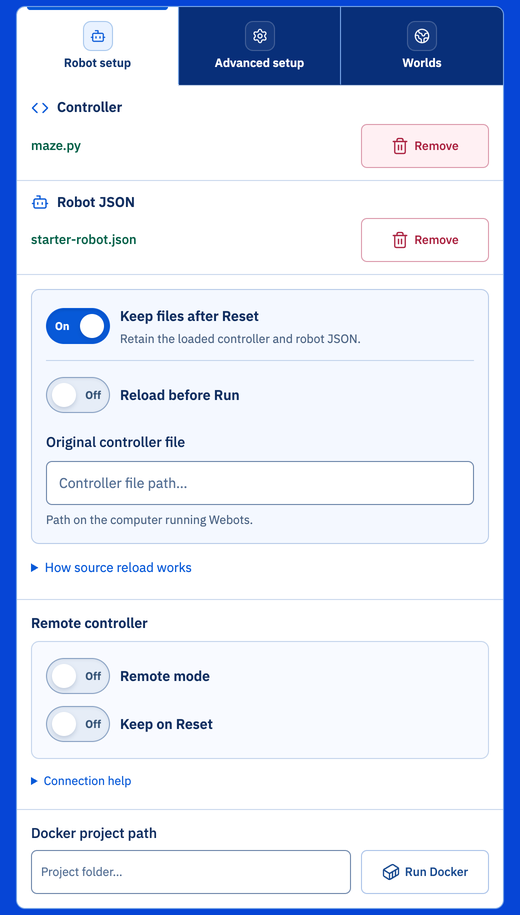
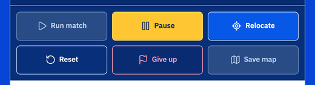

import mazeUrl from '../../../docs/getting-started/../programming/navigate-the-maze/maze.py?url';

Sur cette page, vous exécutez un programme complet sur votre robot, et vous apprenez à utiliser la fenêtre de contrôle d’Erebus. Il vous faut [Erebus installé](/docs/installation/) et [votre robot](/docs/robot/).

## Le dossier d’Erebus \{#the-erebus-folder\}
Voici les principaux dossiers de la version que vous avez téléchargée :

| Dossier | Contenu |
|---|---|
| `game/worlds` | Les mondes (fichiers `.wbt`). Ouvrez-en un pour commencer. |
| `game/logs` | Les journaux écrits à la fin de chaque partie |
| `match-results` | Un dossier par match, avec son replay et le résultat de sa carte |
| `player_controllers` | Des exemples de contrôleurs |

## La fenêtre de contrôle \{#the-control-window\}
1. Ouvrez `game/worlds/world1.wbt` dans Webots.
1. Webots ouvre la fenêtre de contrôle d’Erebus (la fenêtre robot du Main Supervisor) dans votre navigateur web. C’est là que vous chargez votre programme et lancez le jeu.

De haut en bas :

| Partie | Utilité |
|---|---|
| Monde et état | Le nom du monde, et l’état du match : Ready, Running, Paused ou Finished |
| **Robot setup** | Charge votre programme et votre robot, et connecte un contrôleur à distance. Voir plus bas. |
| **Advanced setup** | Des options, expliquées plus bas |
| **Worlds** | Passe à un autre monde |
| Score | Le score actuel |
| **Robot battery** | Le niveau de la batterie du robot. En dessous de 20 %, il indique « Low battery ». Voir [Batterie](/docs/programming/battery/). |
| **Simulation remaining** | Le temps de jeu restant. **Real-world allowance** indique combien de temps réel il reste en plus du temps de jeu. Le jeu se termine quand l’un des deux est écoulé. |
| Commandes du match | Lancer, mettre en pause, déplacer, réinitialiser, abandonner et enregistrer la carte. Voir plus bas. |
| **Match events** | L’historique du match, le plus récent en premier. **Export CSV** l’enregistre dans un fichier. |

Le bouton en haut à droite ouvre la même fenêtre dans une fenêtre de navigateur séparée, plus petite.

:::note
Si [Wireshark](/docs/installation/#optional-wireshark) n’est pas installé, la fenêtre affiche aussi un avertissement indiquant que l’accès réseau n’est pas surveillé, et vous demande de le valider. Cette surveillance sert aux organisateurs en compétition : vous pouvez valider l’avertissement et vous entraîner normalement.
:::

### Robot setup \{#robot-setup\}
Appuyez sur **Robot setup** pour charger votre programme et votre robot.

| Partie | Utilité |
|---|---|
| **Controller** | **Load file** charge le programme de votre robot. Les fichiers Python sont chargés tels quels. Les programmes C et C++ doivent d’abord être compilés. |
| **Robot JSON** | **Load file** charge votre robot, le fichier `.json` créé avec le [Robot Customizer](/docs/robot/customizer/) |
| **Keep files after Reset** | Garde votre programme et votre robot chargés quand le jeu est réinitialisé. Activé par défaut. |
| **Reload before Run** | Recharge votre programme depuis **Original controller file** à chaque lancement de match, pour utiliser vos dernières modifications. Indiquez le chemin du fichier sur l’ordinateur qui exécute Webots. |
| **Remote mode** | Permet à un programme exécuté en dehors de Webots de piloter le robot. Voir [Contrôleur à distance](/docs/competition/remote-controller/). **Keep on Reset** le garde activé quand le jeu est réinitialisé. |
| **Docker project path** | Dossier contenant un `Dockerfile`, pour exécuter votre contrôleur dans un conteneur avec **Run Docker**. Voir le dépôt [erebus-dockerfiles](https://github.com/robocup-junior/erebus-dockerfiles). C’est facultatif. |

### Commandes du match \{#match-controls\}

| Bouton | Utilité |
|---|---|
| **Run match** | Lance le jeu. Le robot apparaît dans le monde, et votre programme démarre. |
| **Pause** | Arrête le robot temporairement. Appuyez sur **Run match** pour continuer. |
| **Relocate** | Déclare une absence de progression : le robot revient au dernier point de contrôle atteint, et vous perdez 5 points |
| **Reset** | Réinitialise le jeu et le monde |
| **Give up** | Termine le jeu |
| **Save map** | Enregistre le résultat de la carte soumise par votre robot, et l’ouvre. Voir [Soumettre la carte](/docs/programming/map-bonus/). |

## Exécuter un programme \{#run-a-program\}
<a href={mazeUrl} download="maze.py">Téléchargez maze.py</a>, un programme complet qui fait parcourir le labyrinthe au robot. C’est le programme que vous écrirez vous-même dans [Parcourir le labyrinthe](/docs/programming/navigate-the-maze/).

1. Ouvrez `game/worlds/world1.wbt`.
1. Appuyez sur **Robot setup** et chargez votre robot avec **Load file** sous **Robot JSON**, si ce n’est pas déjà fait.
1. Chargez `maze.py` avec **Load file** sous **Controller**. Le nom de chaque fichier s’affiche une fois chargé.
1. Appuyez sur **Run match**. Le robot apparaît dans le monde et commence à bouger.
1. Pour arrêter le robot temporairement, appuyez sur **Pause**.
1. Si le robot est bloqué, appuyez sur **Relocate** pour déclencher une absence de progression.
1. Appuyez sur **Reset** pour réinitialiser le jeu. Votre programme et votre robot restent chargés, vous pouvez donc le relancer.

Le programme a besoin d’OpenCV, que vous avez installé avec les autres [bibliothèques Python](/docs/installation/#python-libraries). Les messages de votre programme, et les erreurs, s’affichent dans la console de Webots.

Pendant le jeu, les événements du match s’affichent en bas de la fenêtre. Ils vous disent exactement pourquoi vous avez gagné ou perdu des points : c’est le meilleur outil pour vérifier votre programme.

`maze.py` roule à pleine vitesse et ne remplace jamais sa batterie : sur `world1.wbt`, le jeu se termine donc en moins de deux minutes, avec `Battery depleted`. Vous apprendrez à gérer la batterie dans [Batterie](/docs/programming/battery/).

À la fin du jeu, les mêmes informations sont enregistrées dans le dossier `game/logs`. Le match est aussi enregistré comme replay 3D interactif dans le dossier `match-results` : ouvrez `recording/replay.html` dans votre navigateur pour le revoir.

## Utiliser d’autres mondes \{#using-other-worlds\}
Appuyez sur **Worlds** pour passer à un autre monde. Cherchez un monde par son nom, choisissez-le, puis appuyez sur **Load world**. Vous pouvez aussi ajouter les vôtres, créés avec le [World Editor](/docs/tools/world-editor/).

Les mondes inclus dans Erebus v27 sont :

| Monde | Utilité |
|---|---|
| `2027_d1r1.wbt`, `2027_d1r2.wbt`, `2027_d2r1.wbt`, `2027_d2r2.wbt` | Des mondes d’exemple pour les règles 2027, avec des cases de contact et des victimes leurres |
| `world1.wbt`, `world2.wbt` | Des mondes d’exemple. `world2.wbt` comprend la zone 4. |
| `world3.wbt`, `world4.wbt` | Des mondes d’exemple plus grands, qui comprennent aussi des **victimes leurres** |
| `mapping_example_1.wbt` à `mapping_example_3.wbt` | Des mondes pour tester votre cartographie. Voir [Cartographie](/docs/rules/mapping/). |
| `mapping_example_1_cyan_tiles.wbt` | `mapping_example_1.wbt` avec deux cases de contact |
| `NewPassages.wbt` | Un exemple des passages entre zones |

## Advanced setup \{#advanced-setup\}

| Réglage | Utilité |
|---|---|
| Show head-up display | Affiche le score, le temps et les derniers événements dans la fenêtre de Webots |
| Automatic camera | Fait suivre le robot par la vue |
| HTML replay recording | Enregistre chaque match comme replay 3D interactif dans le dossier `match-results` |
| Automatic map result | Enregistre et ouvre le résultat de la carte dès que le robot la soumet |
| Disable automatic LoP | Arrête l’absence de progression automatique après 20 secondes. Seulement pour le débogage. |
| Enable debugging | Affiche des informations supplémentaires dans la console de Webots, par exemple pourquoi le signalement d’un marqueur mural a été refusé |

Les **References** en bas de la fenêtre mènent au journal des modifications, à cette documentation et aux outils pour créer des mondes et des robots. Pour créer des mondes avec les règles 2027, utilisez le [World Editor](https://world.erebus.rcj.cloud/).

## Déplacer le robot à la main où vous voulez \{#manually-move-the-robot-where-you-want-it-to-go\}
Quand vous cliquez sur un robot dans la fenêtre de simulation, des flèches rouge, verte et bleue apparaissent. Faites-les glisser avec la souris pour déplacer le robot à n’importe quelle position. Notez que le robot n’est pas affiché tant que le programme n’a pas démarré.

## Suite \{#next\}
Vous avez vu un robot explorer tout seul. Apprenez maintenant à le programmer vous-même : commencez par [Votre premier programme](/docs/programming/first-program/).
