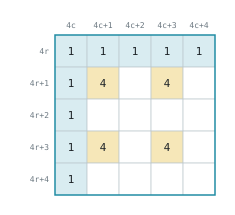

Un robot qui erre au hasard ne marquera pas beaucoup de points. Cette page montre comment passer de l’errance à une exploration méthodique. Ce sont des idées sur lesquelles construire, pas une solution complète.

## Savoir où vous êtes {#know-where-you-are}
Les cases font 12 cm de large : la position GPS vous donne donc la case. Comme la position de départ change d’un monde à l’autre, mesurez tout à partir d’elle :

```python
TILE = 0.12
startX, _, startZ = gps.getValues() # At the start of the game

def currentTile():
    x, _, z = gps.getValues()
    return round((x - startX) / TILE), round((z - startZ) / TILE)
```

:::note
Sans GPS, vous pouvez estimer la position avec les encodeurs des roues et le gyroscope, mais les erreurs s’accumulent.
:::

## Mémoriser ce que vous avez vu {#remember-what-you-have-seen}
Tenez un dictionnaire des cases, avec ce que vous savez de chacune : quels côtés ont des murs, quel est le sol, et si vous l’avez visitée.

```python
tiles = {}
tiles[(0, 0)] = {"walls": {"N": False, "E": True, "S": False, "W": True}, "floor": "start", "visited": True}
```

Les cases ne disent pas tout dans les zones 2 et 3, où les murs peuvent se trouver sur des quarts de case. Stocker la carte à la résolution du quart de case, ou utiliser un nuage de points du LIDAR, vous y préparera.

## Décider où aller {#decide-where-to-go}
Ne vous contentez pas de suivre un mur : cela n’atteint jamais les [cases flottantes](/docs/rules/#linear-and-floating-tiles), dont les marqueurs valent davantage. Une approche courante :

1. Depuis la case actuelle, listez les voisines sans mur entre les deux.
2. Allez sur une case non visitée, s’il y en a une.
3. Sinon, trouvez la case la plus proche ayant une voisine non visitée grâce à un parcours en largeur, et allez-y.
4. Quand il ne reste plus de telle case, ou que le temps vient à manquer, revenez au départ de la même façon.

Traitez les trous comme des murs. Les marécages vident la batterie plus vite : n’y allez que si cela en vaut la peine. Retenez où sont les cases de contact, pour [remplacer la batterie](/docs/programming/battery/) en chemin.

## Gérer l’imprévu {#handle-the-unexpected}
- **Absence de progression (Lack of Progress) :** le robot est ramené au dernier point de contrôle. [Écoutez le message `L`](/docs/programming/communication/#lack-of-progress), et mettez à jour votre position.
- **Temps :** demandez le temps restant avec [`G`](/docs/programming/communication/#game-information). Gardez-en assez pour envoyer la carte et revenir au départ.
- **Bruit :** les capteurs sont bruités : comparez plusieurs mesures avant de vous fier à un mur ou à un marqueur.

## Des cases à la matrice de la carte {#from-tiles-to-the-map-matrix}
La [matrice de la carte](/docs/rules/mapping/) compte 4 cellules par case, plus une. Pour une case à la ligne `r` et à la colonne `c` de votre carte :

| Élément | Position dans la matrice (ligne, colonne) |
|---|---|
| Marques au sol, comme `4` ou `5` | Lignes `4r + 1` et `4r + 3`, colonnes `4c + 1` et `4c + 3` |
| Mur nord | Ligne `4r`, colonnes `4c` à `4c + 4` |
| Mur ouest | Colonne `4c`, lignes `4r` à `4r + 4` |



Votre carte peut commencer n’importe où : Erebus [aligne la matrice](/docs/rules/mapping/#how-correctness-is-calculated) à l’aide de la case de départ, et essaie les quatre rotations. Les [Règles de cartographie](/docs/rules/mapping/) expliquent chaque valeur de la matrice. Ensuite, [soumettez-la](/docs/programming/map-bonus/).

Testez-la avec les mondes d’exemple, dont les bonnes réponses figurent dans [Règles de cartographie](/docs/rules/mapping/#examples). Le résultat apparaît sous la forme `Map Correctness` dans les événements du match de la fenêtre de contrôle.
