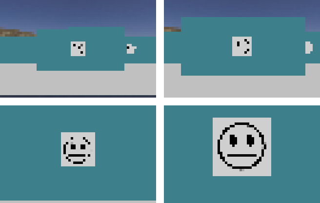
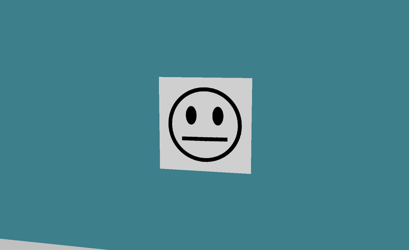
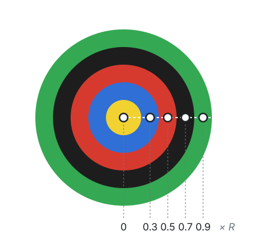
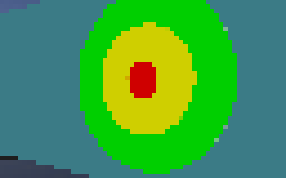
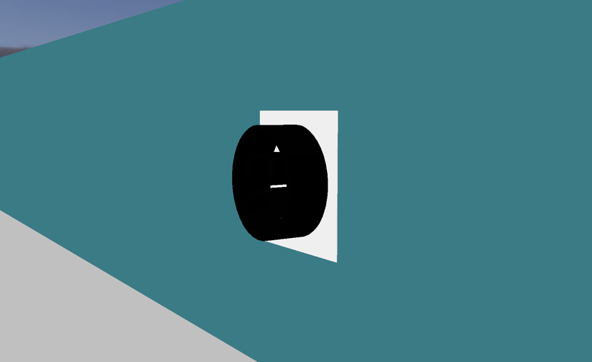

import CodeTabs from '@/components/CodeTabs.astro';

## Ce que le robot doit faire \{#what-the-robot-has-to-do\}
Les marqueurs muraux (wall tokens) représentent l’essentiel de vos points, et chaque mauvais signalement coûte 5 points. Pour chaque marqueur trouvé, vous devez donc choisir entre :

| C’est… | Que faire |
|---|---|
| Une victime smiley (triste, neutre, content) | Signaler `H`, `S` ou `U` |
| Une fausse victime (les mêmes visages, en relief) | Ne pas la signaler, et la laisser hors de la carte |
| Une cible cognitive dont la somme vaut de 0 à 3 | Signaler `F`, `P`, `C` ou `O` |
| Une cible cognitive avec toute autre somme | C’est un leurre : ne pas la signaler, et la laisser hors de la carte |

Consultez les [Règles](/docs/rules/#wall-tokens) pour les définitions exactes, et [Communication](/docs/programming/communication/#scoring-wall-tokens) pour savoir comment envoyer le signalement.

## Ce que voit la caméra \{#what-the-camera-sees\}
La caméra du robot de départ fait 64 × 40 pixels. À cette résolution, un marqueur ne fait que quelques pixels tant que le robot n’est pas proche : il vaut donc mieux repérer les candidats de loin, puis s’approcher pour les lire. N’oubliez pas qu’un signalement exige que le robot soit à moins d’une demi-case du marqueur, et que les caméras personnalisées peuvent avoir une résolution plus élevée, moyennant un coût.

Les victimes smiley sont des visages noirs sur un carré blanc, et elles peuvent être tournées d’un angle quelconque : votre méthode ne doit donc pas dépendre de l’orientation. Les trois visages diffèrent par la forme de la bouche : courbée vers le bas pour le visage triste (`H`), droite pour le visage neutre (`S`), et courbée vers le haut pour le visage content (`U`).

## Lire une cible cognitive \{#reading-a-cognitive-target\}
Une cible cognitive se compose de cinq parties concentriques : inutile donc de reconnaître sa forme. Une fois son centre et son rayon extérieur trouvés, vous pouvez échantillonner la couleur au milieu de chaque partie. Les parties ont des rayons de 0,5, 1, 1,5, 2 et 2,5 cm : leurs points médians se trouvent donc à 0, 0,3, 0,5, 0,7 et 0,9 fois le rayon extérieur.

Cette fonction le fait avec OpenCV en Python. Pour trouver le centre et le rayon, vous pouvez par exemple utiliser le contour de la cible, comme dans [Parcourir le labyrinthe](/docs/programming/navigate-the-maze/).

<CodeTabs file="readRings" />

En conditions réelles, la cible peut être vue de biais : elle ressemble alors à une ellipse. Se placer en face, considérer les couleurs qui semblent incorrectes comme un avertissement, ou lire plusieurs images rendra le résultat plus fiable.

## Calculer le type \{#calculating-the-type\}
Une fois les cinq couleurs obtenues, le code à signaler découle de leur somme. Chacune des cinq parties compte toujours, même quand des couleurs voisines sont identiques.

<CodeTabs file="targetCode" />

Par exemple, `['Y', 'B', 'R', 'K', 'G']` donne une somme de 0, c’est donc `F`, et `['B', 'Y', 'K', 'K', 'K']` donne une somme de -4, c’est donc un leurre.

## Détecter les fausses victimes \{#detecting-fake-victims\}
Les fausses victimes montrent les mêmes visages que les vraies, mais les émojis sont en relief. De face, une caméra seule ne permet pas toujours de les distinguer :

Les règles précisent que le relief peut être détecté avec l’un des capteurs disponibles dans le Robot Customizer. Quelques pistes à explorer :

- Comparer des mesures de distance prises sur toute la largeur du marqueur, avec un LIDAR ou des capteurs de distance, pour chercher une différence de hauteur.
- Regarder le marqueur de biais, là où un relief modifie la forme du visage.

Les mondes `world3.wbt`, `world4.wbt` et les quatre mondes `2027_` contiennent des fausses victimes, et le [World Editor](/docs/tools/world-editor/#victims-and-cognitive-targets) peut en ajouter à vos propres cartes. Erebus inclut aussi le script `scripts/update_maps_with_fakes.py`, qui transforme aléatoirement des victimes de mondes existants en leurres.

Signaler un leurre coûte 5 points au titre d’une erreur d’identification, alors qu’une vraie victime sur une case linéaire vaut 15 points avec son type dans la zone 1, et davantage dans les autres zones. Gardez cela en tête pour décider à quel point votre robot doit être sûr de lui avant de signaler.
