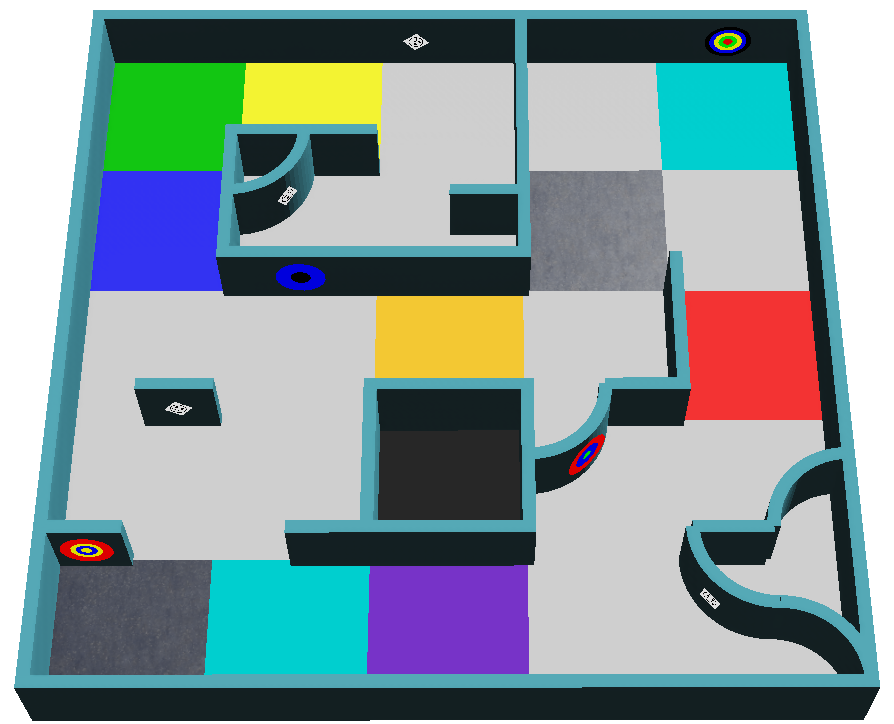

:::note
Cette page est un résumé pour bien démarrer. Les seules règles officielles sont les [RoboCupJunior Rescue Simulation Rules 2027](https://junior.robocup.org/wp-content/uploads/2026/09/RCJRescueSimulation2027-draft.pdf). Ce résumé suit la version mise à jour le 2026-10-24. Si cette page et les règles officielles diffèrent, ce sont les règles officielles qui s’appliquent.

Les corrections et clarifications sont publiées sur le [Forum officiel de la RoboCupJunior](https://junior.forum.robocup.org/). Il appartient à chaque équipe de les consulter.
:::

## Le jeu en une minute {#the-game-in-one-minute}
Votre robot est lâché seul dans un labyrinthe inconnu. En 8 minutes, sans aucune aide de votre part, il doit :

1. **Explorer** le labyrinthe sans rester bloqué ni tomber dans les trous.
2. **Trouver les marqueurs muraux** (wall tokens), c’est-à-dire les victimes et les cibles cognitives placées sur les murs, et signaler ce qu’est chacun d’eux.
3. **Garder sa batterie chargée**, en s’arrêtant sur une case de contact avant qu’elle ne soit vide.
4. **Cartographier** le labyrinthe et envoyer la carte à la fin.
5. **Revenir** à son point de départ.

La suite explique ces cinq tâches en détail. Inutile de tout retenir maintenant : revenez-y au moment de programmer chaque partie.

## Mission et objectif {#mission-and-objective}

Le robot doit explorer en autonomie un environnement inconnu tout en évitant les ennuis. Il y a trois missions principales :

- Parcourir un labyrinthe complexe sans rester bloqué
- Cartographier l’environnement avec précision
- Trouver et identifier les marqueurs muraux : victimes smiley (letter victims) et cibles cognitives (cognitive targets)

## Le terrain {#the-field}
Le terrain comporte jusqu’à quatre zones. La zone 1 fait toujours partie du terrain, et les organisateurs peuvent omettre les zones 2 à 4. Chaque passage entre deux zones a la largeur d’une case standard. Les cases sont un concept qui sert à générer le terrain, pas des structures physiques.

- Une case mesure **12 cm × 12 cm**. Dans les zones 2 et 3, chaque case est subdivisée en quatre **quarts de case** (quarter tiles) de 6 cm × 6 cm.
- Les murs font **1 cm d’épaisseur et 6 cm de hauteur**.
- Les couloirs sont au moins aussi larges que le robot, et peuvent s’ouvrir sur des espaces plus larges.

| Zone | Murs | Remarques |
|---|---|---|
| Zone 1 | Peuvent être placés sur les bords de chaque case | La case de départ se trouve dans cette zone |
| Zone 2 | Peuvent être placés sur les bords de chaque quart de case | |
| Zone 3 | Peuvent être placés sur les bords de chaque quart de case | Les angles à 90° peuvent être arrondis en quart de cercle |
| Zone 4 (facultative) | Pas de cases ; murs et obstacles placés librement | Peut contenir des objets comme des boîtes, et peut exiger des déplacements en diagonale |

### Passages entre les zones {#passages-between-areas}
Les passages sont des cases uniques avec des murs sur deux côtés, pour que leur entrée et leur sortie soient sans ambiguïté. La couleur de leur sol indique quelles zones ils relient :

Les murs des passages ne portent pas de marqueurs muraux.

### Cases linéaires et flottantes {#linear-and-floating-tiles}
Les cases qui mènent à la case de départ en suivant toujours le mur le plus à gauche ou le plus à droite sont des **cases linéaires** (linear tiles). Toutes les autres sont des **cases flottantes** (floating tiles). Les marqueurs situés sur des cases flottantes rapportent plus de points. Les quarts de case ne sont pas pris en compte, et les trous comptent ici comme des murs virtuels.

### Points de contrôle {#checkpoints}
Les cases argentées sont des points de contrôle (checkpoints), et elles peuvent se trouver n’importe où sur le terrain. La zone 4 contient des points de contrôle juste après ses passages. Après une absence de progression, le robot repart du dernier point de contrôle visité.

## Marécages, obstacles et trous {#swamps-obstacles-and-holes}

* Les **marécages** (cases marron) vident la batterie plus vite tant que le robot est dessus, car les moteurs doivent forcer davantage. Le temps de jeu n’est pas affecté.
* Les **obstacles** peuvent être fixés au sol, avoir n’importe quelle forme et couleur, et réduisent la largeur du couloir. Dans les zones 1 à 3, le centre d’un obstacle est toujours sur une case, jamais sur le bord entre deux cases, et il y a au plus un obstacle par case.
* Les **trous** sont des cases avec une ouverture dans le sol. Leurs bords sont noirs, à 1,5 cm des cases voisines. Si le robot tombe dedans, il y a absence de progression.

Aucune case n’est à la fois plusieurs des éléments suivants : marécage, trou, point de contrôle, case de contact, case de départ, case avec un obstacle ou passage entre zones.

## Cases de contact {#contact-tiles}
Les cases de contact sont des cases **cyan** où la batterie du robot peut être remplacée pendant le jeu. Le robot doit rester immobile sur la case pendant le remplacement de sa batterie. Voir [La batterie](#the-battery).

## Marqueurs muraux {#wall-tokens}
Il existe deux types de marqueurs muraux : les victimes smiley et les cibles cognitives. Les deux peuvent se trouver sur n’importe quel mur, y compris les surfaces courbes, sauf les murs des passages entre zones. Les victimes smiley peuvent aussi être tournées d’un angle quelconque, de 0 à 360 degrés.

### Victimes smiley {#smiley-victims}
Les victimes smiley sont des images de 2 cm × 2 cm d’un émoji smiley imprimé en noir. L’expression du visage représente l’état de santé de la victime, et le code est la lettre que vous signalez et inscrivez sur la carte.

| État | Visage | Code |
|---|---|---|
| Blessée | Triste | `H` |
| Stable | Neutre | `S` |
| Indemne | Content | `U` |

### Fausses victimes {#fake-victims}
Certains marqueurs muraux montrent les mêmes visages, mais les émojis sont **en relief**. Ce sont des leurres : vous ne devez ni les signaler au superviseur, ni les inclure dans la carte. Selon les règles, ce relief peut être détecté avec l’un des capteurs disponibles dans le Robot Customizer.

### Cibles cognitives {#cognitive-targets}
Les cibles cognitives (cognitive targets) représentent des matières dangereuses (hazmats). Ce sont des cercles de 5 cm de diamètre composés de cinq parties concentriques, de diamètres 1, 2, 3, 4 et 5 cm. Chaque couleur a une valeur :

| Noir | Rouge | Jaune | Vert | Bleu |
|---|---|---|---|---|
| -2 | -1 | 0 | 1 | 2 |

Additionnez les valeurs des cinq parties pour obtenir le type. Si la somme n’est pas dans la liste ci-dessous, la cible est un marqueur mural leurre : il ne faut ni la signaler ni la cartographier.

| Somme | Matière dangereuse | Code |
|---|---|---|
| 0 | Gaz inflammable (Flammable Gas) | `F` |
| 1 | Toxique (Poison) | `P` |
| 2 | Corrosif (Corrosive) | `C` |
| 3 | Peroxyde organique (Organic Peroxide) | `O` |

Les anneaux adjacents de même couleur ne sont **pas** fusionnés : comptez toujours les cinq, même quand les couleurs se répètent.

La cible de gauche est jaune, bleu, rouge, noir, vert du centre vers l’extérieur : 0 + 2 - 1 - 2 + 1 = 0, c’est donc un gaz inflammable (`F`). La cible de droite est bleu, jaune, noir, noir, noir : 2 + 0 - 2 - 2 - 2 = -4, c’est donc un leurre.

Le [tutoriel Marqueurs muraux](/docs/programming/wall-tokens/) montre comment lire une cible avec une caméra.

## Le robot {#the-robot}
- Les équipes utilisent le modèle de robot fourni par les organisateurs, et peuvent le personnaliser avec le [Robot Customizer](https://robot.erebus.rcj.cloud/) dans la limite d’un budget de **3000**. Consultez [Le robot](/docs/robot/).
- Le robot peut utiliser un GPS, un capteur de couleur, des capteurs de distance, des caméras RVB (RGB), un LIDAR, un gyroscope et un accéléromètre.
- Les capteurs simulés ont un bruit réaliste. Votre programme doit y être robuste, et les organisateurs ne modifieront pas les niveaux de bruit pour la compétition.

### La batterie {#the-battery}
Le robot a une batterie qui se vide selon la vitesse de ses moteurs. Son niveau s’affiche dans la fenêtre de contrôle, au-dessus des chronomètres. Les règles ne donnent pas le rythme exact : les équipes doivent découvrir son comportement par des tests.

- Pour remplacer la batterie, le robot doit **rester immobile sur une case de contact pendant 5 secondes** de temps simulé. La batterie est alors de nouveau pleine.
- Dans les marécages, la batterie se vide plus vite.
- Si la batterie est vide, le jeu se termine.

Le tutoriel [Batterie](/docs/programming/battery/) montre comment votre programme peut lire le niveau de la batterie et la remplacer.
- Les robots doivent être autonomes. Chaque équipe a un robot sur le terrain.
- La cartographie préalable est interdite : cela concerne à la fois le terrain et l’emplacement des marqueurs muraux, y compris les mouvements prédéfinis à partir de positions connues. Elle entraîne la disqualification immédiate pour la manche.

## Déroulement d’une partie {#playing-a-game}
- Une partie dure **8 minutes de temps simulé**. Un second chronomètre tourne en temps réel, avec une limite de **10 minutes**. La partie se termine dès que l’un des deux chronomètres expire.
- Une case compte comme visitée quand le centre du robot est à l’intérieur, d’après le superviseur.
- Le jeu se termine aussi quand la batterie est vide, quand le robot envoie la commande de sortie, ou quand le capitaine de l’équipe demande la fin du jeu (selon la façon dont le jeu se déroule).
- Les mondes de compétition sont dévoilés juste avant les matchs, et les programmes ne peuvent plus être modifiés après la date limite officielle de chaque manche, annoncée par les organisateurs.

### Absence de progression {#lack-of-progress}
Une absence de progression (Lack of Progress, LoP) se produit quand :

- Le robot est tombé dans un trou.
- Le robot reste au même endroit pendant 20 secondes ou plus (déclenchée automatiquement).
- L’arbitre estime que le robot n’est pas immobile, mais coincé dans une séquence de mouvements.
- Le robot la déclenche de lui-même.
- Dans d’autres cas, le capitaine de l’équipe peut la demander, et l’arbitre prend la décision finale. Cela peut ne pas s’appliquer, selon la façon dont la partie est exécutée.

Le robot est alors replacé sur le dernier point de contrôle visité, ou sur la case de départ s’il n’en a jamais atteint. Son orientation ne peut pas être choisie. Erebus envoie aussi la lettre `L` au robot, pour que votre programme puisse [y réagir](/docs/programming/communication/#lack-of-progress).

## Score {#scoring}
Le calcul du score est automatisé par Erebus. Les récompenses ne se cumulent pas : par exemple, chaque point de contrôle ne rapporte des points que la première fois.

Pour identifier un marqueur mural, le robot doit s’arrêter **au moins 1 seconde**, puis [envoyer le type et la position](/docs/programming/communication/#scoring-wall-tokens) au superviseur. Le centre du robot doit être à au plus une demi-case du marqueur.

| Élément | Points |
|---|---|
| Identification d’un marqueur mural (TI) sur une case linéaire des zones 1 à 3 | Victime smiley : 5, cible cognitive : 10 |
| Identification d’un marqueur mural (TI) sur une case flottante des zones 1 à 3, et tous les marqueurs de la zone 4 | Victime smiley : 15, cible cognitive : 30 |
| Type correct (TT), en plus de TI | Victime smiley : 10, cible cognitive : 20 |
| Point de contrôle visité (CN) | 10 |
| Erreur d’identification d’un marqueur mural (TMI) | -5 |
| Absence de progression (LoP) | -5 |

Le score total ne peut pas descendre en dessous de zéro. Une erreur d’identification consiste à signaler une position à plus d’une demi-case du marqueur, à signaler un marqueur là où il n’y en a pas, ou à signaler une victime smiley comme une cible cognitive, ou inversement. Signaler un leurre entre dans la deuxième catégorie.

**Multiplicateurs de zone (Area multipliers, AM)** : TI, TT et CN sont multipliés par 1, 1,25, 1,5 et 2 respectivement dans les zones 1, 2, 3 et 4. TMI et LoP ne sont pas multipliés.

**Bonus de sortie (Exit bonus, EB)** : si le robot a identifié au moins un marqueur mural, revient sur la case de départ et envoie la commande de sortie, le score augmente de 10 %.

**Bonus de cartographie (Mapping bonus, MB)** : le robot peut soumettre une carte du labyrinthe. Le multiplicateur vaut exactitude × 1,2 + 1 : une carte parfaite multiplie donc le score par 2,2. Consultez [Cartographie](/docs/rules/mapping/).

Le score sur le terrain d’une partie se calcule ainsi :

Par exemple, une partie avec ces résultats obtient 2825,35 points :

## La compétition {#the-competition}
La préparation, les documents à soumettre, la configuration de la compétition et le score final sont décrits dans [Se préparer à une compétition](/docs/competition/).

## Et ensuite {#next}
Maintenant que vous savez ce que votre robot doit faire, [obtenez votre robot](/docs/robot/).
