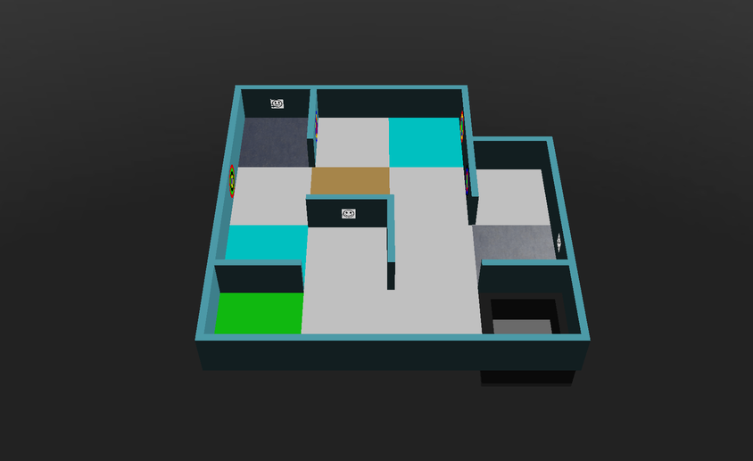

## Principe général {#general-idea}
La cartographie est notée sous la forme d’un multiplicateur appliqué au score de la partie. Pour l’obtenir, le robot doit soumettre une matrice au Main Supervisor (superviseur principal) du jeu. La matrice soumise est comparée à la « grille de réponses » pour obtenir une valeur d’exactitude, et le multiplicateur vaut :

**multiplicateur du bonus de cartographie = exactitude × 1,2 + 1**

Une carte parfaite multiplie donc votre score par 2,2. Pour savoir comment envoyer la matrice, consultez le [tutoriel Soumettre la carte](/docs/programming/map-bonus/).

## Règles de cartographie {#rules-for-mapping}
* Chaque quart de case, chaque bord et chaque sommet est représenté par une cellule (une valeur). Une carte de L × H cases est donc une matrice de (4 × H + 1) lignes et (4 × L + 1) colonnes.
* Chaque élément du monde est représenté comme suit :

| Élément | Valeur |
|---|---|
| Murs | `1` |
| Trous | `2` |
| Marécages | `3` |
| Points de contrôle | `4` |
| Case de départ | `5` |
| Case avec un obstacle | `x` |
| Case de contact (cyan) | `k` |
| Passage entre les zones 1 et 2 (bleu) | `b` |
| Passage entre les zones 1 et 3 (jaune) | `y` |
| Passage entre les zones 1 et 4 (vert) | `g` |
| Passage entre les zones 2 et 3 (violet) | `p` |
| Passage entre les zones 2 et 4 (orange) | `o` |
| Passage entre les zones 3 et 4 (rouge) | `r` |
| Marqueurs muraux | Le code correspondant (`H`, `S`, `U`, `F`, `P`, `C`, `O`) |
| Toutes les cases, bords et sommets de la zone 4, y compris sa bordure | `*` |
| Toutes les autres cases, bords et sommets | `0` |

* Les éléments de sol (`2`, `3`, `4`, `5`, `x`, `k` et les passages) sont inscrits dans la cellule centrale de chacun des quatre quarts de case de la case, comme le montrent les exemples ci-dessous.
* Aucune case n’est à la fois plus d’un de ces éléments : marécage, trou, point de contrôle, case de contact, case de départ, case avec un obstacle, ou passage entre zones.
* Pour les murs courbes de la zone 3, le sommet est représenté par un `0`.
* Un marqueur mural est inscrit dans la cellule du mur sur lequel il se trouve. S’il y a plusieurs marqueurs muraux sur le même mur, par exemple sur ses deux faces, concaténez leurs codes dans une seule cellule, dans l’ordre de leur position absolue sur la carte : d’abord de haut en bas, puis de gauche à droite.
* Les leurres ne doivent pas figurer sur la carte : ni les fausses victimes, ni les cibles cognitives dont la somme n’est pas valide.
* Les marqueurs muraux sur des cases entières (qui ne sont pas des quarts de case) peuvent se trouver n’importe où le long du mur. Ils sont inscrits dans la cellule du quart de case dont ils sont le plus proches, ou dans la cellule du milieu s’ils sont près du centre du côté de la case.
* Les cartes peuvent être soumises avec n’importe quelle rotation, du moment qu’elle est un multiple de 90°. Erebus aligne votre matrice sur la réponse à l’aide de la case de départ, essaie chaque orientation, et garde le meilleur résultat.

## Comment l’exactitude est calculée {#how-correctness-is-calculated}
1. Les matrices sont alignées sur la case de départ. Autrement dit, **votre carte doit contenir la case de départ**.
1. Chaque position où la matrice soumise ou la réponse a une valeur non nulle est comparée. Si les valeurs correspondent, le nombre de bonnes réponses augmente ; sinon, c’est le nombre de mauvaises réponses qui augmente. Les positions qui valent `0` dans les deux sont ignorées.
1. L’exactitude vaut bonnes réponses / (bonnes réponses + mauvaises réponses).

Comme seules les positions où se trouve quelque chose comptent, marquer un élément qui n’existe pas fait baisser votre exactitude autant qu’oublier un élément qui existe.

## Cas limites ambigus {#ambiguous-edge-cases}
Pour les cas ambigus qui ne sont pas traités ci-dessous, contactez le comité international RoboCupJunior Rescue et/ou l’équipe de développement de la plateforme.
### Un mur avec un angle droit normal d’un côté et un mur courbe de l’autre {#one-wall-with-a-normal-right-angled-wall-and-a-curved-wall-on-each-side}
Les règles indiquent que les sommets d’un mur courbe sont représentés par des zéros.
L’exception est le cas suivant, où un côté du mur forme un angle droit normal et l’autre côté est courbe. Il est représenté comme si les deux côtés étaient des murs normaux.


## Exemples {#examples}
Voici les bonnes réponses pour certains des mondes inclus dans Erebus v27, générées par Erebus lui-même.

Les mondes du dossier `game/worlds` changent d’une version à l’autre : si votre version d’Erebus est différente, votre réponse peut l’être aussi. `MapScorerExample.py` dans le dossier `player_controllers` contient aussi des matrices d’exemple.

### mapping_example_1.wbt {#mapping_example_1wbt}
Un petit monde avec une seule zone. La case de départ est la case verte en bas à gauche.


```
[
['1', '1', 'S', '1', '1', '1', '1', '1', '1', '1', '1', '1', '1', '0', '0', '0', '0'],
['1', '4', '0', '4', '1', '0', '0', '0', '0', '0', '0', '0', '1', '0', '0', '0', '0'],
['1', '0', '0', '0', 'C', '0', '0', '0', '0', '0', '0', '0', 'O', '0', '0', '0', '0'],
['1', '4', '0', '4', '1', '0', '0', '0', '0', '0', '0', '0', '1', '0', '0', '0', '0'],
['1', '0', '0', '0', '1', '0', '0', '0', '0', '0', '0', '0', '1', '1', '1', '1', '1'],
['1', '0', '0', '0', '0', '3', '0', '3', '0', '0', '0', '0', '1', '0', '0', '0', '1'],
['F', '0', '0', '0', '0', '0', '0', '0', '0', '0', '0', '0', 'P', '0', '0', '0', '1'],
['1', '0', '0', '0', '0', '3', '0', '3', '0', '0', '0', '0', '1', '0', '0', '0', '1'],
['1', '0', '0', '0', '1', '1', 'U', '1', '1', '0', '0', '0', '1', '0', '0', '0', '1'],
['1', '0', '0', '0', '0', '0', '0', '0', '1', '0', '0', '0', '0', '4', '0', '4', '1'],
['1', '0', '0', '0', '0', '0', '0', '0', '1', '0', '0', '0', '0', '0', '0', '0', 'H'],
['1', '0', '0', '0', '0', '0', '0', '0', '1', '0', '0', '0', '0', '4', '0', '4', '1'],
['1', '1', '1', '1', '1', '0', '0', '0', '1', '0', '0', '0', '1', '1', '1', '1', '1'],
['1', '5', '0', '5', '0', '0', '0', '0', '0', '0', '0', '0', '0', '2', '0', '2', '1'],
['1', '0', '0', '0', '0', '0', '0', '0', '0', '0', '0', '0', '0', '0', '0', '0', '1'],
['1', '5', '0', '5', '0', '0', '0', '0', '0', '0', '0', '0', '0', '2', '0', '2', '1'],
['1', '1', '1', '1', '1', '1', 'F', '1', '1', '1', '1', '1', '1', '1', '1', '1', '1']
]
```

### mapping_example_1_cyan_tiles.wbt {#mapping_example_1_cyan_tileswbt}
Le même monde que `mapping_example_1.wbt`, avec deux cases de contact, notées `k`.



```
[
['1', '1', 'S', '1', '1', '1', '1', '1', '1', '1', '1', '1', '1', '0', '0', '0', '0'],
['1', '4', '0', '4', '1', '0', '0', '0', '0', 'k', '0', 'k', '1', '0', '0', '0', '0'],
['1', '0', '0', '0', 'C', '0', '0', '0', '0', '0', '0', '0', 'O', '0', '0', '0', '0'],
['1', '4', '0', '4', '1', '0', '0', '0', '0', 'k', '0', 'k', '1', '0', '0', '0', '0'],
['1', '0', '0', '0', '1', '0', '0', '0', '0', '0', '0', '0', '1', '1', '1', '1', '1'],
['1', '0', '0', '0', '0', '3', '0', '3', '0', '0', '0', '0', '1', '0', '0', '0', '1'],
['F', '0', '0', '0', '0', '0', '0', '0', '0', '0', '0', '0', 'P', '0', '0', '0', '1'],
['1', '0', '0', '0', '0', '3', '0', '3', '0', '0', '0', '0', '1', '0', '0', '0', '1'],
['1', '0', '0', '0', '1', '1', 'U', '1', '1', '0', '0', '0', '1', '0', '0', '0', '1'],
['1', 'k', '0', 'k', '0', '0', '0', '0', '1', '0', '0', '0', '0', '4', '0', '4', '1'],
['1', '0', '0', '0', '0', '0', '0', '0', '1', '0', '0', '0', '0', '0', '0', '0', 'H'],
['1', 'k', '0', 'k', '0', '0', '0', '0', '1', '0', '0', '0', '0', '4', '0', '4', '1'],
['1', '1', '1', '1', '1', '0', '0', '0', '1', '0', '0', '0', '1', '1', '1', '1', '1'],
['1', '5', '0', '5', '0', '0', '0', '0', '0', '0', '0', '0', '0', '2', '0', '2', '1'],
['1', '0', '0', '0', '0', '0', '0', '0', '0', '0', '0', '0', '0', '0', '0', '0', '1'],
['1', '5', '0', '5', '0', '0', '0', '0', '0', '0', '0', '0', '0', '2', '0', '2', '1'],
['1', '1', '1', '1', '1', '1', 'F', '1', '1', '1', '1', '1', '1', '1', '1', '1', '1']
]
```

### mapping_example_2.wbt {#mapping_example_2wbt}
Ce monde contient des obstacles, marqués par `x`.


```
[
['1', '1', '1', '1', '1', '1', '1', '1', '1', '1', '1', '1', '1', '1', '1', '1', '1', '1', 'F', '1', '1'],
['1', '5', '0', '5', '1', '0', '0', '0', '0', '0', 'O', '0', '0', '0', '0', '0', '0', '0', '0', '0', '1'],
['1', '0', '0', '0', '1', '0', '0', '0', '0', '0', '1', '0', '0', '0', '0', '0', '0', '0', '0', '0', '1'],
['1', '5', '0', '5', '1', '0', '0', '0', '0', '0', '0', '0', '0', '0', '0', '0', '0', '0', '0', '0', '1'],
['1', '0', '0', '0', '1', '0', '1', '0', '0', '0', '0', '0', '0', '0', '1', '1', '1', '0', '0', '0', '1'],
['1', 'b', '0', 'b', '1', '0', 'U', '0', '0', '0', '0', '0', '0', '0', '0', '0', '1', '0', '0', '0', '1'],
['1', '0', '0', '0', '1', 'S', '1', '0', '0', '0', '0', '0', '1', '0', '0', '0', '1', '0', '1', '0', '1'],
['1', 'b', '0', 'b', '1', '0', '0', '0', '0', '0', '0', '0', '1', '0', '0', '0', '1', '0', '1', '0', '1'],
['1', '0', '0', '0', '1', '0', '0', '0', '0', '0', '0', '0', '1', 'H', '1', '1', '1', '0', '1', '0', '1'],
['1', '0', '0', '0', '0', '0', '0', '0', '0', '3', '0', '3', '0', '0', '0', '0', '0', '2', '0', '2', '1'],
['1', '0', '0', '0', '0', '0', '0', '0', '0', '0', '0', '0', '0', '0', '0', '0', '0', '0', '0', '0', '1'],
['1', '0', '0', '0', '0', '0', '0', '0', '0', '3', '0', '3', '0', '0', '0', '0', '0', '2', '0', '2', '1'],
['1', '0', '1', '1', '1', '0', '0', '0', '1', '1', '1', '1', '1', '0', '0', '0', '0', '0', '0', '0', '1'],
['1', '0', '0', '0', '0', '0', '0', '0', '1', '0', '0', '0', '1', '0', '0', '0', '0', '0', '0', '0', '1'],
['1', '0', '0', '0', '0', '0', '0', '0', '1', '0', '0', '0', '1', '1', '1', '0', '0', '0', '1', '0', '1'],
['1', '0', '0', '0', '0', '0', '0', '0', '1', '0', '0', '0', '1', '0', '0', '0', '0', '0', '1', '0', '1'],
['1', '1', '1', '0', '0', '0', '1', 'P', '1', '0', '0', '0', '1', '0', '0', '0', '1', '1', '1', '0', '1'],
['1', '0', '0', '0', '0', '4', '0', '4', '1', '0', '0', '0', '1', '0', '0', '0', '0', 'x', '0', 'x', '1'],
['1', '0', '0', '0', '0', '0', '0', '0', '1', '0', '0', '0', '1', '0', '0', '0', '0', '0', '0', '0', '1'],
['1', '0', '0', '0', '0', '4', '0', '4', '1', '0', '0', '0', 'C', '0', '0', '0', '0', 'x', '0', 'x', '1'],
['1', '1', '1', '1', '1', '1', '1', '1', '1', '0', '0', '0', '1', '1', '1', '1', '1', '1', '1', '1', '1']
]
```

### world1.wbt {#world1wbt}
Ce monde a trois zones, avec les passages `b` et `p`.


```
[
['1', '1', '1', '1', '1', '1', '1', '1', '1', '1', '1', '1', '1', '1', '1', '1', '1', '1', '1', '1', '1', '1', '1', '1', '1', '1', '1', '1', '1', '1', '1', '1', '1'],
['1', '5', '0', '5', '0', '0', '0', '0', '0', '0', '0', '0', '0', '2', '0', '2', '1', '0', '0', '0', '1', '0', '0', '0', '0', '0', '0', '0', '0', '3', '0', '3', '1'],
['1', '0', '0', '0', '0', '0', '0', '0', '0', '0', '0', '0', '0', '0', '0', '0', '1', '0', '0', '0', '1', '0', '0', '0', '0', '0', '0', '0', '0', '0', '0', '0', '1'],
['1', '5', '0', '5', '0', '0', '0', '0', '0', '0', '0', '0', '0', '2', '0', '2', '1', '0', '0', '0', '0', '0', '0', '0', '0', '0', '0', '0', '0', '3', '0', '3', '1'],
['1', '0', '0', '0', '0', '0', '0', '0', '1', '0', '0', '0', '0', '0', '0', '0', '1', '0', '0', '0', '0', '0', '0', '0', '0', '0', '0', '0', '0', '0', '0', '0', '1'],
['1', '0', '0', '0', '0', '0', '0', '0', '1', '0', '0', '0', '0', '0', '0', '0', '1', '0', '0', '0', '0', '0', '0', '0', '0', '0', '0', '0', '0', '0', '0', '0', '1'],
['1', '0', '0', '0', '0', '0', '0', '0', '1', '0', '0', '0', '0', '0', '0', '0', '1', '0', '0', '0', '0', '0', '0', '0', '1', '0', '0', '0', '0', '0', '0', '0', 'S'],
['1', '0', '0', '0', '0', '0', '0', '0', '1', '0', '0', '0', '0', '0', '0', '0', '1', '0', '0', '0', '0', '0', '0', '0', '1', '0', '0', '0', '0', '0', '0', '0', '1'],
['1', '0', '0', '0', '1', '1', '1', '1', '1', '0', '0', '0', '1', '1', '1', '1', '1', '0', '0', '0', '0', '0', '0', '0', '1', '1', '1', '0', '0', '0', '0', '0', '1'],
['1', '0', '0', '0', '0', '0', '0', '0', '1', '0', '0', '0', '0', 'b', '0', 'b', '0', '0', '0', '0', '0', '0', '0', '0', '1', '0', '0', '0', '0', '0', '0', '0', '1'],
['F', '0', '0', '0', '0', '0', '0', '0', '1', '0', '0', '0', '0', '0', '0', '0', '0', '0', '0', '0', '0', '0', '0', '0', '1', '0', '0', '0', '0', '0', '0', '0', '1'],
['1', '0', '0', '0', '0', '0', '0', '0', '1', '0', '0', '0', '0', 'b', '0', 'b', '0', '0', '0', '0', '0', '0', '0', '0', '0', '0', '0', '0', '0', '0', '0', '0', '1'],
['1', '0', '0', '0', '0', '0', '0', '0', '1', '0', '0', '0', '1', '1', '1', '1', '1', '1', '1', '0', '0', '0', '0', '0', '1', '0', '0', '0', '1', '0', '0', '0', '1'],
['1', '0', '0', '0', '0', '0', '0', '0', '1', '0', '0', '0', '0', '0', '0', '0', '1', '0', '0', '0', '0', '0', '0', '0', '1', 'p', '0', 'p', '1', '0', '0', '0', '1'],
['1', '0', '0', '0', '0', '0', '0', '0', '1', '0', '0', '0', '0', '0', '0', '0', '1', '0', '0', '0', '0', '0', '0', '0', '1', '0', '0', '0', '1', '0', '0', '0', '1'],
['1', '0', '0', '0', '0', '0', '0', '0', '1', '0', '0', '0', '0', '0', '0', '0', '1', '0', '0', '0', '0', '0', '0', '0', '1', 'p', '0', 'p', '1', '0', '0', '0', '1'],
['1', '0', '0', '0', '0', '0', '0', '0', '1', '0', '0', '0', '0', '0', '0', '0', '1', '1', '1', '1', '1', '1', '1', '1', '1', '0', '0', '0', '1', '1', '1', '1', '1'],
['1', '0', '0', '0', '0', '0', '0', '0', '0', '0', '0', '0', '0', '0', '0', '0', '0', '0', '0', '0', '1', '0', '0', '0', '0', '0', '0', '0', '0', '0', '0', '0', '1'],
['1', '0', '0', '0', '0', '0', '0', '0', '0', '0', '0', '0', '0', '0', '0', '0', '0', '0', '0', '0', '1', '0', '0', '0', '0', '0', '0', '0', '0', '0', '0', '0', '1'],
['1', '0', '0', '0', '0', '0', '0', '0', '0', '0', '0', '0', '0', '0', '0', '0', '0', '0', '0', '0', '1', '0', '0', '0', '0', '0', '0', '0', '0', '0', '0', '0', '1'],
['1', '0', '0', '0', '0', '0', '0', '0', '1', '0', '0', '0', '1', '0', '0', '0', '0', '0', '0', '0', '1', '0', '0', '0', '0', '0', '1', '0', '0', '0', '0', '0', '1'],
['1', '0', '0', '0', '0', '0', '0', '0', '1', '0', '0', '0', '1', '0', '0', '0', '0', '0', '0', '0', '1', '0', '0', '0', '0', '0', '1', '0', '0', '0', '0', '0', '1'],
['1', '0', '0', '0', '0', '0', '0', '0', '1', '0', '0', '0', '1', '0', '0', '0', '0', '0', '0', '0', 'U', '0', '0', '0', '0', '0', '1', '1', '1', '0', '0', '0', '1'],
['1', '0', '0', '0', '0', '0', '0', '0', '1', '0', '0', '0', '1', '0', '0', '0', '0', '0', '0', '0', '1', '0', '0', '0', '0', '0', '0', '0', '0', '0', '0', '0', '1'],
['1', '0', '0', '0', '0', '0', '0', '0', '1', '1', 'H', '1', '1', '0', '0', '0', '0', '0', '0', '0', '1', '0', '0', '0', '0', '0', '0', '0', '1', '0', '0', '0', '1'],
['1', '0', '0', '0', '0', '0', '0', '0', '0', '0', '0', '0', '1', '0', '0', '0', '0', '0', '0', '0', '1', '0', '0', '0', '0', '0', '0', '0', '1', '0', '0', '0', '1'],
['1', '0', '0', '0', '0', '0', '0', '0', '0', '0', '0', '0', '1', '0', '0', '0', '0', '0', '0', '0', '1', '0', '0', '0', '0', '1', '1', '1', '0', '0', '0', '0', '1'],
['P', '0', '0', '0', '0', '0', '0', '0', '0', '0', '0', '0', '1', '0', '0', '0', '0', '0', '0', '0', '1', '0', '0', '0', '1', '0', '0', '0', '0', '0', '0', '0', '1'],
['1', '0', '0', '0', '0', '0', '0', '0', '0', '0', '0', '0', '1', '0', '0', '0', '0', '0', '0', '0', '1', '0', '0', '0', '1', '0', '0', '0', '0', '0', '0', '0', '1'],
['1', '0', '0', '0', '0', '0', '0', '0', '0', '0', '0', '0', '0', '0', '0', '0', '0', '4', '0', '4', '1', '0', '0', '0', '0', '0', '0', '0', '0', '0', '0', '0', '1'],
['1', '0', '0', '0', '0', '0', '0', '0', '0', '0', '0', '0', '0', '0', '0', '0', '0', '0', '0', '0', '1', '0', '0', '0', '0', '0', '0', '0', '0', '0', '0', '0', '1'],
['1', '0', '0', '0', '0', '0', '0', '0', '0', '0', '0', '0', '0', '0', '0', '0', '0', '4', '0', '4', '1', '0', '0', '0', '0', '0', '0', '0', '0', '0', '0', '0', '1'],
['1', '1', '1', '1', '1', '1', '1', '1', '1', '1', '1', '1', '1', '1', '1', '1', '1', '1', '1', '1', '1', '1', '1', '1', '1', '1', '1', '1', '1', '1', '1', '1', '1']
]
```

### world2.wbt {#world2wbt}
Ce monde contient la zone 4, remplie de `*`, et les passages `g` et `r`.


```
[
['1', '1', '1', '1', '1', '1', '1', '1', '1', '1', '1', '1', '1', '1', '1', '1', '1', '1', '1', '1', '1', '1', 'P', '1', '1', '1', '1', '1', '1', '1', '1', '1', '1', '1', '1', '1', '1'],
['1', '4', '0', '4', '0', '0', '0', '0', '0', '0', '0', '0', '1', '0', '0', '0', '0', '2', '0', '2', '1', '0', '0', '0', '0', '0', '0', '0', '0', '3', '0', '3', '1', '2', '0', '2', '1'],
['1', '0', '0', '0', '0', '0', '0', '0', '1', '0', '0', '0', '1', '0', '0', '0', '0', '0', '0', '0', '1', '0', '0', '0', '0', '0', '0', '0', '0', '0', '0', '0', '1', '0', '0', '0', '1'],
['1', '4', '0', '4', '0', '0', '0', '0', 'C', '0', '0', '0', '0', '0', '0', '0', '0', '2', '0', '2', '1', '0', '0', '0', '0', '0', '0', '0', '0', '3', '0', '3', '1', '2', '0', '2', '1'],
['1', '1', '1', '1', '1', '0', '0', '0', '1', '0', '0', '0', '0', '0', '0', '0', '1', '1', '1', '1', '1', '0', '0', '0', '1', '1', '1', '1', '1', '0', '0', '0', '1', '0', '0', '0', '1'],
['1', '0', '1', '0', '0', '0', '0', '0', '0', '0', '0', '0', '0', '0', '0', '0', '1', 'b', '0', 'b', '0', '0', '0', '0', '0', '0', '0', '0', '1', '0', '0', '0', '0', '0', '0', '0', '1'],
['1', 'U', '1', '0', '0', '0', '0', '0', '0', '0', '0', '0', '0', '0', '1', '1', '1', '0', '0', '0', '0', '0', '0', '0', '0', '0', '0', '0', 'O', '0', '0', '0', '0', '0', '0', '0', '1'],
['1', '0', '0', '0', '0', '0', '0', '0', '0', '0', '0', '0', '0', '0', '0', '0', '1', 'b', '0', 'b', '0', '0', '0', '0', '0', '0', '0', '0', '1', '0', '0', '0', '0', '0', '0', '0', '1'],
['1', '0', '0', '0', '0', '0', '0', '0', '1', '0', '0', '0', '0', '0', '0', '0', '1', '0', '0', '0', '1', '1', '1', '1', '1', '1', '1', '1', '1', '0', '0', '0', '1', '0', '0', '0', '1'],
['1', '0', '0', '0', '0', '0', '0', '0', '1', 'p', '0', 'p', '0', '0', '0', '0', '0', '0', '0', '0', '0', '4', '0', '4', '1', '0', '0', '0', '0', '0', '0', '0', '1', '5', '0', '5', '1'],
['1', '0', '0', '0', '1', '0', '0', '0', '1', '0', '0', '0', '1', '0', '0', '0', '0', '0', '0', '0', '0', '0', '0', '0', 'H', '0', '0', '0', '0', '0', '0', '0', '1', '0', '0', '0', '1'],
['1', '0', '0', '0', '1', '0', '0', '0', '1', 'p', '0', 'p', '1', '0', '0', '0', '0', '0', '0', '0', '0', '4', '0', '4', '1', '0', '0', '0', '0', '0', '0', '0', '1', '5', '0', '5', '1'],
['0', '1', '1', 'S', '1', '1', '1', '1', '1', '0', '0', '0', '0', '1', '1', '1', '*', '*', '*', '*', '*', '*', '*', '*', '*', '*', '*', '*', '*', '0', '0', '0', '1', '0', '0', '0', '1'],
['1', '0', '0', '0', '0', '0', '0', '0', '1', '0', '0', '0', '1', '0', '0', '0', '*', '*', '*', '*', '*', '*', '*', '*', '*', '*', '*', '*', '*', 'g', '0', 'g', '0', '0', '0', '0', '1'],
['1', '0', '0', '0', '0', '1', '1', '1', '0', '0', '0', '0', '1', '0', '0', '0', '*', '*', '*', '*', '*', '*', '*', '*', '*', '*', '*', '*', '*', '0', '0', '0', '0', '0', '0', '0', '1'],
['1', '0', '0', '0', '1', '0', '0', '0', '0', '0', '0', '0', '1', '0', '0', '0', '*', '*', '*', '*', '*', '*', '*', '*', '*', '*', '*', '*', '*', 'g', '0', 'g', '0', '0', '0', '0', '1'],
['1', '0', '0', '0', '1', '0', '0', '0', '0', '0', '1', '1', '1', '0', '0', '0', '*', '*', '*', '*', '*', '*', '*', '*', '*', '*', '*', '*', '*', '*', '*', '*', '*', '*', '*', '*', '*'],
['1', '4', '0', '4', '0', '0', '0', '0', '0', '0', '0', '0', '0', '3', '0', '3', '0', '0', '0', '0', '*', '*', '*', '*', '*', '*', '*', '*', '*', '*', '*', '*', '*', '*', '*', '*', '*'],
['1', '0', '0', '0', '0', '0', '0', '0', '0', '0', '0', '0', '0', '0', '0', '0', '0', '0', '0', '0', '*', '*', '*', '*', '*', '*', '*', '*', '*', '*', '*', '*', '*', '*', '*', '*', '*'],
['1', '4', '0', '4', '0', '0', '0', '0', '0', '0', '0', '0', '0', '3', '0', '3', '0', '0', '0', '0', '*', '*', '*', '*', '*', '*', '*', '*', '*', '*', '*', '*', '*', '*', '*', '*', '*'],
['1', '0', '0', '0', '0', '0', '0', '0', '0', '0', '0', '0', '1', '0', '0', '0', '0', '0', '0', '0', '*', '*', '*', '*', '*', '*', '*', '*', '*', '*', '*', '*', '*', '*', '*', '*', '*'],
['1', '0', '0', '0', '0', '0', '0', '0', '0', '2', '0', '2', '1', '0', '0', '0', '0', 'r', '0', 'r', '*', '*', '*', '*', '*', '*', '*', '*', '*', '*', '*', '*', '*', '*', '*', '*', '*'],
['1', '0', '0', '0', '0', '0', '1', '0', '0', '0', '0', '0', '1', '0', '0', '0', '0', '0', '0', '0', '*', '*', '*', '*', '*', '*', '*', '*', '*', '*', '*', '*', '*', '*', '*', '*', '*'],
['1', '0', '0', '0', '0', '0', '1', '0', '0', '2', '0', '2', '1', '0', '0', '0', '0', 'r', '0', 'r', '*', '*', '*', '*', '*', '*', '*', '*', '*', '*', '*', '*', '*', '*', '*', '*', '*'],
['1', '1', '1', '1', '1', '1', '1', '1', '1', '1', '1', '1', '0', '1', '1', '1', '1', '1', '1', '1', '*', '*', '*', '*', '*', '*', '*', '*', '*', '*', '*', '*', '*', '*', '*', '*', '*']
]
```
