## Contexte {#background}

Une fois que votre robot s’en sort sur les cartes fournies et sur des labyrinthes simples, vous voudrez peut-être quelque chose de plus difficile, ou tester des situations précises que les cartes fournies ne couvrent pas.
Pour cela, il existe le [World Editor d’Erebus](https://world.erebus.rcj.cloud/) en ligne. Vous dessinez une carte dans votre navigateur, et il exporte un fichier de monde `.wbt` que vous pouvez lancer dans Erebus.

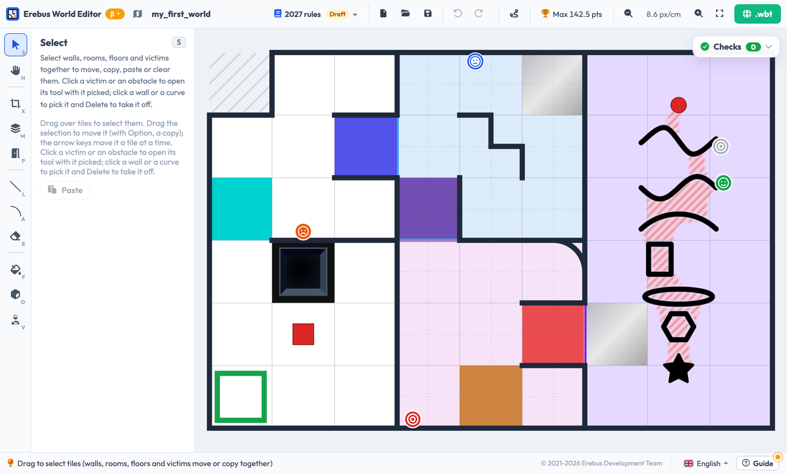

Si vous créez seulement de petites cartes pour vos tests, la conformité du terrain aux règles n’a sans doute pas beaucoup d’importance. Mais si vous prévoyez de construire un terrain de compétition, lisez les [Règles de la simulation](https://junior.robocup.org/wp-content/uploads/2026/02/RCJRescueSimulation2026-final.pdf) officielles. L’éditeur vérifie votre carte par rapport aux règles pendant que vous travaillez.

L’éditeur dispose d’un guide intégré : appuyez sur **Guide** en bas à droite pour une leçon pratique qui crée une carte d’exemple (environ 15 minutes), une visite de l’écran, ou une leçon sur la salle 4 (Room 4). La langue de l’éditeur peut être changée juste à côté.

## Commencer une carte {#starting-a-map}
Quand vous ouvrez l’éditeur, choisissez **les règles de quelle année** vous voulez suivre, puis appuyez sur **New map**. **Choisissez les règles 2026 pour Erebus v26.** Les règles 2027 sont un projet pour la prochaine version d’Erebus.

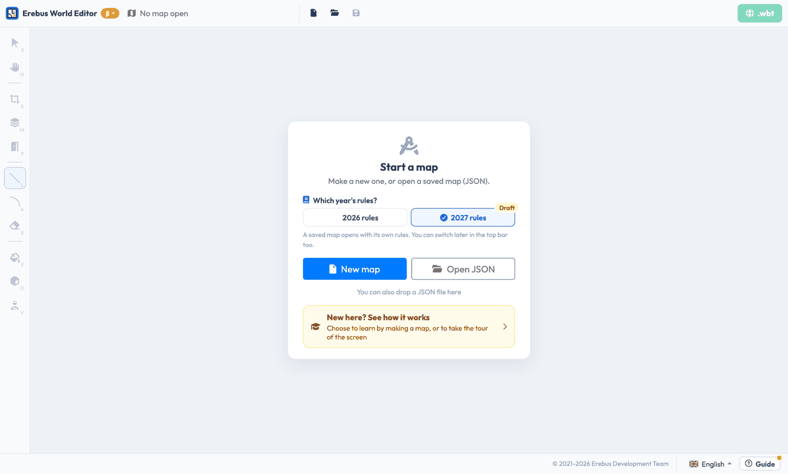

Votre travail est conservé dans le navigateur, mais il est perdu dans un autre navigateur ou quand les données de navigation sont effacées. Conservez les cartes importantes en les enregistrant au format JSON avec le bouton d’enregistrement de la barre du haut, et rouvrez-les avec le bouton d’ouverture.

Voici un bon ordre de travail : taille et contour, salles, passages, murs, sols, obstacles et victimes, salle 4, et enfin les vérifications et l’export. Les outils sont à gauche, chacun avec un raccourci clavier. Les réglages de l’outil sélectionné apparaissent dans le panneau à côté.

| Outil | Touche | Utilité |
|---|---|---|
| Select | `S` | Sélectionner, déplacer, copier et coller des parties de la carte |
| Move | `H` | Déplacer la vue |
| Outline | `X` | Définir la taille et la forme de la carte |
| Rooms | `M` | Peindre les salles 1 à 4 (les zones des règles) |
| Passages | `P` | Relier des salles par un passage |
| Line | `L` | Dessiner des murs |
| Curve | `A` | Dessiner des murs courbes dans la salle 3 |
| Eraser | `E` | Supprimer des murs, sols, obstacles et victimes |
| Floor | `F` | Placer les points de contrôle, les trous, les marécages et la case de départ |
| Obstacle | `O` | Placer des obstacles |
| Victims | `V` | Placer des victimes lettres, des cibles cognitives et des leurres |

La molette de la souris zoome, un glisser en maintenant Espace déplace la vue, et l’annulation se fait avec `⌘Z` ou `Ctrl+Z`.

## Taille et contour {#size-and-outline}
Avec l’outil **Outline**, définissez la taille de la carte en cases. Les murs extérieurs sont ajoutés automatiquement. **Outline (uneven)** vous permet de cliquer sur des cases pour les retirer de la carte, et vous pouvez aussi insérer et supprimer des lignes et des colonnes là où vous cliquez.

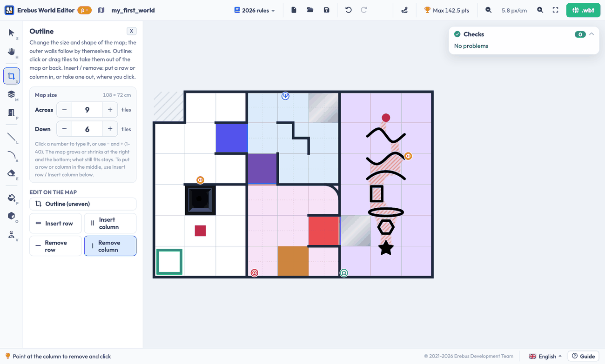

## Salles et passages {#rooms-and-passages}
Avec l’outil **Rooms**, peignez les cases de chaque salle. Les murs sont ajoutés automatiquement aux frontières entre les salles. Ensuite, avec l’outil **Passages**, reliez les salles : la couleur de chaque passage est choisie selon les salles qu’il relie.

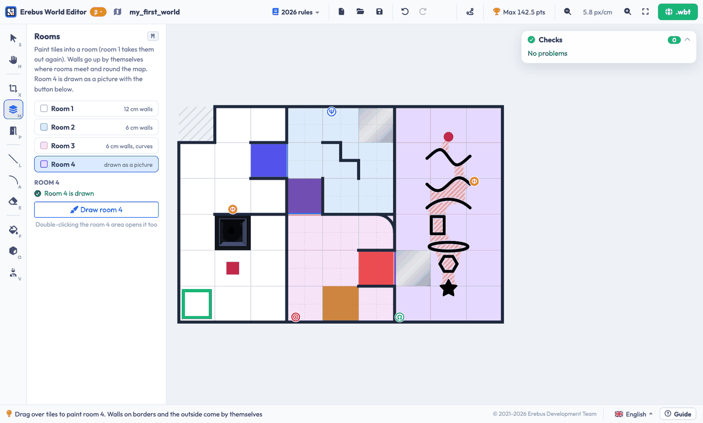

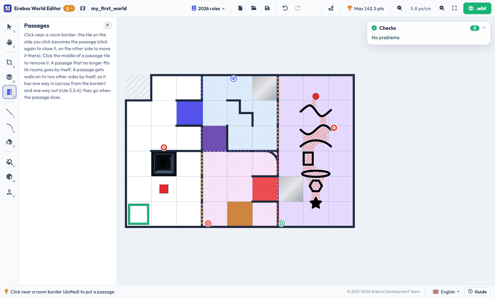

## Murs {#walls}
Utilisez l’outil **Line** pour dessiner des murs : sur les bords des cases dans la salle 1, et sur les quarts de case dans les salles 2 et 3. Utilisez l’outil **Curve** dans la salle 3, en visant un quart de case pour choisir la courbe. Cliquer à nouveau sur la même courbe la supprime.

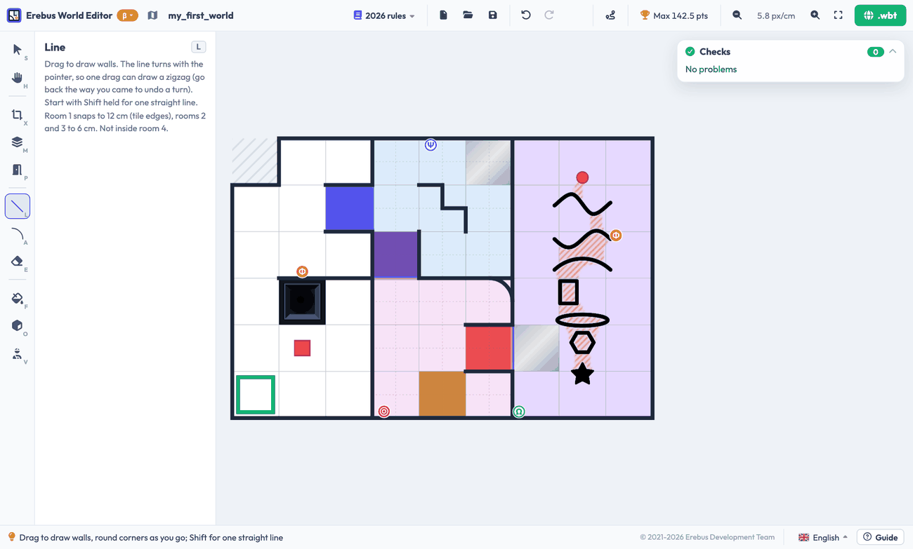

## Sols et obstacles {#floors-and-obstacles}
Avec l’outil **Floor**, choisissez un type de sol et cliquez sur une case pour l’appliquer. La case de départ doit être une case de la salle 1, et le monde ne peut pas être exporté sans elle. Une case ne peut être qu’une seule chose parmi : trou, marécage, point de contrôle, obstacle, départ ou passage.

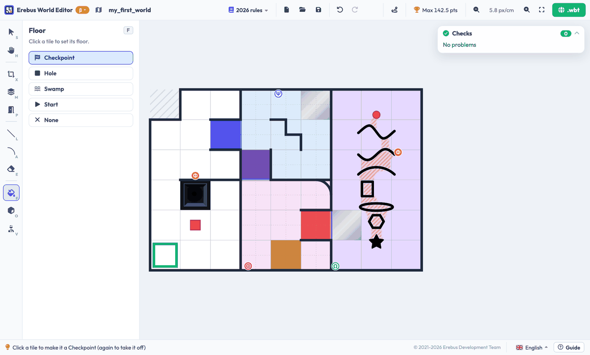

Avec l’outil **Obstacle**, choisissez une forme et cliquez sur une case. Dans les salles 1 à 3, il y a un obstacle par case, avec son centre sur la case. Cliquez sur un obstacle pour modifier sa taille, sa hauteur, sa couleur et sa rotation avec ses poignées et le panneau.

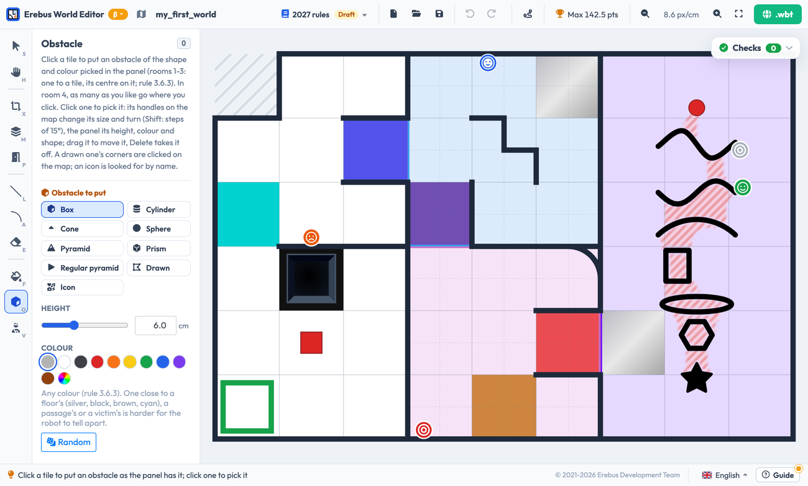

## Victimes et cibles cognitives {#victims-and-cognitive-targets}
Avec l’outil **Victims**, choisissez un type et cliquez près d’un mur. Vous pouvez placer :

- De vraies victimes lettres : blessée (harmed), stable et indemne (unharmed)
- De fausses victimes lettres, aux symboles en trois dimensions
- Des cibles cognitives : choisissez la matière dangereuse, et les couleurs des anneaux si vous le souhaitez. La somme s’affiche, et c’est elle qui détermine le type
- De fausses cibles, dont les anneaux donnent une somme autre que 0 à 3

Dans la salle 1, il peut y avoir une victime sur chaque côté de case. Dans les salles 2 et 3, elles se placent sur les faces des murs de 6 cm, et les courbes ont deux emplacements, à l’intérieur et à l’extérieur. Sous **Turn**, choisissez une rotation fixe, ou une rotation aléatoire pour chaque nouveau marqueur. Cliquez sur un marqueur placé pour le modifier ou le supprimer, ou faites-le glisser le long de son mur.

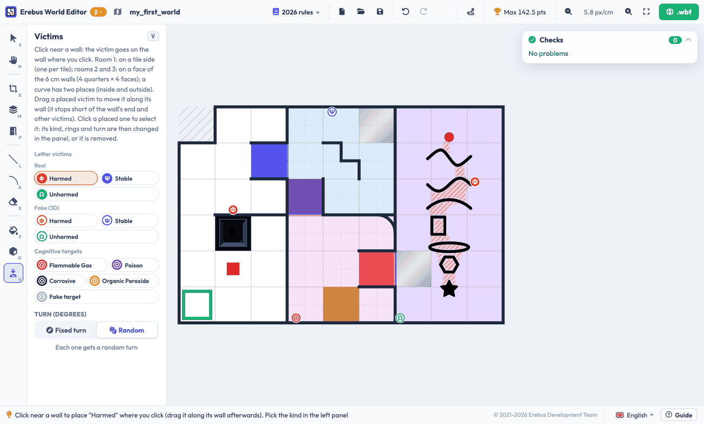

## Salle 4 {#room-4}
La salle 4 n’est pas basée sur des cases : elle se dessine donc comme une image. Avec l’outil **Rooms**, peignez la salle 4, puis appuyez sur **Draw room 4** (ou double-cliquez sur la salle) pour ouvrir le créateur de la salle 4.

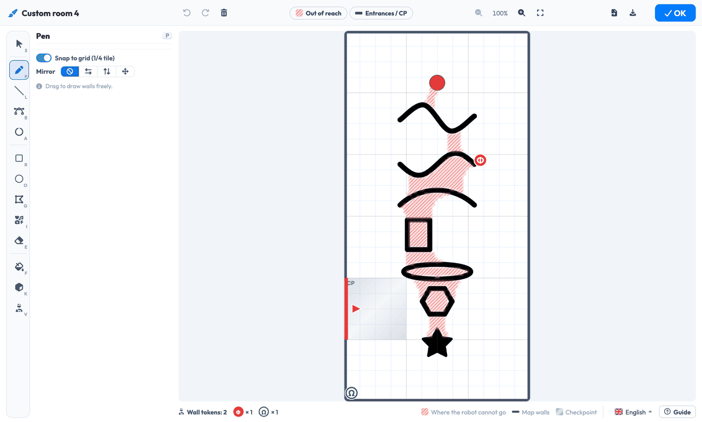

Ce que vous dessinez en noir devient des murs. Le créateur propose des outils pour dessiner à main levée et pour tracer des lignes, des courbes, des arcs, des rectangles, des ellipses, des polygones et des formes à partir d’icônes, ainsi que des outils pour les victimes et les obstacles. Vous pouvez placer autant d’obstacles que vous voulez dans la salle 4. Les rayures rouges indiquent les endroits où le robot ne peut pas aller, et vous devez laisser un passage d’environ une case de large pour que le robot puisse passer.

Quand c’est terminé, appuyez sur **OK** : l’image apparaît comme salle 4 sur la carte et est intégrée au monde exporté. Les boutons en haut à droite du créateur enregistrent l’image au format PNG, pour réutiliser la même salle 4 dans une autre carte, et ouvrent des images PNG ou JPEG.

## Vérifier votre carte {#checking-your-map}
Chaque modification est vérifiée par rapport aux règles, dans la carte **Checks** en haut à droite. Un ✕ rouge est un problème qui empêche d’exporter le monde, et un ! jaune est un avertissement qui mérite qu’on s’y attarde. Cliquez sur un élément pour y aller. **Fix** corrige un élément, et **Fix all that can be fixed** les corrige tous.

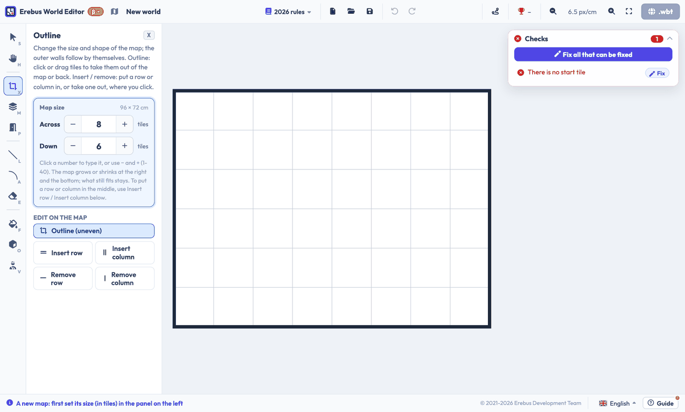

Le bouton **Linear** de la barre du haut colore chaque case selon qu’elle est linéaire ou flottante, ce qui détermine la valeur des marqueurs.

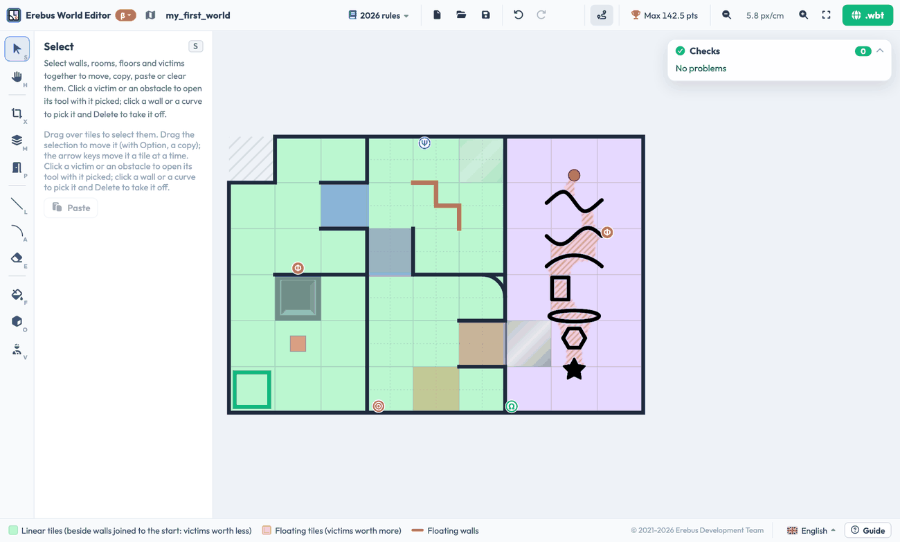

Le trophée de la barre du haut affiche le **score maximal** de la carte, calculé avec les règles de score, avec la part de chaque salle et le score avec les bonus de sortie et de cartographie.

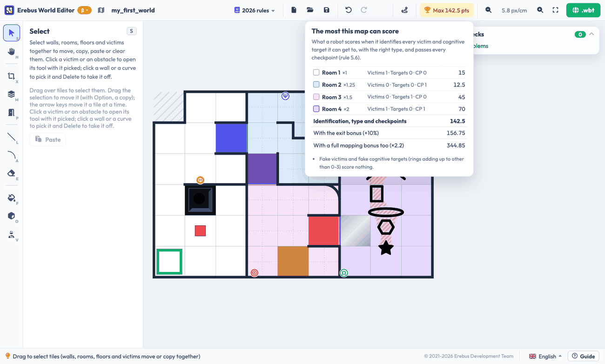

## Exporter et lancer votre monde {#exporting-and-running-your-world}
Indiquez le nom de la carte dans la barre du haut, et appuyez sur le bouton **.wbt** en haut à droite. Ensuite :

1. Copiez le fichier `.wbt` dans le dossier `game/worlds` d’Erebus. Il doit se trouver dans ce dossier, car le monde utilise des fichiers d’Erebus.
1. Ouvrez-le dans Webots, ou choisissez-le avec le bouton **Worlds** de la [fenêtre de contrôle](/docs/getting-started/).

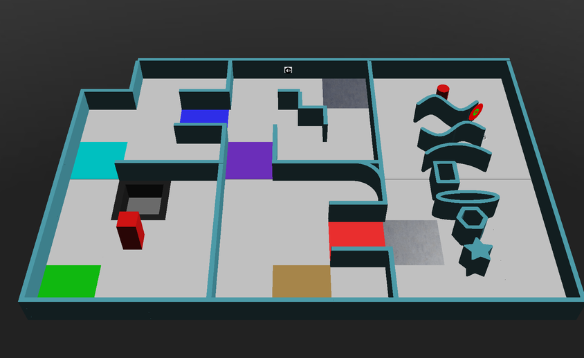

*La carte d’exemple du guide de l’éditeur, lancée dans Erebus v26.1.*

Un fichier `.wbt` ne peut pas être reconverti en carte modifiable : conservez donc aussi le JSON.
