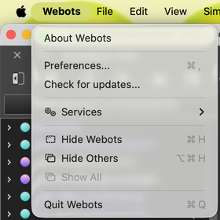
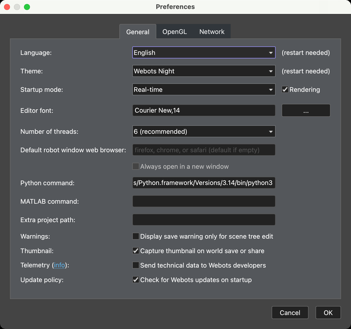
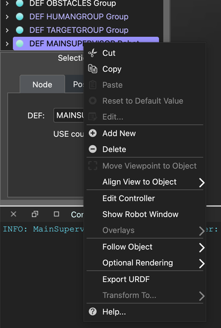
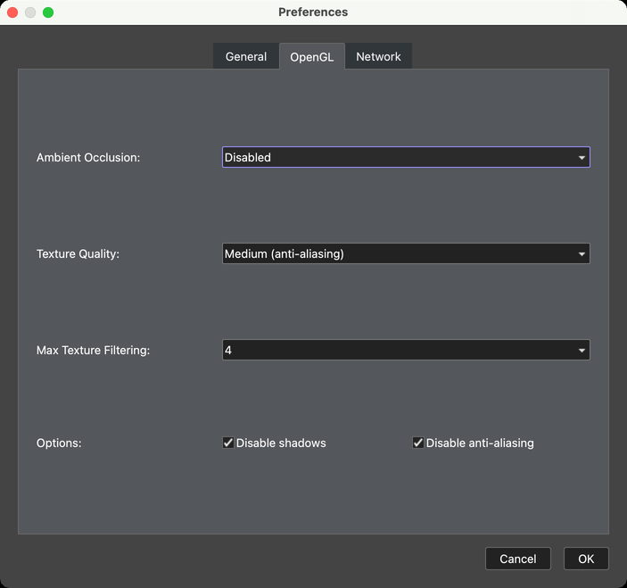

Avant tout, consultez la console de Webots. La plupart des problèmes y affichent un message d’erreur.

## Installation {#installation}

### `No module named 'cv2'` {#no-module-named-cv2}
OpenCV n’est pas installé dans le Python utilisé par Webots. Installez les [bibliothèques nécessaires](/docs/installation/#python-libraries) dans ce Python. Si vous avez plusieurs installations, le réglage **Python command** ci-dessous vous indique laquelle Webots utilise.

### `WARNING: Python was not found` {#warning-python-was-not-found}
Webots ne sait pas où se trouve Python.

1. Trouvez-le. Sous macOS et Linux, exécutez `which python3` dans un terminal. Sous Windows, vérifiez que taper `python` dans une nouvelle invite de commandes ouvre Python. Si ce n’est pas le cas, réinstallez Python en cochant l’option qui l’ajoute à votre PATH.
2. Ouvrez les préférences de Webots : **Webots > Preferences** sous macOS, **Tools > Preferences** sous Windows et Linux.

   

3. Indiquez le chemin dans le champ **Python command**. Sous Windows, `python` suffit généralement.

   

### Le chronomètre de jeu n’apparaît pas {#the-game-timer-does-not-appear}
Le premier démarrage peut prendre quelques minutes, le temps qu’Erebus installe les bibliothèques. S’il ne se termine jamais, cherchez des erreurs dans la console. Si l’installation automatique ne fonctionne pas, installez vous-même les [bibliothèques nécessaires](/docs/installation/#python-libraries).

## Faire tourner Erebus {#running-erebus}

### La fenêtre de contrôle n’apparaît pas {#the-control-window-does-not-appear}
La fenêtre de contrôle est une page web ouverte par Webots.

1. Si votre navigateur l’a bloquée, ouvrez [la fenêtre de contrôle](http://localhost:1234/robot_windows/MainSupervisorWindow/MainSupervisorWindow.html?name=robot) pendant que le monde est ouvert.
2. Sinon, assurez-vous que le Scene Tree (arbre de scène) est affiché, avec **Tools > Scene Tree**.
3. Trouvez **DEF MAINSUPERVISOR Robot** dans le Scene Tree, faites un clic droit dessus et choisissez **Show Robot Window**.

### L’écran de Webots est vide ou noir {#the-webots-screen-is-blank-or-black}
Copiez le téléchargement et décompressez-le dans un dossier séparé avant d’ouvrir le monde.

### La simulation est trop lente {#the-simulation-runs-too-slowly}
C’est probablement dû aux performances de votre ordinateur. Baisser la qualité graphique peut aider :

1. Ouvrez les préférences de Webots.
2. Ouvrez l’onglet **OpenGL**.
3. Modifiez les réglages.

Ces réglages modifient ce que voient les caméras, et la compétition utilise [ses propres réglages](/docs/competition/#opengl-settings) : vérifiez donc aussi votre programme avec ceux-ci.

## Votre robot {#your-robot}

### `PROTO parameter 'camera_width' has no matching IS field` {#proto-parameter-camera_width-has-no-matching-is-field}
Erebus v26.1 affiche cette erreur en rouge lorsqu’il charge un robot créé avec la version actuelle du Robot Customizer. Vous pouvez l’ignorer : le robot fonctionne, et ses caméras ont la résolution que vous avez choisie.

### Mon programme indique qu’un composant est introuvable {#my-program-says-a-device-was-not-found}
Voir ci-dessous. Vérifiez aussi que vous avez chargé votre robot avec le bouton LOAD de **droite** avant de démarrer la partie.

## Votre programme {#your-program}

### `Device "..." was not found` {#device--was-not-found}
Le nom du composant dans votre programme ne correspond pas à votre robot. Les noms du robot de départ se trouvent dans la [Référence](/docs/reference/parameters/#device-names-of-the-starter-robot). Pour votre propre robot, ce sont les noms que vous avez définis dans le [Robot Customizer](/docs/robot/customizer/). Vérifiez que votre robot a bien été chargé.

### Rien ne se passe quand je signale un marqueur mural {#nothing-happens-when-i-report-a-wall-token}
Activez **Enable debugging** dans l’onglet Settings de la fenêtre de contrôle, et consultez la console. Les causes les plus fréquentes : le robot n’était pas arrêté depuis au moins 1 seconde, ou les coordonnées n’ont pas été converties en centimètres. Consultez [Communication](/docs/programming/communication/#scoring-wall-tokens).

### Mes signalements sont des erreurs d’identification {#my-reports-are-misidentifications}
Le robot doit être à au plus une demi-case du marqueur et du même côté du mur, et chaque marqueur ne rapporte des points qu’une seule fois. Signaler un leurre compte aussi comme une erreur d’identification.

### La carte obtient 0 % ou une erreur de score {#the-map-gets-0-or-a-scoring-error}
Votre carte doit contenir la case de départ (`5`), et elle ne peut être évaluée qu’une seule fois. Consultez [Soumettre la carte](/docs/programming/map-bonus/).

### Le contrôleur n’arrive pas à se connecter en mode distant {#the-controller-cannot-connect-in-remote-mode}
Consultez le guide [Remote Controller](/docs/competition/remote-controller/) correspondant à votre système d’exploitation.

## Toujours bloqué ? {#still-stuck}
Posez votre question sur le [serveur Discord](https://discord.com/invite/6FJxZxk), ou [ouvrez une issue](https://github.com/robocup-junior/erebus/issues). Indiquez votre système d’exploitation, vos versions d’Erebus et de Webots, et le message affiché dans la console.
