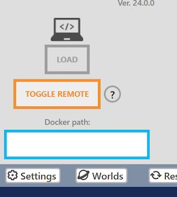
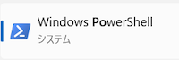
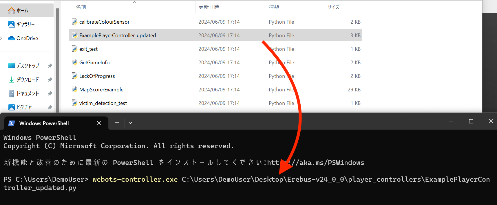
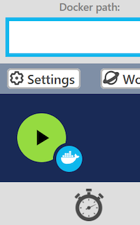
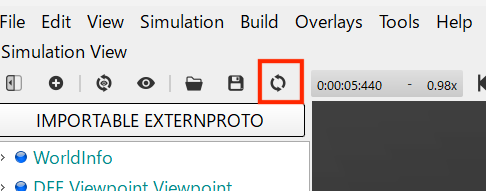

# Menjalankan server permainan dan program controller di PC yang sama
Pertama, mari coba jalankan server permainan dan program controller di PC yang sama. Ini tidak sama dengan pengaturan kompetisi sungguhan, tetapi akan membantumu saat melakukan debugging secara lokal.

## Mengaktifkan mode remote {#toggle-remote-mode}
Tekan "TOGGLE REMOTE" di Robot Window (jendela robot) untuk mengaktifkan pengaturan remote controller. Warna tombol akan berubah menjadi oranye untuk menunjukkan bahwa mode ini aktif.  

Jika Robot Window tidak muncul, klik kanan "DEF MAINSUPERVISOR Robot" di Scene Tree lalu tekan "Show Robot Window".  

## Menjalankan programmu {#execute-your-program}
Buka PowerShell. Biasanya kamu bisa menemukannya di daftar aplikasi.  

Jalankan perintah berikut di PowerShell, dengan mengganti `<Your controller path>` dengan path ke program controller-mu.

`webots-controller.exe <Your controller path>`

Jika perintahnya tidak ditemukan, gunakan path lengkapnya, yang secara bawaan adalah `C:\Program Files\Webots\msys64\mingw64\bin\webots-controller.exe`.

Jika kamu tidak tahu path ke program controller-mu, kamu bisa menyeret dan melepas (drag and drop) file itu ke jendela PowerShell dan path-nya akan terisi otomatis.  

Setelah mengetik perintahnya, tekan Enter untuk menjalankannya.

## Memulai permainan {#start-the-game}
Tekan tombol Start di Robot Window untuk memulai simulasi.  

## Menghentikan permainan {#terminate-the-game}
Untuk menghentikan jalannya permainan, hentikan program yang berjalan di PowerShell dengan menekan Ctrl+C.

Begitu simulasi dihentikan, sistem pengelola permainan Erebus juga ikut berhenti. Jika kamu ingin menjalankan permainan lagi, muat ulang world-nya.  

# Menjalankan server permainan di PC yang berbeda
Ini adalah pengaturan yang digunakan di kompetisi resmi.
PC yang menjalankan controller-mu (klien) dan server permainan (server) harus terhubung ke jaringan yang sama.

1. (Server) Jalankan Webots di PC server, buka world, lalu aktifkan mode remote dari Robot Window.
2. (Server) Cari tahu alamat IP PC tersebut. Kamu bisa melihat [artikel ini sebagai referensi](https://support.microsoft.com/en-gb/windows/find-your-ip-address-in-windows-f21a9bbc-c582-55cd-35e0-73431160a1b9).
3. (Klien) Jalankan perintah berikut di PowerShell, dengan mengganti `<Your controller path>` dengan path ke program controller-mu dan `<Server IP address>` dengan alamat IP yang sudah kita temukan di langkah sebelumnya.   
`webots-controller.exe --protocol=tcp --ip-address=<Server IP address> <Your controller path>`
4. (Server) Mulai permainan dengan menekan tombol start.

# Pemecahan masalah
Jika controller tidak bisa terhubung, pastikan kedua PC bisa saling menjangkau, firewall server mengizinkan port TCP 1234, dan daftar IP yang diizinkan di tab Network pada Preferences Webots kosong atau mencakup klien.

# Dokumen resmi
Jika kamu ingin mengetahui pengaturannya lebih detail, kamu bisa menemukannya di [Panduan Resmi](https://cyberbotics.com/doc/guide/running-extern-robot-controllers?version=R2023b).
