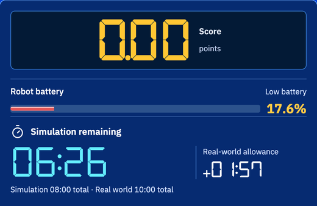
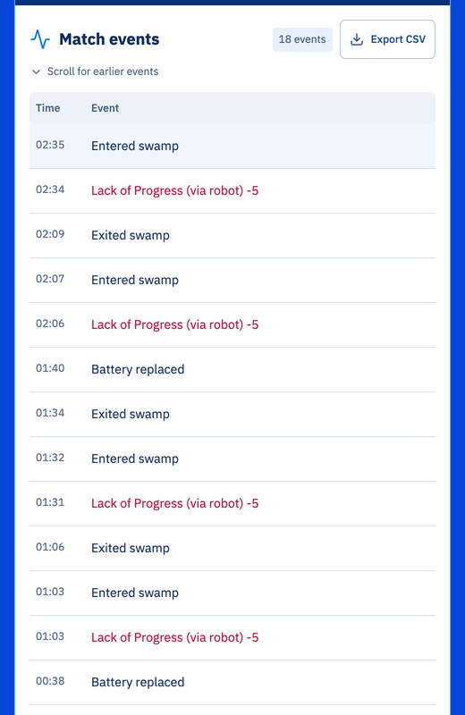

import CodeTabs from '@/components/CodeTabs.astro';

Robotmu memiliki baterai, dan permainan berakhir saat baterai habis. Di halaman ini, kamu mempelajari seberapa cepat baterai berkurang, bagaimana programmu dapat membacanya, dan cara menggantinya.

## Cara kerja baterai \{#how-the-battery-works\}

- Baterai dimulai dari 100% dan **berkurang sesuai kecepatan roda**: makin cepat roda berputar, makin cepat baterai habis. Dengan pengaturan bawaan, robot yang diam tidak memakai baterai.
- Di **rawa**, baterai berkurang lebih cepat.
- Untuk menggantinya, robot harus **diam di atas ubin kontak selama 5 detik**. Setelah itu baterai kembali 100%. Bergerak, atau keluar dari ubin, membuat hitungan 5 detik dimulai lagi.
- Jika baterai mencapai 0%, permainan berakhir dengan `Battery depleted`. Baterai yang sudah habis tidak bisa diganti.

Jendela kontrol menampilkan level baterai di atas pewaktu. Di bawah 20%, ditampilkan "Low battery":

Aturan tidak menyebutkan seberapa cepat baterai berkurang: tim diharapkan mengetahuinya melalui pengujian. Dengan pengaturan bawaan Erebus v27, dua roda pada kecepatan penuh (6,28 rad/s) memakai sekitar 1,25% per detik, jadi robot yang tidak pernah berhenti akan kehabisan baterai dalam waktu kurang dari satu setengah menit, jauh lebih singkat dari 8 menit permainan. Panitia dapat mengubah pengaturan ini, jadi ukurlah di programmu daripada mengandalkan angka ini.

## Membaca level baterai \{#reading-the-battery-level\}

Level baterai adalah nilai terakhir dari [informasi permainan](/docs/programming/communication/#game-information). Fungsi ini memintanya sekali per detik, dan menyimpan nilai terbaru di `battery`:

<CodeTabs file="battery" region="battery" />

## Mengganti baterai \{#replacing-the-battery\}

Ubin kontak berwarna sian, jadi [sensor warna](/docs/programming/sensors/colour-sensor/) dapat melihatnya: merah mendekati 0, sedangkan hijau dan biru tinggi.

Sensor warna robot pemula berada di bagian depan, tetapi Erebus memeriksa posisi **titik tengah** robot. Jadi saat sensor melihat sian, robot melaju sedikit lagi sebelum berhenti. Lalu robot menunggu sampai baterai penuh, yang memakan waktu 5 detik:

<CodeTabs file="battery" region="contact" />

## Program lengkap \{#the-complete-program\}

Program ini berkeliling sambil menghindari dinding, dan mengganti baterainya saat melewati ubin kontak dengan baterai kurang dari 50%. Jalankan di `2027_d1r1.wbt`, tempat sebuah ubin kontak berada di sebelah ubin start.

<CodeTabs file="battery" />

Event pertandingan menampilkan setiap penggantian sebagai `Battery replaced`:

## Perencanaan \{#planning\}
- Ketahui di mana ubin kontak berada: ingat saat menjelajah, seperti yang kamu lakukan untuk peta.
- Sebelum baterai lemah, menuju ubin kontak terdekat yang kamu ketahui. Sisakan cadangan, karena perjalanan bisa lebih lama dari dugaanmu.
- Hindari rawa bila bisa, atau seberangi dengan cepat.
- Berhenti memakan waktu permainan, tetapi tidak memakai baterai dengan pengaturan bawaan, jadi berhenti 1 detik untuk melaporkan penanda dinding tidak menghabiskan baterai.

Berikutnya, pelajari cara mencatat tempat yang sudah dilewati robot di [Menjelajah dan memetakan](/docs/programming/exploring/).
