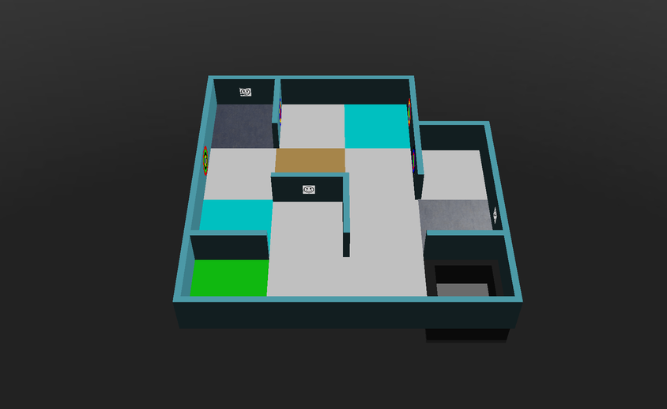

## Gambaran umum {#general-idea}
Pemetaan dinilai sebagai pengali (multiplier) untuk skor permainan. Untuk mendapatkannya, robot harus mengirimkan matriks ke Main Supervisor permainan. Matriks yang dikirim dibandingkan dengan "kunci jawaban" untuk menghasilkan nilai ketepatan (correctness), dan pengalinya adalah:

**pengali bonus pemetaan = ketepatan × 1,2 + 1**

Jadi peta yang sempurna mengalikan skormu dengan 2,2. Untuk mempelajari cara mengirim matriks, lihat [tutorial Mengirim peta](/docs/programming/map-bonus/).

## Aturan pemetaan {#rules-for-mapping}
* Setiap seperempat ubin, setiap tepi, dan setiap titik sudut direpresentasikan oleh satu sel (nilai). Jadi peta berukuran W × H ubin adalah matriks dengan (4 × H + 1) baris dan (4 × W + 1) kolom.
* Setiap elemen di world direpresentasikan sebagai berikut:

| Elemen | Nilai |
|---|---|
| Dinding | `1` |
| Lubang | `2` |
| Rawa | `3` |
| Checkpoint | `4` |
| Ubin awal | `5` |
| Ubin dengan rintangan | `x` |
| Ubin kontak (sian) | `k` |
| Lorong penghubung antara Area 1 dan 2 (biru) | `b` |
| Lorong penghubung antara Area 1 dan 3 (kuning) | `y` |
| Lorong penghubung antara Area 1 dan 4 (hijau) | `g` |
| Lorong penghubung antara Area 2 dan 3 (ungu) | `p` |
| Lorong penghubung antara Area 2 dan 4 (oranye) | `o` |
| Lorong penghubung antara Area 3 dan 4 (merah) | `r` |
| Penanda dinding | Kode yang sesuai (`H`, `S`, `U`, `F`, `P`, `C`, `O`) |
| Semua ubin, tepi, dan titik sudut Area 4, termasuk batasnya | `*` |
| Ubin, tepi, dan titik sudut lainnya | `0` |

* Elemen lantai (`2`, `3`, `4`, `5`, `x`, `k`, dan lorong penghubung) ditulis di sel tengah masing-masing dari keempat seperempat ubin pada ubin tersebut, seperti yang bisa kamu lihat di contoh-contoh di bawah.
* Satu ubin tidak pernah sekaligus menjadi lebih dari satu hal berikut: rawa, lubang, checkpoint, ubin kontak, ubin awal, ubin dengan rintangan, atau lorong penghubung antar-area.
* Untuk dinding melengkung di Area 3, titik sudutnya direpresentasikan dengan `0`.
* Penanda dinding ditulis di sel dinding tempat penanda itu berada. Jika ada beberapa penanda dinding di dinding yang sama, misalnya di kedua sisinya, gabungkan kode-kodenya dalam satu sel, berurutan sesuai posisi absolutnya di peta: pertama dari atas ke bawah, lalu dari kiri ke kanan.
* Penanda palsu tidak boleh dimasukkan ke peta: baik korban palsu maupun target kognitif dengan jumlah yang tidak valid.
* Penanda dinding di ubin penuh (bukan seperempat ubin) bisa berada di mana saja di sepanjang dinding. Penanda itu ditulis di sel seperempat ubin yang paling dekat dengannya, atau di sel tengah jika berada di dekat tengah sisi ubin.
* Peta boleh dikirim dalam rotasi apa pun, asalkan kelipatan 90°. Erebus menyejajarkan matriksmu dengan jawaban menggunakan ubin awal, mencoba setiap orientasi, dan memakai hasil terbaik.

## Cara menghitung ketepatan {#how-correctness-is-calculated}
1. Matriks-matriks disejajarkan berdasarkan ubin awal. Artinya, **petamu harus memuat ubin awal**.
1. Setiap posisi yang nilainya bukan nol di matriks yang dikirim atau di jawaban akan dibandingkan. Jika nilainya cocok, hitungan benar bertambah; jika tidak, hitungan salah bertambah. Posisi yang bernilai `0` di keduanya diabaikan.
1. Ketepatan adalah hitungan benar / (hitungan benar + hitungan salah).

Karena hanya posisi yang berisi sesuatu yang dihitung, menandai sesuatu yang tidak ada menurunkan ketepatanmu sama besarnya dengan melewatkan sesuatu yang ada.

## Kasus khusus yang ambigu {#ambiguous-edge-cases}
Untuk kasus ambigu yang tidak dibahas di bawah ini, silakan hubungi Komite Internasional RoboCupJunior Rescue dan/atau tim pengembang platform.
### Satu dinding dengan dinding siku biasa di satu sisi dan dinding melengkung di sisi lainnya {#one-wall-with-a-normal-right-angled-wall-and-a-curved-wall-on-each-side}
Aturan menyatakan bahwa titik sudut dinding melengkung direpresentasikan dengan nol.
Pengecualiannya adalah kasus berikut, ketika satu sisi dinding berupa sudut siku biasa dan sisi lainnya melengkung. Kasus ini direpresentasikan seolah-olah kedua sisinya adalah dinding biasa.


## Contoh {#examples}
Berikut adalah jawaban benar untuk beberapa world yang disertakan di Erebus v27, yang dihasilkan oleh Erebus sendiri.

World di folder `game/worlds` berubah antar-versi, jadi jika versi Erebus-mu berbeda, jawabanmu mungkin juga berbeda. `MapScorerExample.py` di folder `player_controllers` juga berisi contoh matriks.

### mapping_example_1.wbt {#mapping_example_1wbt}
World kecil dengan satu area. Ubin awalnya adalah ubin hijau di kiri bawah.


```
[
['1', '1', 'S', '1', '1', '1', '1', '1', '1', '1', '1', '1', '1', '0', '0', '0', '0'],
['1', '4', '0', '4', '1', '0', '0', '0', '0', '0', '0', '0', '1', '0', '0', '0', '0'],
['1', '0', '0', '0', 'C', '0', '0', '0', '0', '0', '0', '0', 'O', '0', '0', '0', '0'],
['1', '4', '0', '4', '1', '0', '0', '0', '0', '0', '0', '0', '1', '0', '0', '0', '0'],
['1', '0', '0', '0', '1', '0', '0', '0', '0', '0', '0', '0', '1', '1', '1', '1', '1'],
['1', '0', '0', '0', '0', '3', '0', '3', '0', '0', '0', '0', '1', '0', '0', '0', '1'],
['F', '0', '0', '0', '0', '0', '0', '0', '0', '0', '0', '0', 'P', '0', '0', '0', '1'],
['1', '0', '0', '0', '0', '3', '0', '3', '0', '0', '0', '0', '1', '0', '0', '0', '1'],
['1', '0', '0', '0', '1', '1', 'U', '1', '1', '0', '0', '0', '1', '0', '0', '0', '1'],
['1', '0', '0', '0', '0', '0', '0', '0', '1', '0', '0', '0', '0', '4', '0', '4', '1'],
['1', '0', '0', '0', '0', '0', '0', '0', '1', '0', '0', '0', '0', '0', '0', '0', 'H'],
['1', '0', '0', '0', '0', '0', '0', '0', '1', '0', '0', '0', '0', '4', '0', '4', '1'],
['1', '1', '1', '1', '1', '0', '0', '0', '1', '0', '0', '0', '1', '1', '1', '1', '1'],
['1', '5', '0', '5', '0', '0', '0', '0', '0', '0', '0', '0', '0', '2', '0', '2', '1'],
['1', '0', '0', '0', '0', '0', '0', '0', '0', '0', '0', '0', '0', '0', '0', '0', '1'],
['1', '5', '0', '5', '0', '0', '0', '0', '0', '0', '0', '0', '0', '2', '0', '2', '1'],
['1', '1', '1', '1', '1', '1', 'F', '1', '1', '1', '1', '1', '1', '1', '1', '1', '1']
]
```

### mapping_example_1_cyan_tiles.wbt {#mapping_example_1_cyan_tileswbt}
World yang sama dengan `mapping_example_1.wbt`, dengan dua ubin kontak, yang ditandai dengan `k`.



```
[
['1', '1', 'S', '1', '1', '1', '1', '1', '1', '1', '1', '1', '1', '0', '0', '0', '0'],
['1', '4', '0', '4', '1', '0', '0', '0', '0', 'k', '0', 'k', '1', '0', '0', '0', '0'],
['1', '0', '0', '0', 'C', '0', '0', '0', '0', '0', '0', '0', 'O', '0', '0', '0', '0'],
['1', '4', '0', '4', '1', '0', '0', '0', '0', 'k', '0', 'k', '1', '0', '0', '0', '0'],
['1', '0', '0', '0', '1', '0', '0', '0', '0', '0', '0', '0', '1', '1', '1', '1', '1'],
['1', '0', '0', '0', '0', '3', '0', '3', '0', '0', '0', '0', '1', '0', '0', '0', '1'],
['F', '0', '0', '0', '0', '0', '0', '0', '0', '0', '0', '0', 'P', '0', '0', '0', '1'],
['1', '0', '0', '0', '0', '3', '0', '3', '0', '0', '0', '0', '1', '0', '0', '0', '1'],
['1', '0', '0', '0', '1', '1', 'U', '1', '1', '0', '0', '0', '1', '0', '0', '0', '1'],
['1', 'k', '0', 'k', '0', '0', '0', '0', '1', '0', '0', '0', '0', '4', '0', '4', '1'],
['1', '0', '0', '0', '0', '0', '0', '0', '1', '0', '0', '0', '0', '0', '0', '0', 'H'],
['1', 'k', '0', 'k', '0', '0', '0', '0', '1', '0', '0', '0', '0', '4', '0', '4', '1'],
['1', '1', '1', '1', '1', '0', '0', '0', '1', '0', '0', '0', '1', '1', '1', '1', '1'],
['1', '5', '0', '5', '0', '0', '0', '0', '0', '0', '0', '0', '0', '2', '0', '2', '1'],
['1', '0', '0', '0', '0', '0', '0', '0', '0', '0', '0', '0', '0', '0', '0', '0', '1'],
['1', '5', '0', '5', '0', '0', '0', '0', '0', '0', '0', '0', '0', '2', '0', '2', '1'],
['1', '1', '1', '1', '1', '1', 'F', '1', '1', '1', '1', '1', '1', '1', '1', '1', '1']
]
```

### mapping_example_2.wbt {#mapping_example_2wbt}
World ini punya rintangan, yang ditandai dengan `x`.


```
[
['1', '1', '1', '1', '1', '1', '1', '1', '1', '1', '1', '1', '1', '1', '1', '1', '1', '1', 'F', '1', '1'],
['1', '5', '0', '5', '1', '0', '0', '0', '0', '0', 'O', '0', '0', '0', '0', '0', '0', '0', '0', '0', '1'],
['1', '0', '0', '0', '1', '0', '0', '0', '0', '0', '1', '0', '0', '0', '0', '0', '0', '0', '0', '0', '1'],
['1', '5', '0', '5', '1', '0', '0', '0', '0', '0', '0', '0', '0', '0', '0', '0', '0', '0', '0', '0', '1'],
['1', '0', '0', '0', '1', '0', '1', '0', '0', '0', '0', '0', '0', '0', '1', '1', '1', '0', '0', '0', '1'],
['1', 'b', '0', 'b', '1', '0', 'U', '0', '0', '0', '0', '0', '0', '0', '0', '0', '1', '0', '0', '0', '1'],
['1', '0', '0', '0', '1', 'S', '1', '0', '0', '0', '0', '0', '1', '0', '0', '0', '1', '0', '1', '0', '1'],
['1', 'b', '0', 'b', '1', '0', '0', '0', '0', '0', '0', '0', '1', '0', '0', '0', '1', '0', '1', '0', '1'],
['1', '0', '0', '0', '1', '0', '0', '0', '0', '0', '0', '0', '1', 'H', '1', '1', '1', '0', '1', '0', '1'],
['1', '0', '0', '0', '0', '0', '0', '0', '0', '3', '0', '3', '0', '0', '0', '0', '0', '2', '0', '2', '1'],
['1', '0', '0', '0', '0', '0', '0', '0', '0', '0', '0', '0', '0', '0', '0', '0', '0', '0', '0', '0', '1'],
['1', '0', '0', '0', '0', '0', '0', '0', '0', '3', '0', '3', '0', '0', '0', '0', '0', '2', '0', '2', '1'],
['1', '0', '1', '1', '1', '0', '0', '0', '1', '1', '1', '1', '1', '0', '0', '0', '0', '0', '0', '0', '1'],
['1', '0', '0', '0', '0', '0', '0', '0', '1', '0', '0', '0', '1', '0', '0', '0', '0', '0', '0', '0', '1'],
['1', '0', '0', '0', '0', '0', '0', '0', '1', '0', '0', '0', '1', '1', '1', '0', '0', '0', '1', '0', '1'],
['1', '0', '0', '0', '0', '0', '0', '0', '1', '0', '0', '0', '1', '0', '0', '0', '0', '0', '1', '0', '1'],
['1', '1', '1', '0', '0', '0', '1', 'P', '1', '0', '0', '0', '1', '0', '0', '0', '1', '1', '1', '0', '1'],
['1', '0', '0', '0', '0', '4', '0', '4', '1', '0', '0', '0', '1', '0', '0', '0', '0', 'x', '0', 'x', '1'],
['1', '0', '0', '0', '0', '0', '0', '0', '1', '0', '0', '0', '1', '0', '0', '0', '0', '0', '0', '0', '1'],
['1', '0', '0', '0', '0', '4', '0', '4', '1', '0', '0', '0', 'C', '0', '0', '0', '0', 'x', '0', 'x', '1'],
['1', '1', '1', '1', '1', '1', '1', '1', '1', '0', '0', '0', '1', '1', '1', '1', '1', '1', '1', '1', '1']
]
```

### world1.wbt {#world1wbt}
World ini punya tiga area, dengan lorong penghubung `b` dan `p`.


```
[
['1', '1', '1', '1', '1', '1', '1', '1', '1', '1', '1', '1', '1', '1', '1', '1', '1', '1', '1', '1', '1', '1', '1', '1', '1', '1', '1', '1', '1', '1', '1', '1', '1'],
['1', '5', '0', '5', '0', '0', '0', '0', '0', '0', '0', '0', '0', '2', '0', '2', '1', '0', '0', '0', '1', '0', '0', '0', '0', '0', '0', '0', '0', '3', '0', '3', '1'],
['1', '0', '0', '0', '0', '0', '0', '0', '0', '0', '0', '0', '0', '0', '0', '0', '1', '0', '0', '0', '1', '0', '0', '0', '0', '0', '0', '0', '0', '0', '0', '0', '1'],
['1', '5', '0', '5', '0', '0', '0', '0', '0', '0', '0', '0', '0', '2', '0', '2', '1', '0', '0', '0', '0', '0', '0', '0', '0', '0', '0', '0', '0', '3', '0', '3', '1'],
['1', '0', '0', '0', '0', '0', '0', '0', '1', '0', '0', '0', '0', '0', '0', '0', '1', '0', '0', '0', '0', '0', '0', '0', '0', '0', '0', '0', '0', '0', '0', '0', '1'],
['1', '0', '0', '0', '0', '0', '0', '0', '1', '0', '0', '0', '0', '0', '0', '0', '1', '0', '0', '0', '0', '0', '0', '0', '0', '0', '0', '0', '0', '0', '0', '0', '1'],
['1', '0', '0', '0', '0', '0', '0', '0', '1', '0', '0', '0', '0', '0', '0', '0', '1', '0', '0', '0', '0', '0', '0', '0', '1', '0', '0', '0', '0', '0', '0', '0', 'S'],
['1', '0', '0', '0', '0', '0', '0', '0', '1', '0', '0', '0', '0', '0', '0', '0', '1', '0', '0', '0', '0', '0', '0', '0', '1', '0', '0', '0', '0', '0', '0', '0', '1'],
['1', '0', '0', '0', '1', '1', '1', '1', '1', '0', '0', '0', '1', '1', '1', '1', '1', '0', '0', '0', '0', '0', '0', '0', '1', '1', '1', '0', '0', '0', '0', '0', '1'],
['1', '0', '0', '0', '0', '0', '0', '0', '1', '0', '0', '0', '0', 'b', '0', 'b', '0', '0', '0', '0', '0', '0', '0', '0', '1', '0', '0', '0', '0', '0', '0', '0', '1'],
['F', '0', '0', '0', '0', '0', '0', '0', '1', '0', '0', '0', '0', '0', '0', '0', '0', '0', '0', '0', '0', '0', '0', '0', '1', '0', '0', '0', '0', '0', '0', '0', '1'],
['1', '0', '0', '0', '0', '0', '0', '0', '1', '0', '0', '0', '0', 'b', '0', 'b', '0', '0', '0', '0', '0', '0', '0', '0', '0', '0', '0', '0', '0', '0', '0', '0', '1'],
['1', '0', '0', '0', '0', '0', '0', '0', '1', '0', '0', '0', '1', '1', '1', '1', '1', '1', '1', '0', '0', '0', '0', '0', '1', '0', '0', '0', '1', '0', '0', '0', '1'],
['1', '0', '0', '0', '0', '0', '0', '0', '1', '0', '0', '0', '0', '0', '0', '0', '1', '0', '0', '0', '0', '0', '0', '0', '1', 'p', '0', 'p', '1', '0', '0', '0', '1'],
['1', '0', '0', '0', '0', '0', '0', '0', '1', '0', '0', '0', '0', '0', '0', '0', '1', '0', '0', '0', '0', '0', '0', '0', '1', '0', '0', '0', '1', '0', '0', '0', '1'],
['1', '0', '0', '0', '0', '0', '0', '0', '1', '0', '0', '0', '0', '0', '0', '0', '1', '0', '0', '0', '0', '0', '0', '0', '1', 'p', '0', 'p', '1', '0', '0', '0', '1'],
['1', '0', '0', '0', '0', '0', '0', '0', '1', '0', '0', '0', '0', '0', '0', '0', '1', '1', '1', '1', '1', '1', '1', '1', '1', '0', '0', '0', '1', '1', '1', '1', '1'],
['1', '0', '0', '0', '0', '0', '0', '0', '0', '0', '0', '0', '0', '0', '0', '0', '0', '0', '0', '0', '1', '0', '0', '0', '0', '0', '0', '0', '0', '0', '0', '0', '1'],
['1', '0', '0', '0', '0', '0', '0', '0', '0', '0', '0', '0', '0', '0', '0', '0', '0', '0', '0', '0', '1', '0', '0', '0', '0', '0', '0', '0', '0', '0', '0', '0', '1'],
['1', '0', '0', '0', '0', '0', '0', '0', '0', '0', '0', '0', '0', '0', '0', '0', '0', '0', '0', '0', '1', '0', '0', '0', '0', '0', '0', '0', '0', '0', '0', '0', '1'],
['1', '0', '0', '0', '0', '0', '0', '0', '1', '0', '0', '0', '1', '0', '0', '0', '0', '0', '0', '0', '1', '0', '0', '0', '0', '0', '1', '0', '0', '0', '0', '0', '1'],
['1', '0', '0', '0', '0', '0', '0', '0', '1', '0', '0', '0', '1', '0', '0', '0', '0', '0', '0', '0', '1', '0', '0', '0', '0', '0', '1', '0', '0', '0', '0', '0', '1'],
['1', '0', '0', '0', '0', '0', '0', '0', '1', '0', '0', '0', '1', '0', '0', '0', '0', '0', '0', '0', 'U', '0', '0', '0', '0', '0', '1', '1', '1', '0', '0', '0', '1'],
['1', '0', '0', '0', '0', '0', '0', '0', '1', '0', '0', '0', '1', '0', '0', '0', '0', '0', '0', '0', '1', '0', '0', '0', '0', '0', '0', '0', '0', '0', '0', '0', '1'],
['1', '0', '0', '0', '0', '0', '0', '0', '1', '1', 'H', '1', '1', '0', '0', '0', '0', '0', '0', '0', '1', '0', '0', '0', '0', '0', '0', '0', '1', '0', '0', '0', '1'],
['1', '0', '0', '0', '0', '0', '0', '0', '0', '0', '0', '0', '1', '0', '0', '0', '0', '0', '0', '0', '1', '0', '0', '0', '0', '0', '0', '0', '1', '0', '0', '0', '1'],
['1', '0', '0', '0', '0', '0', '0', '0', '0', '0', '0', '0', '1', '0', '0', '0', '0', '0', '0', '0', '1', '0', '0', '0', '0', '1', '1', '1', '0', '0', '0', '0', '1'],
['P', '0', '0', '0', '0', '0', '0', '0', '0', '0', '0', '0', '1', '0', '0', '0', '0', '0', '0', '0', '1', '0', '0', '0', '1', '0', '0', '0', '0', '0', '0', '0', '1'],
['1', '0', '0', '0', '0', '0', '0', '0', '0', '0', '0', '0', '1', '0', '0', '0', '0', '0', '0', '0', '1', '0', '0', '0', '1', '0', '0', '0', '0', '0', '0', '0', '1'],
['1', '0', '0', '0', '0', '0', '0', '0', '0', '0', '0', '0', '0', '0', '0', '0', '0', '4', '0', '4', '1', '0', '0', '0', '0', '0', '0', '0', '0', '0', '0', '0', '1'],
['1', '0', '0', '0', '0', '0', '0', '0', '0', '0', '0', '0', '0', '0', '0', '0', '0', '0', '0', '0', '1', '0', '0', '0', '0', '0', '0', '0', '0', '0', '0', '0', '1'],
['1', '0', '0', '0', '0', '0', '0', '0', '0', '0', '0', '0', '0', '0', '0', '0', '0', '4', '0', '4', '1', '0', '0', '0', '0', '0', '0', '0', '0', '0', '0', '0', '1'],
['1', '1', '1', '1', '1', '1', '1', '1', '1', '1', '1', '1', '1', '1', '1', '1', '1', '1', '1', '1', '1', '1', '1', '1', '1', '1', '1', '1', '1', '1', '1', '1', '1']
]
```

### world2.wbt {#world2wbt}
World ini mencakup Area 4, yang diisi dengan `*`, serta lorong penghubung `g` dan `r`.


```
[
['1', '1', '1', '1', '1', '1', '1', '1', '1', '1', '1', '1', '1', '1', '1', '1', '1', '1', '1', '1', '1', '1', 'P', '1', '1', '1', '1', '1', '1', '1', '1', '1', '1', '1', '1', '1', '1'],
['1', '4', '0', '4', '0', '0', '0', '0', '0', '0', '0', '0', '1', '0', '0', '0', '0', '2', '0', '2', '1', '0', '0', '0', '0', '0', '0', '0', '0', '3', '0', '3', '1', '2', '0', '2', '1'],
['1', '0', '0', '0', '0', '0', '0', '0', '1', '0', '0', '0', '1', '0', '0', '0', '0', '0', '0', '0', '1', '0', '0', '0', '0', '0', '0', '0', '0', '0', '0', '0', '1', '0', '0', '0', '1'],
['1', '4', '0', '4', '0', '0', '0', '0', 'C', '0', '0', '0', '0', '0', '0', '0', '0', '2', '0', '2', '1', '0', '0', '0', '0', '0', '0', '0', '0', '3', '0', '3', '1', '2', '0', '2', '1'],
['1', '1', '1', '1', '1', '0', '0', '0', '1', '0', '0', '0', '0', '0', '0', '0', '1', '1', '1', '1', '1', '0', '0', '0', '1', '1', '1', '1', '1', '0', '0', '0', '1', '0', '0', '0', '1'],
['1', '0', '1', '0', '0', '0', '0', '0', '0', '0', '0', '0', '0', '0', '0', '0', '1', 'b', '0', 'b', '0', '0', '0', '0', '0', '0', '0', '0', '1', '0', '0', '0', '0', '0', '0', '0', '1'],
['1', 'U', '1', '0', '0', '0', '0', '0', '0', '0', '0', '0', '0', '0', '1', '1', '1', '0', '0', '0', '0', '0', '0', '0', '0', '0', '0', '0', 'O', '0', '0', '0', '0', '0', '0', '0', '1'],
['1', '0', '0', '0', '0', '0', '0', '0', '0', '0', '0', '0', '0', '0', '0', '0', '1', 'b', '0', 'b', '0', '0', '0', '0', '0', '0', '0', '0', '1', '0', '0', '0', '0', '0', '0', '0', '1'],
['1', '0', '0', '0', '0', '0', '0', '0', '1', '0', '0', '0', '0', '0', '0', '0', '1', '0', '0', '0', '1', '1', '1', '1', '1', '1', '1', '1', '1', '0', '0', '0', '1', '0', '0', '0', '1'],
['1', '0', '0', '0', '0', '0', '0', '0', '1', 'p', '0', 'p', '0', '0', '0', '0', '0', '0', '0', '0', '0', '4', '0', '4', '1', '0', '0', '0', '0', '0', '0', '0', '1', '5', '0', '5', '1'],
['1', '0', '0', '0', '1', '0', '0', '0', '1', '0', '0', '0', '1', '0', '0', '0', '0', '0', '0', '0', '0', '0', '0', '0', 'H', '0', '0', '0', '0', '0', '0', '0', '1', '0', '0', '0', '1'],
['1', '0', '0', '0', '1', '0', '0', '0', '1', 'p', '0', 'p', '1', '0', '0', '0', '0', '0', '0', '0', '0', '4', '0', '4', '1', '0', '0', '0', '0', '0', '0', '0', '1', '5', '0', '5', '1'],
['0', '1', '1', 'S', '1', '1', '1', '1', '1', '0', '0', '0', '0', '1', '1', '1', '*', '*', '*', '*', '*', '*', '*', '*', '*', '*', '*', '*', '*', '0', '0', '0', '1', '0', '0', '0', '1'],
['1', '0', '0', '0', '0', '0', '0', '0', '1', '0', '0', '0', '1', '0', '0', '0', '*', '*', '*', '*', '*', '*', '*', '*', '*', '*', '*', '*', '*', 'g', '0', 'g', '0', '0', '0', '0', '1'],
['1', '0', '0', '0', '0', '1', '1', '1', '0', '0', '0', '0', '1', '0', '0', '0', '*', '*', '*', '*', '*', '*', '*', '*', '*', '*', '*', '*', '*', '0', '0', '0', '0', '0', '0', '0', '1'],
['1', '0', '0', '0', '1', '0', '0', '0', '0', '0', '0', '0', '1', '0', '0', '0', '*', '*', '*', '*', '*', '*', '*', '*', '*', '*', '*', '*', '*', 'g', '0', 'g', '0', '0', '0', '0', '1'],
['1', '0', '0', '0', '1', '0', '0', '0', '0', '0', '1', '1', '1', '0', '0', '0', '*', '*', '*', '*', '*', '*', '*', '*', '*', '*', '*', '*', '*', '*', '*', '*', '*', '*', '*', '*', '*'],
['1', '4', '0', '4', '0', '0', '0', '0', '0', '0', '0', '0', '0', '3', '0', '3', '0', '0', '0', '0', '*', '*', '*', '*', '*', '*', '*', '*', '*', '*', '*', '*', '*', '*', '*', '*', '*'],
['1', '0', '0', '0', '0', '0', '0', '0', '0', '0', '0', '0', '0', '0', '0', '0', '0', '0', '0', '0', '*', '*', '*', '*', '*', '*', '*', '*', '*', '*', '*', '*', '*', '*', '*', '*', '*'],
['1', '4', '0', '4', '0', '0', '0', '0', '0', '0', '0', '0', '0', '3', '0', '3', '0', '0', '0', '0', '*', '*', '*', '*', '*', '*', '*', '*', '*', '*', '*', '*', '*', '*', '*', '*', '*'],
['1', '0', '0', '0', '0', '0', '0', '0', '0', '0', '0', '0', '1', '0', '0', '0', '0', '0', '0', '0', '*', '*', '*', '*', '*', '*', '*', '*', '*', '*', '*', '*', '*', '*', '*', '*', '*'],
['1', '0', '0', '0', '0', '0', '0', '0', '0', '2', '0', '2', '1', '0', '0', '0', '0', 'r', '0', 'r', '*', '*', '*', '*', '*', '*', '*', '*', '*', '*', '*', '*', '*', '*', '*', '*', '*'],
['1', '0', '0', '0', '0', '0', '1', '0', '0', '0', '0', '0', '1', '0', '0', '0', '0', '0', '0', '0', '*', '*', '*', '*', '*', '*', '*', '*', '*', '*', '*', '*', '*', '*', '*', '*', '*'],
['1', '0', '0', '0', '0', '0', '1', '0', '0', '2', '0', '2', '1', '0', '0', '0', '0', 'r', '0', 'r', '*', '*', '*', '*', '*', '*', '*', '*', '*', '*', '*', '*', '*', '*', '*', '*', '*'],
['1', '1', '1', '1', '1', '1', '1', '1', '1', '1', '1', '1', '0', '1', '1', '1', '1', '1', '1', '1', '*', '*', '*', '*', '*', '*', '*', '*', '*', '*', '*', '*', '*', '*', '*', '*', '*']
]
```
