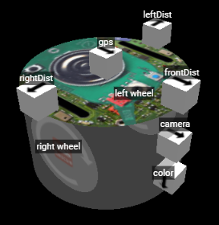

import CodeTabs from '@/components/CodeTabs.astro';
import mazePy from '../../../../docs/programming/navigate-the-maze/maze.py?url';
import mazeC from '../../../../docs/programming/navigate-the-maze/maze.c?url';

このチュートリアルでは、完全なプログラムを一歩ずつ作っていきます。ロボットは壁や穴を避けながら迷路を走り回り、壁のトークンらしきものを見つけたら報告します。これは[初めての実行](/docs/getting-started/)で動かしたプログラムです。

[スターターロボット](/docs/robot/)と、[移動](/docs/programming/movement/)と[センサー](/docs/programming/sensors/)で学んだことを使います。

完全なプログラム: <a href={mazePy} download="maze.py">maze.py</a> · <a href={mazeC} download="maze.cpp">maze.cpp</a>

## フィールド \{#the-field\}
`world1.wbt` で実行しましょう。このワールドは次のようになっています。

## 一歩ずつ \{#step-by-step\}

### 1. 準備 \{#1-setup\}
まず、プログラムはロボットを作成し、車輪のモーターを取得して、制限なく回るようにします。`speeds` は各車輪の速度を保持し、プログラムの残りの部分がこれを変更します。`reported` は、ロボットがすでにトークンを報告した場所を記憶します。

<CodeTabs file="maze" region="setup" />

### 2. センサー \{#2-sensors\}
次に、スターターロボットのセンサーを取得して有効にします。

<CodeTabs file="maze" region="sensors" />

### 3. 動き \{#3-moves\}
これらの関数は、速度を変えて曲がったりその場で回転したりします。`delay` は、指定したミリ秒のあいだロボットに同じ動作を続けさせ、`getBrightness` はカラーセンサーを 0（黒）から 255（白）までの 1 つの値として読み取ります。

<CodeTabs file="maze" region="moves" />

### 4. トークンを見つける \{#4-seeing-a-token\}
この関数は、カメラ画像の中から壁のトークンを探します。トークンは暗い壁の上の明るい四角形なので、ほぼ正方形で、画像の端（ふつうは床が写る部分）に接していない明るい形を探します。

<CodeTabs file="maze" region="detect" />

これは簡単な出発点です。記号を見分けることはできず、コグニティブターゲットもうまく見えません。[壁のトークン](/docs/programming/wall-tokens/)のチュートリアルで、よりよい方法を紹介しています。

### 5. 報告する \{#5-reporting\}
トークンで得点するには、ロボットは 1 秒より長く停止してから、位置とトークンの種類を送る必要があります。各トークンで得点できるのは 1 回だけで、もう一度報告すると 5 点の減点になるので、プログラムは報告した場所を記憶します。これらのメッセージは[通信](/docs/programming/communication/)で説明しています。

<CodeTabs file="maze" region="report" />

### 6. メインループ \{#6-the-main-loop\}
最後に、メインループですべてを組み合わせます。各ステップで、全速力で走り始め、壁から離れるように曲がり、穴からは引き返し、正面の壁に近づいたらカメラに見えたものを報告します。

<CodeTabs file="maze" region="loop" />

## どのくらいうまく動きますか？ \{#how-well-does-it-do\}
このロボットはあてもなく走り回ります。どこを通ったかを覚えておらず、すべての被災者の種類を推測で決めています。ときどき動けなくなり、20 秒後にゲームによってチェックポイントに戻されます。最初のプログラムとしてはこれで十分です。

## 試してみよう \{#try-it\}
- 自分のロボットに最適な速度と距離を見つけましょう。
- 片側の壁に沿って進んでみましょう。横のセンサーの距離を一定に保ち、前のセンサーが壁を見つけたら曲がります。
- 壁までの近さに応じて速度を変えてみましょう。

次は、[通信](/docs/programming/communication/)で得点のしかたを学びましょう。
