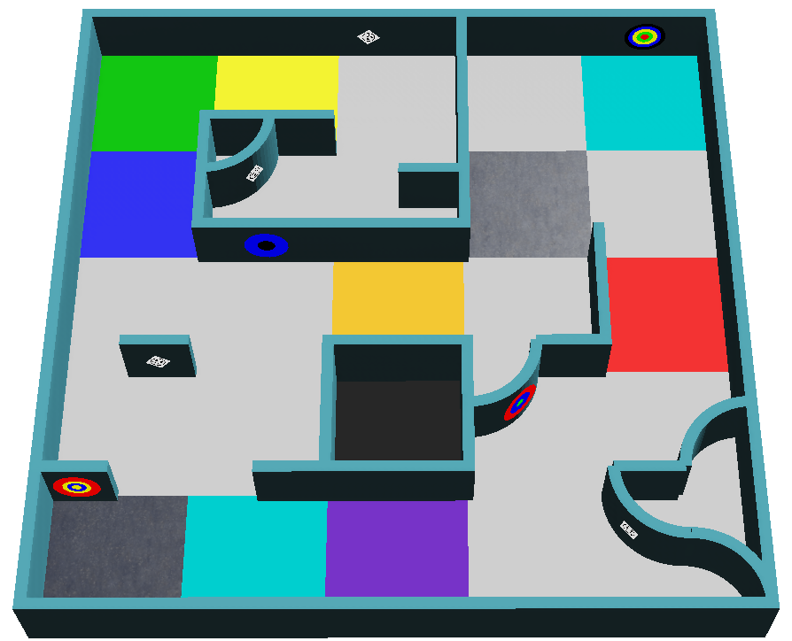

:::note
このページは、これから始める人のための概要です。公式のルールは [RoboCupJunior Rescue Simulation Rules 2027](https://junior.robocup.org/wp-content/uploads/2026/09/RCJRescueSimulation2027-draft.pdf) だけです。この概要は 2026-10-24 に最終更新された版に基づいています。このページと公式ルールが異なる場合は、公式ルールが適用されます。

ルールの修正や補足（Clarifications）は、[RoboCupJunior の公式フォーラム](https://junior.forum.robocup.org/)に投稿されます。これを確認するのは各チームの責任です。
:::

## 1 分でわかるゲーム {#the-game-in-one-minute}
ロボットは、未知の迷路にひとりで送り込まれます。あなたの助けなしに、8 分間で次のことをしなければなりません。

1. 動けなくなったり穴に落ちたりせずに、迷路を **探索する**。
2. 壁にある被災者やコグニティブターゲットなどの **壁のトークンを見つけ**、それぞれの種類を報告する。
3. **バッテリーを切らさない**: バッテリーが切れる前に、コンタクトタイルで止まって交換します。
4. 迷路の**地図を作り**、最後に地図を送ります。
5. スタートした場所に**戻ります**。

以下では、この 5 つの仕事を詳しく説明します。今すべてを覚える必要はありません。それぞれの部分をプログラムするときに、ここに戻ってきてください。

## ミッションと目的 {#mission-and-objective}

ロボットは、トラブルを避けながら、未知の環境を自律的に探索する必要があります。主なミッションは 3 つです。

- 動けなくならずに、複雑な迷路を進む
- 環境の地図を正確に作る
- 壁のトークン（スマイリーの被災者とコグニティブターゲット）を見つけて識別する

## フィールド {#the-field}
フィールドは最大 4 つのエリアでできています。エリア 1 は必ずフィールドにあり、エリア 2 から 4 は運営者が省くこともあります。エリアの間の通路は、標準のタイル 1 枚分の幅です。タイルはフィールドを生成するための概念で、物理的な構造物ではありません。

- タイルは **12 cm × 12 cm** です。エリア 2 と 3 では、各タイルが 6 cm × 6 cm の 4 つの **4 分の 1 タイル**（quarter tiles）に分かれています。
- 壁は **厚さ 1 cm、高さ 6 cm** です。
- 通り道の幅は少なくともロボットの幅以上あり、より広い空間につながっていることもあります。

| エリア | 壁 | 備考 |
|---|---|---|
| エリア 1 | 各タイルの辺に置ける | スタートタイルはこのエリアにあります |
| エリア 2 | 各 4 分の 1 タイルの辺に置ける | |
| エリア 3 | 各 4 分の 1 タイルの辺に置ける | 90° の角を 4 分の 1 円に丸められます |
| エリア 4（任意） | タイルにもとづかず、壁と障害物は自由に配置される | 箱などの物体があることがあり、斜めの移動が必要になることもあります |

### エリア間の通路 {#passages-between-areas}
通路（Passages）は 2 辺に壁がある 1 枚のタイルで、入口と出口がはっきりしています。床の色で、どのエリアをつないでいるかがわかります。

通路の壁には、壁のトークンは置かれません。

### リニアタイルとフローティングタイル {#linear-and-floating-tiles}
いちばん左またはいちばん右の壁に沿って進み続けるとスタートタイルにたどり着けるタイルが **リニアタイル**（linear tiles）です。それ以外はすべて **フローティングタイル**（floating tiles）です。フローティングタイルにあるトークンは、より高い得点になります。ここでは 4 分の 1 タイルは考慮せず、穴は仮想の壁として数えます。

### チェックポイント {#checkpoints}
銀色のタイルがチェックポイント（Checkpoint）で、フィールドのどこにでもあり得ます。エリア 4 では、通路のすぐ後にチェックポイントがあります。競技進行停止の後、ロボットは最後に訪れたチェックポイントから再スタートします。

## 沼地、障害物、穴 {#swamps-obstacles-and-holes}

* **沼地**（茶色のタイル）の上では、モーターに負荷がかかるため、バッテリーが速く減ります。ゲーム時間には影響しません。
* **障害物**（Obstacles）は床に固定されていることがあり、形や色は自由で、通り道の幅に影響します。エリア 1 〜 3 では、障害物の中心は必ずタイルの上にあり、タイルの境界の上にはありません。また、1 つのタイルに障害物は最大 1 つです。
* **穴**は、床に開口部があるタイルです。縁は黒く、隣のタイルから 1.5 cm のところにあります。ロボットが穴に落ちると、競技進行停止になります。

次のうち 2 つ以上を同時に兼ねるタイルはありません: 沼地、穴、チェックポイント、コンタクトタイル、スタートタイル、障害物のあるタイル、エリア間の通路。

## コンタクトタイル {#contact-tiles}
コンタクトタイルは**シアン**のタイルで、ゲーム中にここでロボットのバッテリーを交換できます。バッテリーの交換中、ロボットはタイルの上で止まっていなければなりません。[バッテリー](#the-battery)を参照してください。

## 壁のトークン {#wall-tokens}
壁のトークンには、スマイリーの被災者とコグニティブターゲットの 2 種類があります。どちらも曲面を含むあらゆる壁に置かれますが、エリア間の通路の壁には置かれません。スマイリーの被災者は、0 度から 360 度まで任意の角度に回転していることもあります。

### スマイリーの被災者 {#smiley-victims}
スマイリーの被災者は、黒で印刷されたスマイリーの絵文字の 2 cm × 2 cm の画像です。表情が被災者の健康状態を表し、コードは報告して地図に書く文字です。

| 状態 | 表情 | コード |
|---|---|---|
| 負傷 | 悲しい顔 | `H` |
| 安定 | 普通の顔 | `S` |
| 無傷 | 笑顔 | `U` |

### 偽の被災者 {#fake-victims}
同じ顔を表示していても、絵文字が**立体的**な壁のトークンがあります。これは偽物で、スーパーバイザーに報告したり地図に含めたりしてはいけません。ルールでは、この奥行きはロボットカスタマイザーで使えるセンサーのどれかで検出できるとされています。

### コグニティブターゲット {#cognitive-targets}
コグニティブターゲット（Cognitive targets）は危険物（hazmat）を表します。直径 5 cm の円で、直径 1、2、3、4、5 cm の 5 つの同心円の部分でできています。各色には値があります。

| 黒 | 赤 | 黄 | 緑 | 青 |
|---|---|---|---|---|
| -2 | -1 | 0 | 1 | 2 |

5 つの部分すべての値を足すと種類がわかります。合計が下の表にない場合、そのターゲットは偽物の壁のトークンで、報告も地図への記入もしてはいけません。

| 合計 | 危険物 | コード |
|---|---|---|
| 0 | Flammable Gas（可燃性ガス） | `F` |
| 1 | Poison（毒物） | `P` |
| 2 | Corrosive（腐食性物質） | `C` |
| 3 | Organic Peroxide（有機過酸化物） | `O` |

隣り合う同じ色のリングは **まとめません**。色が繰り返されていても、必ず 5 つすべてを数えます。

左のターゲットは、中心から外側に向かって黄、青、赤、黒、緑です。0 + 2 - 1 - 2 + 1 = 0 なので、Flammable Gas（`F`）です。右のターゲットは青、黄、黒、黒、黒です。2 + 0 - 2 - 2 - 2 = -4 なので、偽物です。

カメラでターゲットを読み取る方法は、[壁のトークンのチュートリアル](/docs/programming/wall-tokens/)で説明しています。

## ロボット {#the-robot}
- チームは運営者が提供するロボットモデルを使い、[Robot Customizer](https://robot.erebus.rcj.cloud/) で予算 **3000** の範囲内でカスタマイズできます。[ロボット](/docs/robot/)を参照してください。
- ロボットは、GPS、カラーセンサー、距離センサー、RGB カメラ、LiDAR、ジャイロスコープ、加速度センサーを使えます。
- シミュレーションのセンサーには現実的なノイズがあります。プログラムはノイズに強くなければならず、競技でも運営者はノイズのレベルを変更しません。

### バッテリー {#the-battery}
ロボットにはバッテリーがあり、モーターの速さに応じて減っていきます。バッテリー残量は、コントロールウィンドウのタイマーの上に表示されます。ルールには正確な減り方は書かれていません。チームはテストしてその振る舞いを調べることが求められています。

- バッテリーを交換するには、ロボットは**コンタクトタイルの上で、シミュレーション時間で 5 秒間止まっていなければなりません**。するとバッテリーは満タンに戻ります。
- 沼地では、バッテリーが速く減ります。
- バッテリーが切れると、ゲームは終わります。

[バッテリー](/docs/programming/battery/)のチュートリアルで、プログラムからバッテリー残量を読み取り、交換する方法を説明しています。
- ロボットは自律的でなければなりません。各チームがフィールドに置けるロボットは 1 台です。
- 事前マッピングは禁止されています。これはフィールドと壁のトークンの位置の両方が対象で、既知の位置にもとづいてあらかじめ決めた動きも含みます。違反すると、そのラウンドは即座に失格になります。

## ゲームのプレイ {#playing-a-game}
- 1 ゲームは **シミュレーション時間で 8 分** です。もう 1 つのタイマーが実時間で動き、上限は **10 分** です。どちらかのタイマーが切れるとゲームは終了します。
- ロボットの中心がタイルの中にあるとき、そのタイルは訪問済みになります。これはスーパーバイザーが判定します。
- バッテリーが切れたとき、ロボットが終了コマンドを送ったとき、またはチームキャプテンがゲームの終了を申し出たとき（ゲームの実施方法によります）にも、ゲームは終わります。
- 競技用のワールドはゲームの直前に公開されます。運営者が発表する各ラウンドの公式の締め切りの後は、プログラムを変更できません。

### 競技進行停止 {#lack-of-progress}
競技進行停止（Lack of Progress, LoP）は、次の場合に発生します。

- ロボットが穴に落ちた。
- ロボットが 20 秒以上同じ場所にとどまった（自動で宣言されます）。
- 審判が、ロボットは止まってはいないものの、同じ動きを繰り返して抜け出せなくなっていると判断した。
- ロボットが自律的に宣言した。
- それ以外の場合、チームのキャプテンが要求でき、最終的な判断は審判が行います。ゲームの実行方法によっては、これは当てはまらないことがあります。

ロボットは、最後に訪れたチェックポイントに戻されます。チェックポイントに一度も到達していなければ、スタートタイルに戻されます。向きは選べません。Erebus はロボットに文字 `L` も送るので、プログラムはそれに[反応](/docs/programming/communication/#lack-of-progress)できます。

## 得点 {#scoring}
得点計算は Erebus が自動で行います。得点は重複しません。たとえば、各チェックポイントで得点できるのは最初の 1 回だけです。

壁のトークンを識別するには、ロボットは **1 秒以上** 停止してから、スーパーバイザーに[種類と位置を送る](/docs/programming/communication/#scoring-wall-tokens)必要があります。ロボットの中心は、トークンからタイル半分以内になければなりません。

| 項目 | 点数 |
|---|---|
| エリア 1 〜 3 のリニアタイルでの壁のトークンの識別（TI） | スマイリーの被災者: 5、コグニティブターゲット: 10 |
| エリア 1 〜 3 のフローティングタイルでの壁のトークンの識別（TI）、およびエリア 4 のすべてのトークン | スマイリーの被災者: 15、コグニティブターゲット: 30 |
| 正しい種類（TT）、TI に加算 | スマイリーの被災者: 10、コグニティブターゲット: 20 |
| チェックポイントの通過（CN） | 10 |
| 壁のトークンの誤識別（TMI） | -5 |
| 競技進行停止（LoP） | -5 |

合計スコアが 0 を下回ることはありません。誤識別とは、トークンからタイル半分より離れた位置を報告すること、トークンがない場所でトークンを報告すること、スマイリーの被災者をコグニティブターゲットとして（またはその逆に）報告することです。偽のトークンを報告した場合は、2 番目の「トークンがない場所での報告」に当たります。

**エリア倍率（Area multipliers, AM）**: TI、TT、CN には、エリア 1、2、3、4 でそれぞれ 1、1.25、1.5、2 が掛けられます。TMI と LoP には掛けられません。

**脱出ボーナス（Exit bonus, EB）**: ロボットが壁のトークンを 1 つ以上識別し、スタートタイルに戻って終了コマンドを送ると、スコアが 10% 増えます。

**地図ボーナス（Mapping bonus, MB）**: ロボットは迷路の地図を提出できます。倍率は 正確さ × 1.2 + 1 なので、完璧な地図ならスコアは 2.2 倍になります。[地図作成](/docs/rules/mapping/)を参照してください。

ゲームのフィールドスコアは、次のように計算されます。

たとえば、次の結果の走行は 2825.35 点になります。

## 競技 {#the-competition}
準備のしかた、提出する書類、競技の構成、最終スコアについては、[競技の準備](/docs/competition/)を参照してください。

## 次へ {#next}
ロボットが何をしなければならないかがわかったら、[ロボットを用意しましょう](/docs/robot/)。
