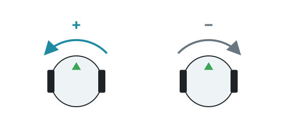

import CodeTabs from '@/components/CodeTabs.astro';

## 자이로스코프 \{#gyroscope\}

자이로스코프는 각 축을 중심으로 한 로봇의 회전 속도를 **초당 라디안** 단위로 반환해요. 스타터 로봇에서는 이름이 `gyro`예요.

`getValues()`는 `[x, y, z]`를 반환해요. **Y축이 수직**이므로 `getValues()[1]`이 로봇의 회전 속도예요. 왼쪽으로 돌 때 양수가 돼요.

:::caution
이 내용은 스타터 로봇의 자이로 기준이에요. 축은 자이로의 회전을 따르므로, 직접 만든 로봇에서 자이로를 회전시켰다면 로봇이 돌 때 어떤 값이 바뀌는지 확인하세요.
:::

## 예제: 90도 회전하기 \{#example-turning-90-degrees\}

회전 속도에 타임 스텝을 곱해서 더해 나가면 회전한 각도를 구할 수 있어요. 속도에 의존하지 않기 때문에 회전을 시간으로 제어하는 것보다 더 믿을 만해요.

<CodeTabs file="turn" />

스타터 로봇으로 테스트했을 때, 이렇게 계산한 각도는 실제 회전과 0.01 라디안 이내로 일치했어요. 작은 오차도 게임 동안 쌓이므로, 기회가 있을 때마다 방향을 보정하세요. 예를 들어 벽에 맞춰 정렬할 수 있어요.

## 가속도계 \{#accelerometer\}

가속도계는 각 축 방향의 가속도를 m/s² 단위로 반환해요. 스타터 로봇에서는 이름이 `accelerometer`예요. 정지해 있을 때 `getValues()[1]`은 약 9.8인데, 이것이 중력이에요.

## 관성 측정 장치 \{#inertial-unit\}

관성 측정 장치(inertial unit)는 스타터 로봇에 없어요. [Robot Customizer](/docs/robot/customizer/)로 추가할 수 있으며, 기본 이름은 `inertial_unit`이에요. 회전 속도를 더해 나갈 필요 없이 `getRollPitchYaw()`로 방향을 바로 알려 줘요. [Webots 레퍼런스](https://cyberbotics.com/doc/reference/inertialunit?version=R2023b)를 참고하세요.
