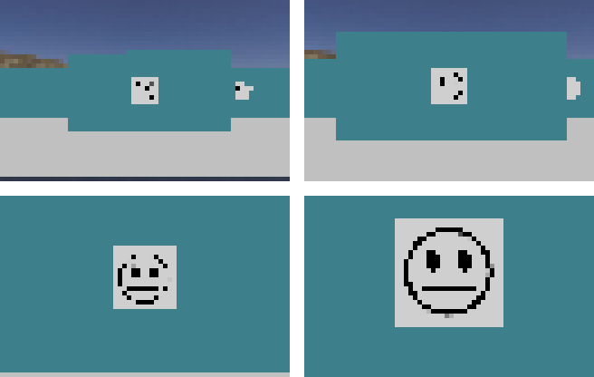
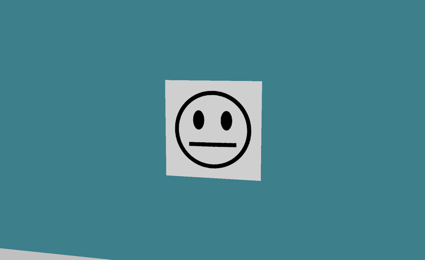
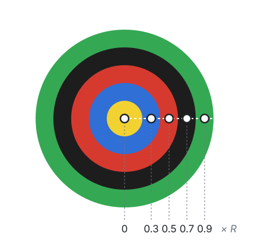
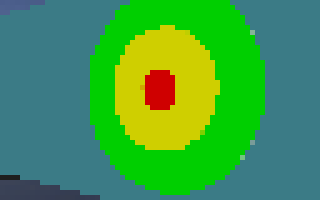
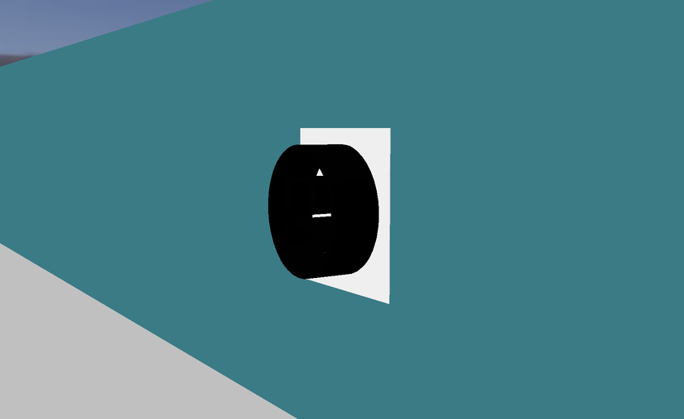

import CodeTabs from '@/components/CodeTabs.astro';

## 로봇이 해야 할 일 \{#what-the-robot-has-to-do\}
벽 토큰(Wall tokens)은 점수의 대부분을 차지하고, 잘못 보고할 때마다 5점을 잃어요. 그래서 찾은 토큰마다 다음 중 무엇인지 판단해야 해요.

| 토큰의 종류 | 할 일 |
|---|---|
| 스마일리 피해자(슬픈 얼굴, 무표정, 웃는 얼굴) | `H`, `S`, `U`를 보고해요 |
| 가짜 피해자(같은 얼굴이지만 입체적) | 보고하지 말고, 지도에도 넣지 마세요 |
| 합이 0~3인 인지 표적(Cognitive target) | `F`, `P`, `C` 또는 `O`를 보고해요 |
| 합이 그 외인 인지 표적 | 가짜예요. 보고하지 말고, 지도에서도 빼요 |

정확한 정의는 [규칙](/docs/rules/#wall-tokens)을, 보고를 보내는 방법은 [통신](/docs/programming/communication/#scoring-wall-tokens)을 참고하세요.

## 카메라에 보이는 것 \{#what-the-camera-sees\}
스타터 로봇의 카메라는 64 × 40 픽셀이에요. 이 해상도에서는 로봇이 가까이 가기 전까지 토큰이 몇 픽셀밖에 되지 않으므로, 멀리서 후보를 찾은 다음 가까이 가서 읽는 것이 좋아요. 보고하려면 로봇이 토큰에서 반 타일 이내에 있어야 하고, 커스텀 카메라는 비용을 들여 해상도를 높일 수 있다는 점을 기억하세요.

스마일리 피해자는 흰 사각형 위의 검은 얼굴이고, 어떤 각도로든 회전되어 있을 수 있으므로, 인식 방법이 토큰의 방향에 좌우되면 안 돼요. 세 얼굴은 입 모양이 달라요. 슬픈 얼굴(`H`)은 아래로 휘어 있고, 무표정(`S`)은 곧고, 웃는 얼굴(`U`)은 위로 휘어 있어요.

## 인지 표적 읽기 \{#reading-a-cognitive-target\}
인지 표적은 다섯 개의 동심원 부분으로 이루어져 있어서 모양을 인식할 필요가 없어요. 중심과 바깥 반지름을 찾으면 각 부분의 가운데 색을 샘플링할 수 있어요. 각 부분의 반지름은 0.5, 1, 1.5, 2, 2.5 cm이므로, 가운데 지점은 바깥 반지름의 0, 0.3, 0.5, 0.7, 0.9 위치에 있어요.

이 함수는 Python에서 OpenCV로 그 작업을 해요. 중심과 반지름을 찾으려면 예를 들어 [미로 탐색](/docs/programming/navigate-the-maze/)에서처럼 표적의 윤곽선을 사용할 수 있어요.

<CodeTabs file="readRings" />

실제로 실행할 때는 표적을 비스듬히 보게 될 수도 있고, 그러면 타원처럼 보여요. 표적 정면으로 가거나, 이상해 보이는 색을 경고 신호로 사용하거나, 여러 프레임을 읽으면 결과를 더 믿을 수 있어요.

## 종류 계산하기 \{#calculating-the-type\}
다섯 가지 색을 얻으면, 보고할 코드는 그 합으로 정해져요. 이웃한 색이 같더라도 다섯 부분은 항상 각각 계산해요.

<CodeTabs file="targetCode" />

예를 들어 `['Y', 'B', 'R', 'K', 'G']`는 합이 0이므로 `F`이고, `['B', 'Y', 'K', 'K', 'K']`는 합이 -4이므로 가짜예요.

## 가짜 피해자 감지하기 \{#detecting-fake-victims\}
가짜 피해자는 진짜와 같은 얼굴을 보여 주지만, 이모지가 입체적이에요. 정면에서는 카메라만으로 구별하지 못할 수도 있어요.

규칙에 따르면 깊이는 Robot Customizer에서 사용할 수 있는 센서 중 하나로 감지할 수 있어요. 시도해 볼 만한 아이디어는 다음과 같아요.

- 라이다나 거리 센서로 토큰을 가로지르며 측정한 거리를 비교해서 높이 차이를 찾아요.
- 토큰을 비스듬히 보기. 튀어나온 부분 때문에 얼굴의 모양이 달라 보여요.

`world3.wbt`, `world4.wbt`와 네 개의 `2027_` 월드에는 가짜 피해자가 들어 있고, [World Editor](/docs/tools/world-editor/#victims-and-cognitive-targets)로 나만의 맵에 추가할 수도 있어요. Erebus에는 기존 월드의 피해자를 무작위로 가짜로 바꾸는 스크립트 `scripts/update_maps_with_fakes.py`도 들어 있어요.

가짜를 보고하면 오식별로 5점을 잃지만, 구역 1의 선형 타일에 있는 진짜 피해자는 종류까지 맞히면 15점이고, 다른 구역에서는 더 높아요. 로봇이 보고하기 전에 얼마나 확신해야 할지 정할 때 이 점을 기억하세요.
