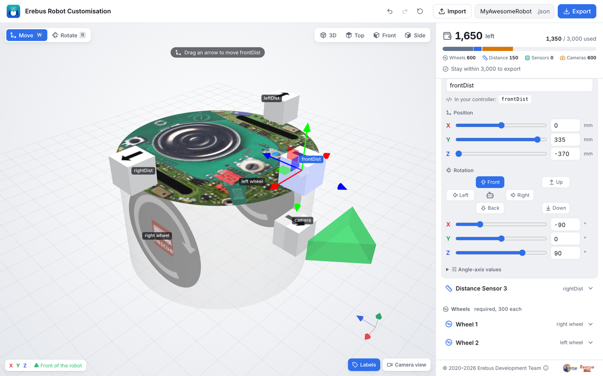
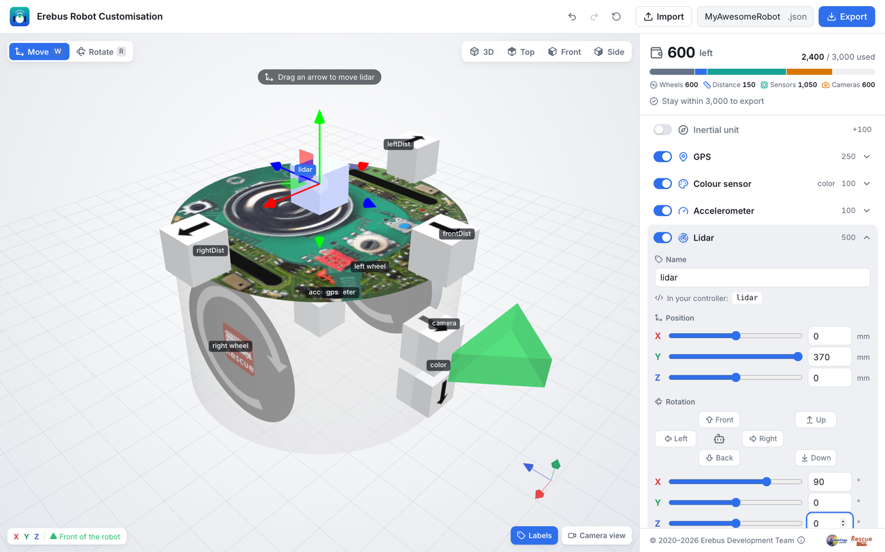
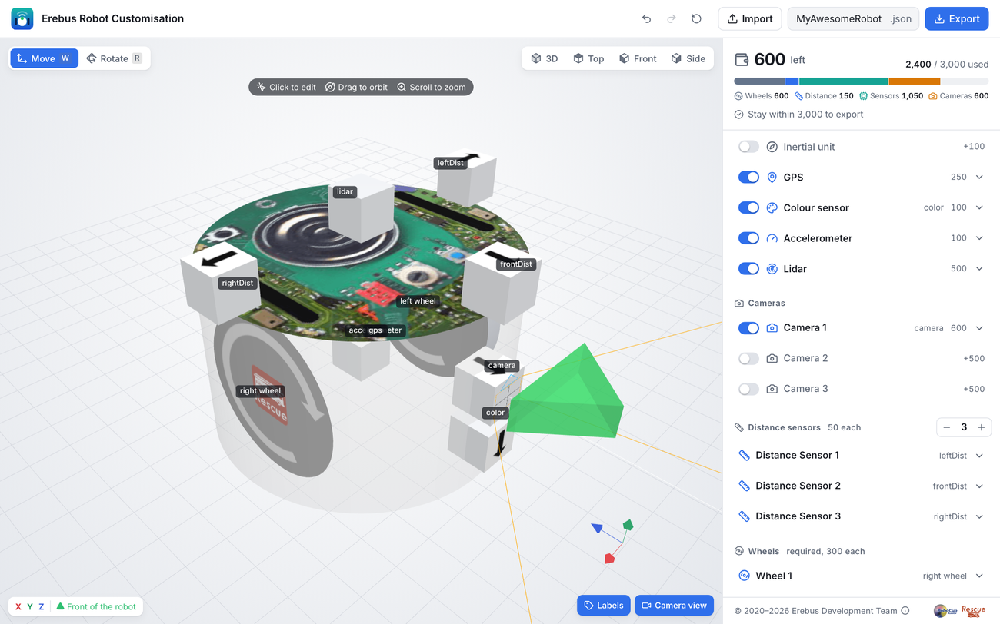

import { Steps } from '@astrojs/starlight/components';

이 튜토리얼에서는 [Robot Customizer](https://robot.erebus.rcj.cloud/)로 [스타터 로봇](/docs/robot/#the-starter-robot)을 조립해요. 이 문서의 모든 예제에서 사용하는 로봇이므로, 마치고 나면 프로그래밍할 준비가 모두 끝나요.

예산 3000 중 2400을 사용해요.

:::tip
각 구성 요소에는 이름이 있고, 프로그램은 그 이름으로 구성 요소를 찾아요. 예제가 작동하도록 아래 이름을 정확히 그대로 사용하세요.
:::

## 로봇 설계하기 \{#design-the-robot\}

[Robot Customizer](https://robot.erebus.rcj.cloud/)를 여세요. 처음에는 기본 부품인 바퀴 두 개와 거리 센서 네 개로 시작해요. 이전에 사용한 적이 있다면 위쪽의 리셋 버튼을 눌러 처음부터 다시 시작하세요.

입력 칸에는 mm라고 쓰여 있지만, 위치의 단위는 0.1밀리미터예요. 로봇 몸체의 반지름은 약 370이에요.

<Steps>

1. **거리 센서를 설정하세요.** **Distance sensors**에서 `−`를 한 번 눌러 세 개만 남기세요. 그런 다음 각 센서를 클릭해서 열고 이름, 위치, 회전을 설정하세요.

   | 센서 | 이름 | X | Y | Z | 회전 |
   |---|---|---:|---:|---:|---|
   | Distance Sensor 1 | `leftDist` | -370 | 335 | 0 | Left |
   | Distance Sensor 2 | `frontDist` | 0 | 335 | -370 | Front |
   | Distance Sensor 3 | `rightDist` | 370 | 335 | 0 | Right |

   슬라이더 옆 입력 칸에 값을 입력하고 회전 버튼을 누르세요. **Top**은 앞쪽이 위로 가게 로봇을 위에서 보여 주므로, 각 센서가 올바른 방향을 향하는지 확인할 수 있어요.

   

2. **바퀴에 이름을 붙이세요.** 로봇 오른쪽에 있는 **Wheel 1**을 열고 이름을 `right wheel`로 하세요. **Wheel 2**의 이름은 `left wheel`로 하세요. **In your controller**에 표시된 대로, 프로그램에서는 `right wheel motor`와 `left wheel motor`로 사용해요.

3. **카메라를 추가하세요.** **Camera 1**을 켜고 다음과 같이 설정하세요.

   - 이름: `camera`
   - 해상도: 너비 **64px**, 높이 **40px**
   - 위치: X `0`, Y `90`, Z `-370`
   - 회전: **Front**

   

4. **컬러 센서를 추가하세요.** **Colour sensor**를 켜고 다음과 같이 설정하세요.

   - 이름: `color`
   - 위치: X `0`, Y `-41`, Z `-370`
   - 회전: **Down**

   컬러 센서는 바닥을 보기 위해 아래를 향해야 해요. 앞쪽에 배치하면 바퀴가 닿기 전에 로봇이 구멍을 볼 수 있어요.

5. **GPS, 자이로, 가속도계를 추가하세요.** **GPS**, **Gyro**, **Accelerometer**를 켜세요. 기본 이름인 `gps`, `gyro`, `accelerometer`와 기본 위치 그대로 괜찮아요.

6. **라이다를 추가하세요.** **Lidar**를 켜고 다음과 같이 설정하세요.

   - 위치: X `0`, Y `370`, Z `0`
   - 회전: X `90`, Y `0`, Z `0`을 입력

   라이다는 로봇 위에 있어야 몸체에 가리지 않고, 주위 전체를 스캔하려면 평평하게 놓여야 해요. 회전 버튼으로는 평평하게 놓을 수 없으니 값을 입력하세요.

   

7. **로봇을 확인하세요.** 오른쪽 위의 예산에 **2,400 / 3,000 used**가 표시되어야 해요. **Labels**를 켜면 모든 이름을, **Camera view**를 켜면 카메라가 보게 될 모습을 볼 수 있어요.

   

8. **내보내세요.** 위쪽에 파일 이름으로 `starter-robot`을 입력하고 **Export**를 누르세요. `starter-robot.json` 파일은 보관해 두세요. 나중에 **Import**해서 로봇을 바꿀 수 있어요.

</Steps>

문제가 생겼다면 완성된 로봇과 비교해 보세요. [`starter-robot.json`을 다운로드](/downloads/starter-robot.json)한 뒤 가져오세요.

## 다음 단계 \{#next\}
[Erebus에 로봇을 불러오고](/docs/robot/#load-it-in-erebus), [첫 번째 프로그램을 실행](/docs/getting-started/)하세요.
