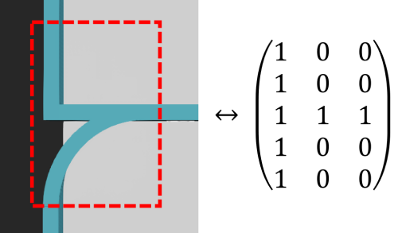
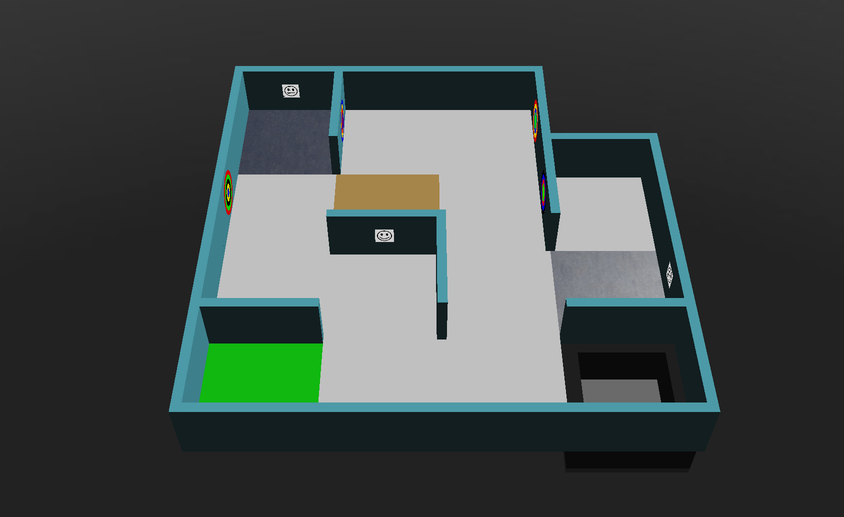
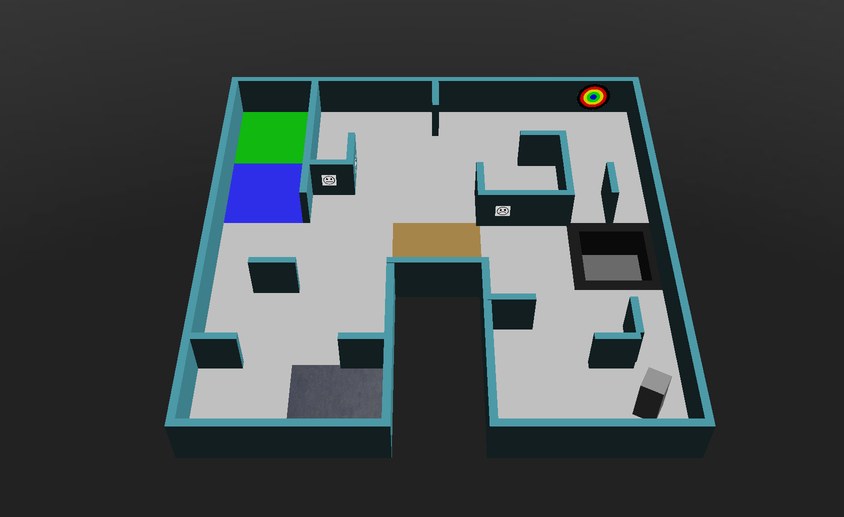
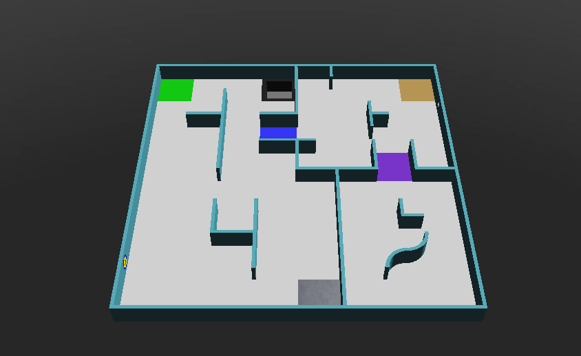
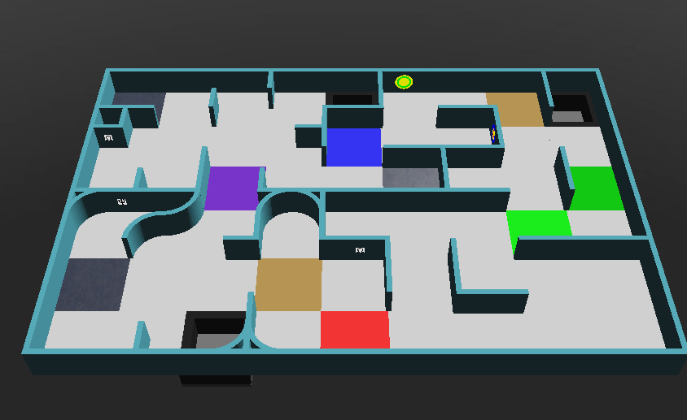

## 기본 개념 {#general-idea}
지도 작성은 경기 중에 얻은 전체 점수에 곱하는 배율로 점수가 매겨져요. 지도 배율을 얻으려면 로봇이 게임의 Main Supervisor에 행렬을 제출해야 해요. 제출한 행렬은 "정답"과 비교되어 정확도 값이 나오고, 배율은 다음과 같아요.

**지도 보너스 배율 = 정확도 × 1.2 + 1**

따라서 완벽한 지도는 점수를 2.2배로 만들어요. 행렬을 보내는 방법은 [지도 제출 튜토리얼](/docs/programming/map-bonus/)을 참고하세요.

## 지도 작성 규칙 {#rules-for-mapping}
* 각 4분의 1 타일과 그 주위의 변과 꼭짓점은 셀(값) 하나로 나타내요. 따라서 W × H 타일의 지도는 (4 × H + 1)행, (4 × W + 1)열의 행렬이에요.
* 월드의 각 요소는 다음과 같이 나타내요.

| 요소 | 값 |
|---|---|
| 벽 | `1` |
| 구멍 | `2` |
| 늪 | `3` |
| 체크포인트 | `4` |
| 시작 타일 | `5` |
| 장애물이 있는 타일 | `x` |
| 구역 1과 2 사이의 통로 (파랑) | `b` |
| 구역 1과 3 사이의 통로 (노랑) | `y` |
| 구역 1과 4 사이의 통로 (초록) | `g` |
| 구역 2와 3 사이의 통로 (보라) | `p` |
| 구역 2와 4 사이의 통로 (주황) | `o` |
| 구역 3과 4 사이의 통로 (빨강) | `r` |
| 벽 토큰 | 해당 코드 (`H`, `S`, `U`, `F`, `P`, `C`, `O`) |
| 경계를 포함한 구역 4의 모든 타일, 변, 꼭짓점 | `*` |
| 그 밖의 모든 타일, 변, 꼭짓점 | `0` |

* 바닥 요소(`2`, `3`, `4`, `5`, `x`, 통로)는 아래 예제에서 볼 수 있듯이 각 4분의 1 타일 중심의 네 셀에 써요.
* 어떤 타일도 늪, 구멍, 체크포인트, 시작 타일, 장애물이 있는 타일, 구역 통로 중 두 가지 이상을 동시에 겸하지 않아요.
* 구역 3의 곡선 벽에서는 꼭짓점을 `0`으로 나타내요.
* 벽 토큰이 있으면 그 토큰이 붙은 벽의 셀에 표시해요. 같은 벽에 벽 토큰이 여러 개 있으면(예를 들어 벽의 양면에), 지도상의 절대 위치 순서로, 즉 먼저 위에서 아래로, 다음으로 왼쪽에서 오른쪽으로 코드를 한 셀에 이어 붙여요.
* 가짜 토큰은 지도에 넣으면 안 돼요. 가짜 피해자도, 합이 유효하지 않은 인지 표적도 넣지 마세요.
* 온전한 타일(4분의 1 타일이 아닌 타일)의 벽 토큰은 벽을 따라 어디에나 있을 수 있어요. 더 가까운 4분의 1 타일의 셀에 넣고, 타일 변의 중앙 근처에 있다면 가운데 셀에 넣어요.
* 지도는 90°의 배수라면 어떤 회전으로든 저장할 수 있어요. Erebus는 시작 타일을 사용해 행렬을 정답에 맞춰 정렬하고, 각 방향을 시도해 가장 좋은 결과를 사용해요.

## 정확도 계산 방법 {#how-correctness-is-calculated}
1. 행렬은 시작 타일을 기준으로 정렬돼요. 즉, **지도에 시작 타일이 반드시 있어야 해요**.
1. 제출한 행렬이나 정답 중 하나라도 0이 아닌 값이 있는 모든 위치를 비교해요. 값이 같으면 정답 수가, 다르면 오답 수가 늘어나요. 둘 다 `0`인 위치는 무시해요.
1. 정확도는 정답 수 / (정답 수 + 오답 수)예요.

무언가가 있는 위치만 계산되므로, 존재하지 않는 것을 표시하면 존재하는 것을 빠뜨린 것만큼 정확도가 떨어져요.

## 모호한 경우 {#ambiguous-edge-cases}
아래에 정의되지 않은 모호한 경우에 대해서는 International RoboCupJunior Rescue Committee 또는 플랫폼 개발 팀에 문의하세요.
### 한쪽은 일반 직각 벽, 다른 쪽은 곡선 벽인 벽 {#one-wall-with-a-normal-right-angled-wall-and-a-curved-wall-on-each-side}
규칙에 따르면 곡선 벽의 꼭짓점은 0으로 나타내야 해요.
예외는 다음 경우예요. 벽의 한쪽은 일반 직각이고 다른 쪽은 곡선인 경우로, 양쪽 모두 일반 벽인 것처럼 나타내요.


## 예제 {#examples}
다음은 Erebus v26에 포함된 몇몇 월드의 정답으로, Erebus가 직접 생성한 거예요.

`game/worlds` 폴더의 월드는 버전마다 바뀌므로, Erebus 버전이 다르면 정답이 다를 수 있어요. `player_controllers` 폴더의 `MapScorerExample.py`에도 예제 행렬이 있어요.

### mapping_example_1.wbt {#mapping_example_1wbt}
구역이 하나인 작은 월드예요. 시작 타일은 왼쪽 아래의 초록색 타일이에요.



```
[
['1', '1', 'S', '1', '1', '1', '1', '1', '1', '1', '1', '1', '1', '0', '0', '0', '0'],
['1', '4', '0', '4', '1', '0', '0', '0', '0', '0', '0', '0', '1', '0', '0', '0', '0'],
['1', '0', '0', '0', 'C', '0', '0', '0', '0', '0', '0', '0', 'O', '0', '0', '0', '0'],
['1', '4', '0', '4', '1', '0', '0', '0', '0', '0', '0', '0', '1', '0', '0', '0', '0'],
['1', '0', '0', '0', '1', '0', '0', '0', '0', '0', '0', '0', '1', '1', '1', '1', '1'],
['1', '0', '0', '0', '0', '3', '0', '3', '0', '0', '0', '0', '1', '0', '0', '0', '1'],
['F', '0', '0', '0', '0', '0', '0', '0', '0', '0', '0', '0', 'P', '0', '0', '0', '1'],
['1', '0', '0', '0', '0', '3', '0', '3', '0', '0', '0', '0', '1', '0', '0', '0', '1'],
['1', '0', '0', '0', '1', '1', 'U', '1', '1', '0', '0', '0', '1', '0', '0', '0', '1'],
['1', '0', '0', '0', '0', '0', '0', '0', '1', '0', '0', '0', '0', '4', '0', '4', '1'],
['1', '0', '0', '0', '0', '0', '0', '0', '1', '0', '0', '0', '0', '0', '0', '0', 'H'],
['1', '0', '0', '0', '0', '0', '0', '0', '1', '0', '0', '0', '0', '4', '0', '4', '1'],
['1', '1', '1', '1', '1', '0', '0', '0', '1', '0', '0', '0', '1', '1', '1', '1', '1'],
['1', '5', '0', '5', '0', '0', '0', '0', '0', '0', '0', '0', '0', '2', '0', '2', '1'],
['1', '0', '0', '0', '0', '0', '0', '0', '0', '0', '0', '0', '0', '0', '0', '0', '1'],
['1', '5', '0', '5', '0', '0', '0', '0', '0', '0', '0', '0', '0', '2', '0', '2', '1'],
['1', '1', '1', '1', '1', '1', 'F', '1', '1', '1', '1', '1', '1', '1', '1', '1', '1']
]
```

### mapping_example_2.wbt {#mapping_example_2wbt}
이 월드에는 `x`로 표시되는 장애물이 있어요.



```
[
['1', '1', '1', '1', '1', '1', '1', '1', '1', '1', '1', '1', '1', '1', '1', '1', '1', '1', 'F', '1', '1'],
['1', '5', '0', '5', '1', '0', '0', '0', '0', '0', 'O', '0', '0', '0', '0', '0', '0', '0', '0', '0', '1'],
['1', '0', '0', '0', '1', '0', '0', '0', '0', '0', '1', '0', '0', '0', '0', '0', '0', '0', '0', '0', '1'],
['1', '5', '0', '5', '1', '0', '0', '0', '0', '0', '0', '0', '0', '0', '0', '0', '0', '0', '0', '0', '1'],
['1', '0', '0', '0', '1', '0', '1', '0', '0', '0', '0', '0', '0', '0', '1', '1', '1', '0', '0', '0', '1'],
['1', 'b', '0', 'b', '1', '0', 'U', '0', '0', '0', '0', '0', '0', '0', '0', '0', '1', '0', '0', '0', '1'],
['1', '0', '0', '0', '1', 'S', '1', '0', '0', '0', '0', '0', '1', '0', '0', '0', '1', '0', '1', '0', '1'],
['1', 'b', '0', 'b', '1', '0', '0', '0', '0', '0', '0', '0', '1', '0', '0', '0', '1', '0', '1', '0', '1'],
['1', '0', '0', '0', '1', '0', '0', '0', '0', '0', '0', '0', '1', 'H', '1', '1', '1', '0', '1', '0', '1'],
['1', '0', '0', '0', '0', '0', '0', '0', '0', '3', '0', '3', '0', '0', '0', '0', '0', '2', '0', '2', '1'],
['1', '0', '0', '0', '0', '0', '0', '0', '0', '0', '0', '0', '0', '0', '0', '0', '0', '0', '0', '0', '1'],
['1', '0', '0', '0', '0', '0', '0', '0', '0', '3', '0', '3', '0', '0', '0', '0', '0', '2', '0', '2', '1'],
['1', '0', '1', '1', '1', '0', '0', '0', '1', '1', '1', '1', '1', '0', '0', '0', '0', '0', '0', '0', '1'],
['1', '0', '0', '0', '0', '0', '0', '0', '1', '0', '0', '0', '1', '0', '0', '0', '0', '0', '0', '0', '1'],
['1', '0', '0', '0', '0', '0', '0', '0', '1', '0', '0', '0', '1', '1', '1', '0', '0', '0', '1', '0', '1'],
['1', '0', '0', '0', '0', '0', '0', '0', '1', '0', '0', '0', '1', '0', '0', '0', '0', '0', '1', '0', '1'],
['1', '1', '1', '0', '0', '0', '1', 'P', '1', '0', '0', '0', '1', '0', '0', '0', '1', '1', '1', '0', '1'],
['1', '0', '0', '0', '0', '4', '0', '4', '1', '0', '0', '0', '1', '0', '0', '0', '0', 'x', '0', 'x', '1'],
['1', '0', '0', '0', '0', '0', '0', '0', '1', '0', '0', '0', '1', '0', '0', '0', '0', '0', '0', '0', '1'],
['1', '0', '0', '0', '0', '4', '0', '4', '1', '0', '0', '0', 'C', '0', '0', '0', '0', 'x', '0', 'x', '1'],
['1', '1', '1', '1', '1', '1', '1', '1', '1', '0', '0', '0', '1', '1', '1', '1', '1', '1', '1', '1', '1']
]
```

### world1.wbt {#world1wbt}
이 월드에는 구역이 세 개 있고, 통로 `b`와 `p`가 있어요.



```
[
['1', '1', '1', '1', '1', '1', '1', '1', '1', '1', '1', '1', '1', '1', '1', '1', '1', '1', '1', '1', '1', '1', '1', '1', '1', '1', '1', '1', '1', '1', '1', '1', '1'],
['1', '5', '0', '5', '0', '0', '0', '0', '0', '0', '0', '0', '0', '2', '0', '2', '1', '0', '0', '0', '1', '0', '0', '0', '0', '0', '0', '0', '0', '3', '0', '3', '1'],
['1', '0', '0', '0', '0', '0', '0', '0', '0', '0', '0', '0', '0', '0', '0', '0', '1', '0', '0', '0', '1', '0', '0', '0', '0', '0', '0', '0', '0', '0', '0', '0', '1'],
['1', '5', '0', '5', '0', '0', '0', '0', '0', '0', '0', '0', '0', '2', '0', '2', '1', '0', '0', '0', '0', '0', '0', '0', '0', '0', '0', '0', '0', '3', '0', '3', '1'],
['1', '0', '0', '0', '0', '0', '0', '0', '1', '0', '0', '0', '0', '0', '0', '0', '1', '0', '0', '0', '0', '0', '0', '0', '0', '0', '0', '0', '0', '0', '0', '0', '1'],
['1', '0', '0', '0', '0', '0', '0', '0', '1', '0', '0', '0', '0', '0', '0', '0', '1', '0', '0', '0', '0', '0', '0', '0', '0', '0', '0', '0', '0', '0', '0', '0', '1'],
['1', '0', '0', '0', '0', '0', '0', '0', '1', '0', '0', '0', '0', '0', '0', '0', '1', '0', '0', '0', '0', '0', '0', '0', '1', '0', '0', '0', '0', '0', '0', '0', 'S'],
['1', '0', '0', '0', '0', '0', '0', '0', '1', '0', '0', '0', '0', '0', '0', '0', '1', '0', '0', '0', '0', '0', '0', '0', '1', '0', '0', '0', '0', '0', '0', '0', '1'],
['1', '0', '0', '0', '1', '1', '1', '1', '1', '0', '0', '0', '1', '1', '1', '1', '1', '0', '0', '0', '0', '0', '0', '0', '1', '1', '1', '0', '0', '0', '0', '0', '1'],
['1', '0', '0', '0', '0', '0', '0', '0', '1', '0', '0', '0', '0', 'b', '0', 'b', '0', '0', '0', '0', '0', '0', '0', '0', '1', '0', '0', '0', '0', '0', '0', '0', '1'],
['F', '0', '0', '0', '0', '0', '0', '0', '1', '0', '0', '0', '0', '0', '0', '0', '0', '0', '0', '0', '0', '0', '0', '0', '1', '0', '0', '0', '0', '0', '0', '0', '1'],
['1', '0', '0', '0', '0', '0', '0', '0', '1', '0', '0', '0', '0', 'b', '0', 'b', '0', '0', '0', '0', '0', '0', '0', '0', '0', '0', '0', '0', '0', '0', '0', '0', '1'],
['1', '0', '0', '0', '0', '0', '0', '0', '1', '0', '0', '0', '1', '1', '1', '1', '1', '1', '1', '0', '0', '0', '0', '0', '1', '0', '0', '0', '1', '0', '0', '0', '1'],
['1', '0', '0', '0', '0', '0', '0', '0', '1', '0', '0', '0', '0', '0', '0', '0', '1', '0', '0', '0', '0', '0', '0', '0', '1', 'p', '0', 'p', '1', '0', '0', '0', '1'],
['1', '0', '0', '0', '0', '0', '0', '0', '1', '0', '0', '0', '0', '0', '0', '0', '1', '0', '0', '0', '0', '0', '0', '0', '1', '0', '0', '0', '1', '0', '0', '0', '1'],
['1', '0', '0', '0', '0', '0', '0', '0', '1', '0', '0', '0', '0', '0', '0', '0', '1', '0', '0', '0', '0', '0', '0', '0', '1', 'p', '0', 'p', '1', '0', '0', '0', '1'],
['1', '0', '0', '0', '0', '0', '0', '0', '1', '0', '0', '0', '0', '0', '0', '0', '1', '1', '1', '1', '1', '1', '1', '1', '1', '0', '0', '0', '1', '1', '1', '1', '1'],
['1', '0', '0', '0', '0', '0', '0', '0', '0', '0', '0', '0', '0', '0', '0', '0', '0', '0', '0', '0', '1', '0', '0', '0', '0', '0', '0', '0', '0', '0', '0', '0', '1'],
['1', '0', '0', '0', '0', '0', '0', '0', '0', '0', '0', '0', '0', '0', '0', '0', '0', '0', '0', '0', '1', '0', '0', '0', '0', '0', '0', '0', '0', '0', '0', '0', '1'],
['1', '0', '0', '0', '0', '0', '0', '0', '0', '0', '0', '0', '0', '0', '0', '0', '0', '0', '0', '0', '1', '0', '0', '0', '0', '0', '0', '0', '0', '0', '0', '0', '1'],
['1', '0', '0', '0', '0', '0', '0', '0', '1', '0', '0', '0', '1', '0', '0', '0', '0', '0', '0', '0', '1', '0', '0', '0', '0', '0', '1', '0', '0', '0', '0', '0', '1'],
['1', '0', '0', '0', '0', '0', '0', '0', '1', '0', '0', '0', '1', '0', '0', '0', '0', '0', '0', '0', '1', '0', '0', '0', '0', '0', '1', '0', '0', '0', '0', '0', '1'],
['1', '0', '0', '0', '0', '0', '0', '0', '1', '0', '0', '0', '1', '0', '0', '0', '0', '0', '0', '0', 'U', '0', '0', '0', '0', '0', '1', '1', '1', '0', '0', '0', '1'],
['1', '0', '0', '0', '0', '0', '0', '0', '1', '0', '0', '0', '1', '0', '0', '0', '0', '0', '0', '0', '1', '0', '0', '0', '0', '0', '0', '0', '0', '0', '0', '0', '1'],
['1', '0', '0', '0', '0', '0', '0', '0', '1', '1', 'H', '1', '1', '0', '0', '0', '0', '0', '0', '0', '1', '0', '0', '0', '0', '0', '0', '0', '1', '0', '0', '0', '1'],
['1', '0', '0', '0', '0', '0', '0', '0', '0', '0', '0', '0', '1', '0', '0', '0', '0', '0', '0', '0', '1', '0', '0', '0', '0', '0', '0', '0', '1', '0', '0', '0', '1'],
['1', '0', '0', '0', '0', '0', '0', '0', '0', '0', '0', '0', '1', '0', '0', '0', '0', '0', '0', '0', '1', '0', '0', '0', '0', '1', '1', '1', '0', '0', '0', '0', '1'],
['P', '0', '0', '0', '0', '0', '0', '0', '0', '0', '0', '0', '1', '0', '0', '0', '0', '0', '0', '0', '1', '0', '0', '0', '1', '0', '0', '0', '0', '0', '0', '0', '1'],
['1', '0', '0', '0', '0', '0', '0', '0', '0', '0', '0', '0', '1', '0', '0', '0', '0', '0', '0', '0', '1', '0', '0', '0', '1', '0', '0', '0', '0', '0', '0', '0', '1'],
['1', '0', '0', '0', '0', '0', '0', '0', '0', '0', '0', '0', '0', '0', '0', '0', '0', '4', '0', '4', '1', '0', '0', '0', '0', '0', '0', '0', '0', '0', '0', '0', '1'],
['1', '0', '0', '0', '0', '0', '0', '0', '0', '0', '0', '0', '0', '0', '0', '0', '0', '0', '0', '0', '1', '0', '0', '0', '0', '0', '0', '0', '0', '0', '0', '0', '1'],
['1', '0', '0', '0', '0', '0', '0', '0', '0', '0', '0', '0', '0', '0', '0', '0', '0', '4', '0', '4', '1', '0', '0', '0', '0', '0', '0', '0', '0', '0', '0', '0', '1'],
['1', '1', '1', '1', '1', '1', '1', '1', '1', '1', '1', '1', '1', '1', '1', '1', '1', '1', '1', '1', '1', '1', '1', '1', '1', '1', '1', '1', '1', '1', '1', '1', '1']
]
```

### world2.wbt {#world2wbt}
이 월드에는 `*`로 채워진 구역 4와, 통로 `g`와 `r`이 있어요.



```
[
['1', '1', '1', '1', '1', '1', '1', '1', '1', '1', '1', '1', '1', '1', '1', '1', '1', '1', '1', '1', '1', '1', 'P', '1', '1', '1', '1', '1', '1', '1', '1', '1', '1', '1', '1', '1', '1'],
['1', '4', '0', '4', '0', '0', '0', '0', '0', '0', '0', '0', '1', '0', '0', '0', '0', '2', '0', '2', '1', '0', '0', '0', '0', '0', '0', '0', '0', '3', '0', '3', '1', '2', '0', '2', '1'],
['1', '0', '0', '0', '0', '0', '0', '0', '1', '0', '0', '0', '1', '0', '0', '0', '0', '0', '0', '0', '1', '0', '0', '0', '0', '0', '0', '0', '0', '0', '0', '0', '1', '0', '0', '0', '1'],
['1', '4', '0', '4', '0', '0', '0', '0', 'C', '0', '0', '0', '0', '0', '0', '0', '0', '2', '0', '2', '1', '0', '0', '0', '0', '0', '0', '0', '0', '3', '0', '3', '1', '2', '0', '2', '1'],
['1', '1', '1', '1', '1', '0', '0', '0', '1', '0', '0', '0', '0', '0', '0', '0', '1', '1', '1', '1', '1', '0', '0', '0', '1', '1', '1', '1', '1', '0', '0', '0', '1', '0', '0', '0', '1'],
['1', '0', '1', '0', '0', '0', '0', '0', '0', '0', '0', '0', '0', '0', '0', '0', '1', 'b', '0', 'b', '0', '0', '0', '0', '0', '0', '0', '0', '1', '0', '0', '0', '0', '0', '0', '0', '1'],
['1', 'U', '1', '0', '0', '0', '0', '0', '0', '0', '0', '0', '0', '0', '1', '1', '1', '0', '0', '0', '0', '0', '0', '0', '0', '0', '0', '0', 'O', '0', '0', '0', '0', '0', '0', '0', '1'],
['1', '0', '0', '0', '0', '0', '0', '0', '0', '0', '0', '0', '0', '0', '0', '0', '1', 'b', '0', 'b', '0', '0', '0', '0', '0', '0', '0', '0', '1', '0', '0', '0', '0', '0', '0', '0', '1'],
['1', '0', '0', '0', '0', '0', '0', '0', '1', '0', '0', '0', '0', '0', '0', '0', '1', '0', '0', '0', '1', '1', '1', '1', '1', '1', '1', '1', '1', '0', '0', '0', '1', '0', '0', '0', '1'],
['1', '0', '0', '0', '0', '0', '0', '0', '1', 'p', '0', 'p', '0', '0', '0', '0', '0', '0', '0', '0', '0', '4', '0', '4', '1', '0', '0', '0', '0', '0', '0', '0', '1', '5', '0', '5', '1'],
['1', '0', '0', '0', '1', '0', '0', '0', '1', '0', '0', '0', '1', '0', '0', '0', '0', '0', '0', '0', '0', '0', '0', '0', 'H', '0', '0', '0', '0', '0', '0', '0', '1', '0', '0', '0', '1'],
['1', '0', '0', '0', '1', '0', '0', '0', '1', 'p', '0', 'p', '1', '0', '0', '0', '0', '0', '0', '0', '0', '4', '0', '4', '1', '0', '0', '0', '0', '0', '0', '0', '1', '5', '0', '5', '1'],
['0', '1', '1', 'S', '1', '1', '1', '1', '1', '0', '0', '0', '0', '1', '1', '1', '*', '*', '*', '*', '*', '*', '*', '*', '*', '*', '*', '*', '*', '0', '0', '0', '1', '0', '0', '0', '1'],
['1', '0', '0', '0', '0', '0', '0', '0', '1', '0', '0', '0', '1', '0', '0', '0', '*', '*', '*', '*', '*', '*', '*', '*', '*', '*', '*', '*', '*', 'g', '0', 'g', '0', '0', '0', '0', '1'],
['1', '0', '0', '0', '0', '1', '1', '1', '0', '0', '0', '0', '1', '0', '0', '0', '*', '*', '*', '*', '*', '*', '*', '*', '*', '*', '*', '*', '*', '0', '0', '0', '0', '0', '0', '0', '1'],
['1', '0', '0', '0', '1', '0', '0', '0', '0', '0', '0', '0', '1', '0', '0', '0', '*', '*', '*', '*', '*', '*', '*', '*', '*', '*', '*', '*', '*', 'g', '0', 'g', '0', '0', '0', '0', '1'],
['1', '0', '0', '0', '1', '0', '0', '0', '0', '0', '1', '1', '1', '0', '0', '0', '*', '*', '*', '*', '*', '*', '*', '*', '*', '*', '*', '*', '*', '*', '*', '*', '*', '*', '*', '*', '*'],
['1', '4', '0', '4', '0', '0', '0', '0', '0', '0', '0', '0', '0', '3', '0', '3', '0', '0', '0', '0', '*', '*', '*', '*', '*', '*', '*', '*', '*', '*', '*', '*', '*', '*', '*', '*', '*'],
['1', '0', '0', '0', '0', '0', '0', '0', '0', '0', '0', '0', '0', '0', '0', '0', '0', '0', '0', '0', '*', '*', '*', '*', '*', '*', '*', '*', '*', '*', '*', '*', '*', '*', '*', '*', '*'],
['1', '4', '0', '4', '0', '0', '0', '0', '0', '0', '0', '0', '0', '3', '0', '3', '0', '0', '0', '0', '*', '*', '*', '*', '*', '*', '*', '*', '*', '*', '*', '*', '*', '*', '*', '*', '*'],
['1', '0', '0', '0', '0', '0', '0', '0', '0', '0', '0', '0', '1', '0', '0', '0', '0', '0', '0', '0', '*', '*', '*', '*', '*', '*', '*', '*', '*', '*', '*', '*', '*', '*', '*', '*', '*'],
['1', '0', '0', '0', '0', '0', '0', '0', '0', '2', '0', '2', '1', '0', '0', '0', '0', 'r', '0', 'r', '*', '*', '*', '*', '*', '*', '*', '*', '*', '*', '*', '*', '*', '*', '*', '*', '*'],
['1', '0', '0', '0', '0', '0', '1', '0', '0', '0', '0', '0', '1', '0', '0', '0', '0', '0', '0', '0', '*', '*', '*', '*', '*', '*', '*', '*', '*', '*', '*', '*', '*', '*', '*', '*', '*'],
['1', '0', '0', '0', '0', '0', '1', '0', '0', '2', '0', '2', '1', '0', '0', '0', '0', 'r', '0', 'r', '*', '*', '*', '*', '*', '*', '*', '*', '*', '*', '*', '*', '*', '*', '*', '*', '*'],
['1', '1', '1', '1', '1', '1', '1', '1', '1', '1', '1', '1', '0', '1', '1', '1', '1', '1', '1', '1', '*', '*', '*', '*', '*', '*', '*', '*', '*', '*', '*', '*', '*', '*', '*', '*', '*']
]
```
