:::note
Esta página é um resumo para ajudar você a começar. As únicas regras oficiais são as [RoboCupJunior Rescue Simulation Rules 2026](https://junior.robocup.org/wp-content/uploads/2026/02/RCJRescueSimulation2026-final.pdf) (última atualização em 11/02/2026). Se esta página e as regras oficiais forem diferentes, valem as regras oficiais.

Correções e esclarecimentos são publicados no [fórum oficial da RoboCupJunior](https://junior.forum.robocup.org/). É responsabilidade de cada equipe acompanhá-los.
:::

## O jogo em um minuto {#the-game-in-one-minute}
O seu robô é colocado sozinho em um labirinto desconhecido. Em 8 minutos, sem nenhuma ajuda sua, ele precisa:

1. **Explorar** o labirinto sem ficar preso nem cair em buracos.
2. **Encontrar os marcadores nas paredes** (wall tokens), vítimas e sinais de perigo (hazard signs), e informar o que cada um é.
3. **Mapear** o labirinto e enviar o mapa no final.
4. **Voltar** para onde começou.

Tudo o que vem abaixo explica essas quatro tarefas em detalhe. Você não precisa lembrar de tudo agora: volte aqui conforme for programando cada parte.

## Missão e objetivo {#mission-and-objective}
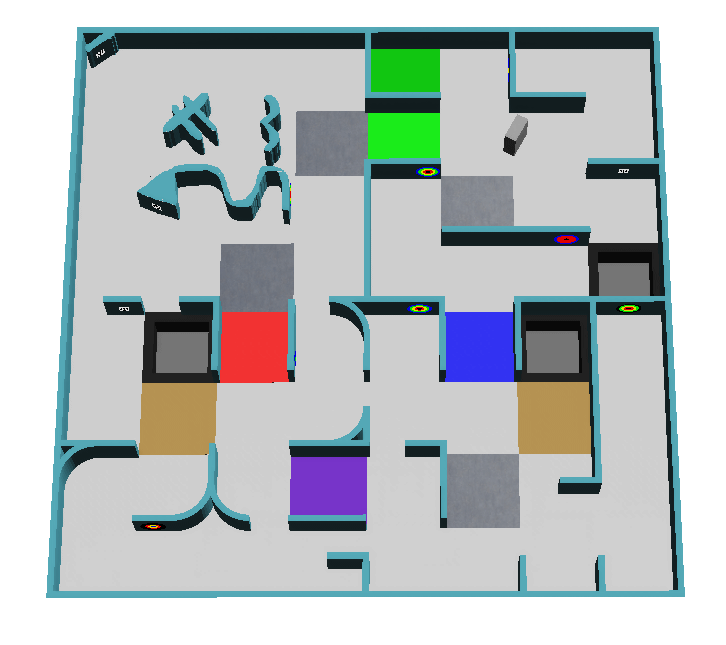

O robô precisa explorar de forma autônoma um ambiente desconhecido, sem se meter em apuros. Há três missões principais:

- Navegar por um labirinto complexo sem ficar preso
- Mapear o ambiente com precisão
- Encontrar e identificar os marcadores nas paredes: vítimas de letra e alvos cognitivos

## O campo {#the-field}
O campo pode ser dividido em quatro áreas, e cada passagem entre áreas tem a largura de um ladrilho padrão. Os ladrilhos (tiles) são um conceito usado para gerar o campo, não estruturas físicas.

- Um ladrilho mede **12 cm × 12 cm**. Nas áreas 2 e 3, cada ladrilho é subdividido em quatro **quartos de ladrilho** (quarter tiles) de 6 cm × 6 cm.
- As paredes têm **1 cm de espessura e 6 cm de altura**.
- Os caminhos têm pelo menos a largura do robô e podem se abrir em saguões mais largos.

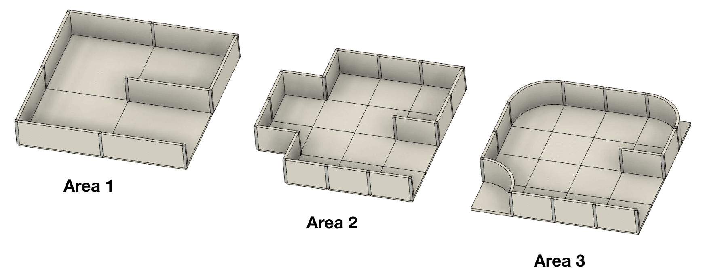

| Área | Paredes | Observações |
|---|---|---|
| Área 1 | Podem ficar nas bordas de cada ladrilho | O ladrilho inicial fica nesta área |
| Área 2 | Podem ficar nas bordas de cada quarto de ladrilho | |
| Área 3 | Podem ficar nas bordas de cada quarto de ladrilho | Cantos de 90° podem ser arredondados em um quarto de círculo |
| Área 4 (opcional) | Não é baseada em ladrilhos; paredes e obstáculos são colocados livremente | Pode conter objetos como caixas e pode exigir movimentos na diagonal |

### Passagens entre áreas {#passages-between-areas}
As passagens são ladrilhos únicos com paredes em dois lados, para que tenham uma entrada e uma saída sem ambiguidade. A cor do piso indica quais áreas elas conectam:

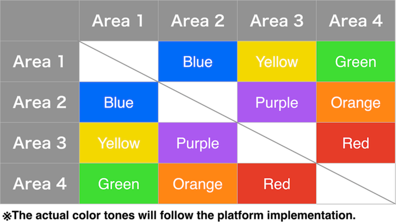

Não são colocadas vítimas de letra nas passagens.

### Ladrilhos lineares e flutuantes {#linear-and-floating-tiles}
Os ladrilhos que levam ao ladrilho inicial seguindo sempre a parede mais à esquerda ou mais à direita são **ladrilhos lineares** (linear tiles). Todos os outros são **ladrilhos flutuantes** (floating tiles). Os marcadores em ladrilhos flutuantes valem mais pontos. Os quartos de ladrilho não são levados em conta, e os buracos pretos contam como paredes virtuais aqui.

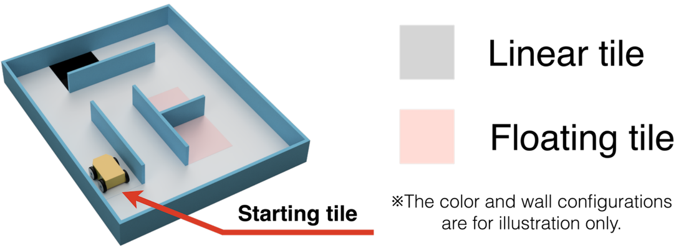

### Pontos de controle {#checkpoints}
Os ladrilhos prateados são pontos de controle (checkpoints) e podem ficar em qualquer lugar do campo. A área 4 tem pontos de controle logo depois das suas passagens. Depois de uma falta de progresso, o robô recomeça a partir do último ponto de controle que visitou.

## Pântanos, obstáculos e buracos {#swamps-obstacles-and-holes}
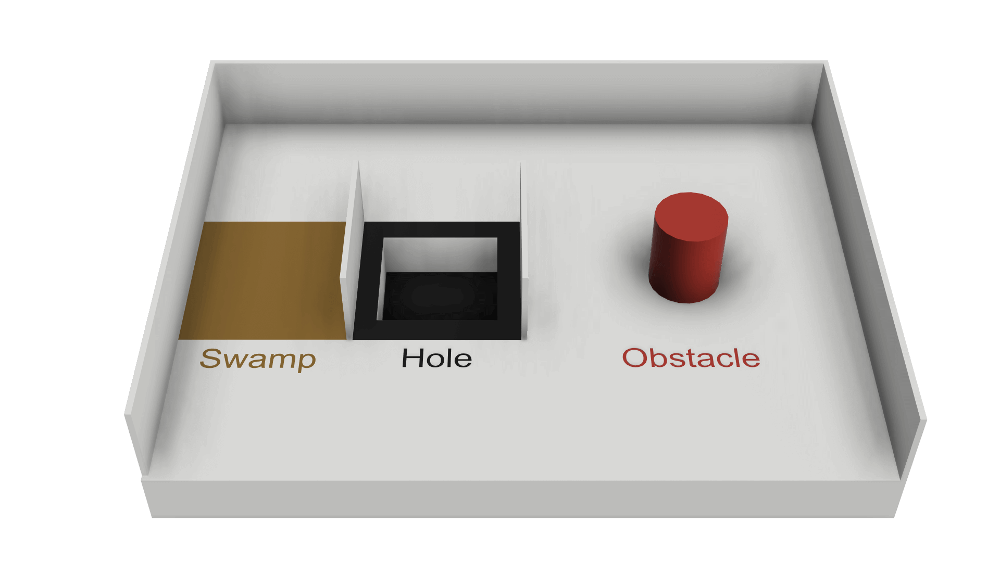

* Os **pântanos** (swamps, ladrilhos marrons) fazem o tempo de partida correr mais rápido enquanto o robô está sobre eles. Na primeira vez que o robô entra em um pântano, o tempo corre 5 vezes mais rápido. Cada nova entrada no mesmo pântano soma mais um, até o limite de x10.
* Os **obstáculos** podem estar fixos no piso, podem ter qualquer forma e cor e afetam a largura do caminho. Nas áreas 1 a 3, o centro de um obstáculo fica sempre em um ladrilho, nunca na borda entre ladrilhos, e há no máximo um obstáculo por ladrilho.
* Os **buracos** (holes) têm bordas pretas. Se o robô cair em um, acontece uma falta de progresso.

Nenhum ladrilho é mais de uma destas coisas ao mesmo tempo: pântano, buraco, ponto de controle, ladrilho inicial, ladrilho com obstáculo ou passagem entre áreas.

## Marcadores nas paredes {#wall-tokens}
Há dois tipos de marcadores nas paredes: vítimas de letra e alvos cognitivos. Os dois podem aparecer em qualquer parede, inclusive em superfícies curvas. As vítimas de letra também podem estar giradas em qualquer ângulo.

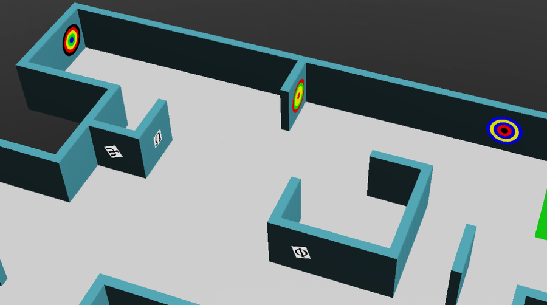

### Vítimas de letra {#letter-victims}
As vítimas de letra (letter victims) são imagens de 2 cm × 2 cm. O símbolo representa o estado de saúde da vítima, e a letra entre parênteses é o código que você informa e escreve no mapa.

| Estado | Símbolo | Código |
|---|---|---|
| Ferida (Harmed) | Φ | `H` |
| Estável (Stable) | Ψ | `S` |
| Ilesa (Unharmed) | Ω | `U` |

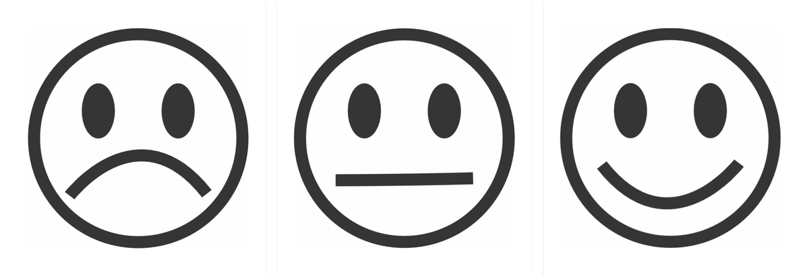

### Vítimas falsas {#fake-victims}
Alguns marcadores mostram os mesmos símbolos, mas com letras **tridimensionais**. Eles são falsos (fake victims): você não deve informá-los ao supervisor nem incluí-los no mapa. As regras dizem que essa profundidade pode ser detectada com um dos sensores disponíveis no Robot Customizer.

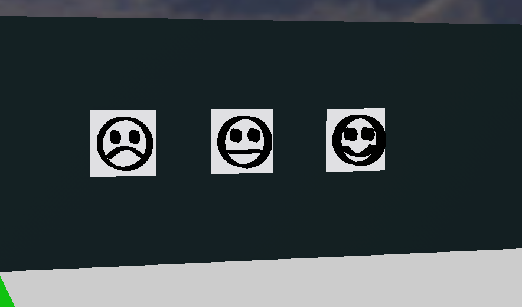

### Alvos cognitivos {#cognitive-targets}
Os alvos cognitivos (cognitive targets) representam materiais perigosos (hazmats). São círculos com 5 cm de diâmetro, formados por cinco partes concêntricas, com diâmetros de 1, 2, 3, 4 e 5 cm. Cada cor tem um valor:

| Preto | Vermelho | Amarelo | Verde | Azul |
|---|---|---|---|---|
| -2 | -1 | 0 | 1 | 2 |

Some os valores das cinco partes para obter o tipo. Se a soma não estiver na lista abaixo, o alvo é falso e não deve ser informado nem mapeado.

| Soma | Material perigoso | Código |
|---|---|---|
| 0 | Gás inflamável (Flammable Gas) | `F` |
| 1 | Veneno (Poison) | `P` |
| 2 | Corrosivo (Corrosive) | `C` |
| 3 | Peróxido orgânico (Organic Peroxide) | `O` |

Anéis vizinhos da mesma cor **não** são juntados: conte sempre as cinco partes, mesmo quando as cores se repetem.

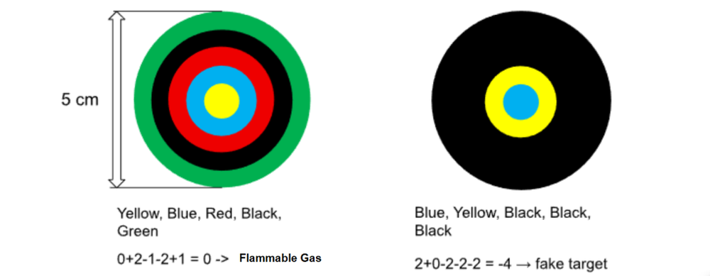

O alvo da esquerda é amarelo, azul, vermelho, preto e verde, do centro para fora: 0 + 2 - 1 - 2 + 1 = 0, então é gás inflamável (`F`). O alvo da direita é azul, amarelo, preto, preto e preto: 2 + 0 - 2 - 2 - 2 = -4, então é falso.

O [tutorial Marcadores nas paredes](/docs/programming/wall-tokens/) mostra como ler um alvo com uma câmera.

## O robô {#the-robot}
- As equipes usam o modelo de robô fornecido pelos organizadores e podem personalizá-lo com o [Robot Customizer](https://robot.erebus.rcj.cloud/) dentro de um orçamento de **3000**. Veja [Obtenha seu robô](/docs/robot/).
- O robô pode usar um GPS, um sensor de cor, sensores de distância, câmeras RGB, um LiDAR, um giroscópio e um acelerômetro.
- Os sensores simulados têm ruído realista. O seu programa precisa ser robusto a ele, e os organizadores não vão mudar os níveis de ruído na competição.
- Os robôs precisam ser autônomos. Cada equipe tem um robô no campo.
- O mapeamento prévio é proibido: isso vale tanto para o campo quanto para a localização dos marcadores, incluindo movimentos predefinidos a partir de posições conhecidas. Ele resulta em desclassificação imediata da rodada.

## Jogando uma partida {#playing-a-game}
- Uma partida dura **8 minutos de tempo simulado**. Um segundo cronômetro corre em tempo real, com limite de **10 minutos**. A partida termina quando qualquer um dos cronômetros acaba.
- Um ladrilho conta como visitado quando o centro do robô está dentro dele. O Erebus faz esse julgamento automaticamente.
- A partida também termina quando o robô envia o comando de saída, ou quando o capitão da equipe pede o fim da partida (dependendo de como a partida é executada).
- Os mundos da competição são revelados pouco antes das partidas, e os programas não podem ser alterados depois do prazo de cada rodada.

### Falta de progresso {#lack-of-progress}
Uma falta de progresso (Lack of Progress, LoP) acontece quando:

- O robô caiu em um buraco.
- O robô fica em um mesmo lugar por 20 segundos ou mais (declarada automaticamente).
- O árbitro determina que o robô não está parado, mas preso em uma sequência de movimentos.
- O próprio robô a declara de forma autônoma.
- Em outros casos, o capitão da equipe pode pedi-la, e o árbitro toma a decisão final. Isso pode não se aplicar, dependendo de como a partida é executada.

O robô é então colocado de volta no último ponto de controle visitado, ou no ladrilho inicial se nunca tiver chegado a um. A direção dele não pode ser escolhida. O Erebus também envia a letra `L` ao robô, para que o seu programa possa [reagir a ela](/docs/programming/communication/#lack-of-progress).

## Pontuação {#scoring}
A pontuação é automatizada pelo Erebus. As recompensas não se repetem: por exemplo, cada ponto de controle só pontua na primeira vez.

Para identificar um marcador, o robô precisa parar por **pelo menos 1 segundo** e depois [enviar o tipo e a posição](/docs/programming/communication/#scoring-wall-tokens) ao gerenciador da partida. O centro do robô precisa estar a no máximo meio ladrilho do marcador.

| Item | Pontos |
|---|---|
| Identificação do marcador (TI) em um ladrilho linear nas áreas 1 a 3 | Vítima de letra: 5, alvo cognitivo: 10 |
| Identificação do marcador (TI) em um ladrilho flutuante nas áreas 1 a 3, e todos os marcadores da área 4 | Vítima de letra: 15, alvo cognitivo: 30 |
| Tipo correto (TT), além da TI | Vítima de letra: 10, alvo cognitivo: 20 |
| Ponto de controle visitado (CN) | 10 |
| Identificação errada do marcador (TMI) | -5 |
| Falta de progresso (LoP) | -5 |

A pontuação total não pode ficar abaixo de zero. Uma identificação errada significa informar uma posição a mais de meio ladrilho do marcador, informar um marcador onde não há nenhum, ou informar uma vítima como material perigoso, ou vice-versa. Informar um marcador falso se encaixa na segunda categoria.

**Multiplicadores de área (AM)**: TI, TT e CN são multiplicados por 1, 1,25, 1,5 e 2 nas áreas 1, 2, 3 e 4, respectivamente. TMI e LoP não são multiplicados.

**Bônus de saída (Exit bonus, EB)**: se o robô identificou pelo menos um marcador, volta ao ladrilho inicial e envia o comando de saída, a pontuação aumenta 10%.

**Bônus de mapa (Mapping bonus, MB)**: o robô pode enviar um mapa do labirinto. O multiplicador é acerto × 1,2 + 1, então um mapa perfeito multiplica a pontuação por 2,2. Veja [Regras do mapa](/docs/rules/mapping/).

A pontuação de campo de uma partida é calculada assim:

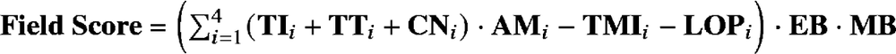

Por exemplo, uma execução com estes resultados marca 2680,15 pontos:

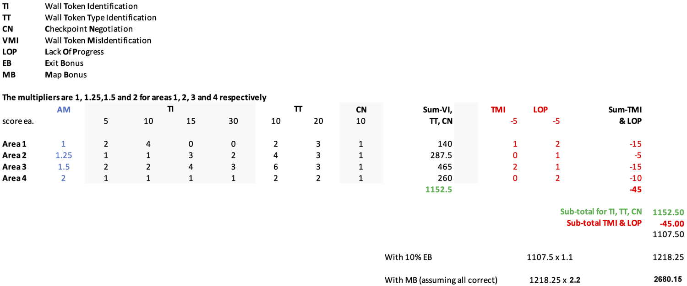

## A competição {#the-competition}
Como se preparar, os documentos que você precisa enviar, a configuração da competição e a pontuação final estão em [Preparando-se para uma competição](/docs/competition/).

## Próximo passo {#next}
Agora que você sabe o que o seu robô precisa fazer, [obtenha o seu robô](/docs/robot/).
