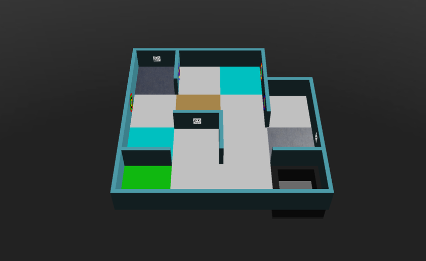

## Ideia geral {#general-idea}
O mapeamento é pontuado como um multiplicador sobre a pontuação da execução. Para obtê-lo, o robô precisa enviar uma matriz ao Main Supervisor da partida. A matriz enviada é comparada com o "gabarito" para gerar um valor de acerto (correctness), e o multiplicador é:

**multiplicador do bônus de mapa = acerto × 1,2 + 1**

Então um mapa perfeito multiplica a sua pontuação por 2,2. Para aprender a enviar a matriz, veja o [tutorial Enviar o mapa](/docs/programming/map-bonus/).

## Regras do mapeamento {#rules-for-mapping}
* Cada quarto de ladrilho, cada borda e cada vértice é representado por uma célula (valor). Um mapa de L × A ladrilhos é, portanto, uma matriz com (4 × A + 1) linhas e (4 × L + 1) colunas.
* Cada elemento do mundo é representado da seguinte forma:

| Elemento | Valor |
|---|---|
| Paredes | `1` |
| Buracos | `2` |
| Pântanos | `3` |
| Pontos de controle | `4` |
| Ladrilho inicial | `5` |
| Ladrilho com obstáculo | `x` |
| Ladrilho de contato (ciano) | `k` |
| Passagem entre as áreas 1 e 2 (azul) | `b` |
| Passagem entre as áreas 1 e 3 (amarela) | `y` |
| Passagem entre as áreas 1 e 4 (verde) | `g` |
| Passagem entre as áreas 2 e 3 (roxa) | `p` |
| Passagem entre as áreas 2 e 4 (laranja) | `o` |
| Passagem entre as áreas 3 e 4 (vermelha) | `r` |
| Marcadores nas paredes | O código correspondente (`H`, `S`, `U`, `F`, `P`, `C`, `O`) |
| Todos os ladrilhos, bordas e vértices da área 4, incluindo a sua divisa | `*` |
| Quaisquer outros ladrilhos, bordas e vértices | `0` |

* Os elementos do piso (`2`, `3`, `4`, `5`, `x`, `k` e as passagens) são escritos na célula central de cada um dos quatro quartos de ladrilho do ladrilho, como você pode ver nos exemplos abaixo.
* Nenhum ladrilho é mais de uma destas coisas ao mesmo tempo: pântano, buraco, ponto de controle, ladrilho de contato, ladrilho inicial, ladrilho com obstáculo ou passagem entre áreas.
* Nas paredes curvas da área 3, o vértice é representado por um `0`.
* Um marcador de parede é escrito na célula da parede em que ele está. Se houver vários marcadores na mesma parede, por exemplo nos dois lados dela, concatene os códigos em uma única célula, na ordem da posição absoluta no mapa: primeiro de cima para baixo, depois da esquerda para a direita.
* Os marcadores falsos não devem ser incluídos no mapa: nem as vítimas falsas, nem os alvos cognitivos com soma inválida.
* Os marcadores em ladrilhos inteiros (que não são quartos de ladrilho) podem estar em qualquer ponto ao longo da parede. Eles são escritos na célula do quarto de ladrilho de que estiverem mais perto, ou na célula do meio se estiverem perto do centro do lado do ladrilho.
* Os mapas podem ser enviados em qualquer rotação, desde que seja um múltiplo de 90°. O Erebus alinha a sua matriz com o gabarito usando o ladrilho inicial, testa cada orientação e fica com o melhor resultado.

## Como o acerto é calculado {#how-correctness-is-calculated}
1. As matrizes são alinhadas pelo ladrilho inicial. Isso significa que **o seu mapa precisa conter o ladrilho inicial**.
1. Toda posição em que a matriz enviada ou o gabarito tem um valor diferente de zero é comparada. Se os valores forem iguais, a contagem de acertos aumenta; caso contrário, a contagem de erros aumenta. Posições que são `0` nas duas são ignoradas.
1. O acerto é acertos / (acertos + erros).

Como só contam as posições que têm alguma coisa, marcar algo que não existe diminui o seu acerto tanto quanto deixar de marcar algo que existe.

## Casos ambíguos {#ambiguous-edge-cases}
Para casos ambíguos que não são tratados abaixo, entre em contato com o Comitê Internacional da RoboCupJunior Rescue e/ou com a equipe de desenvolvimento da plataforma.
### Uma parede com uma parede normal em ângulo reto de um lado e uma parede curva do outro {#one-wall-with-a-normal-right-angled-wall-and-a-curved-wall-on-each-side}
As regras dizem que os vértices de uma parede curva são representados por zeros.
A exceção é o caso a seguir, em que um lado da parede é um ângulo reto normal e o outro lado é curvo. Ele é representado como se os dois lados fossem paredes normais.


## Exemplos {#examples}
Estas são as respostas corretas para alguns dos mundos incluídos no Erebus v27, geradas pelo próprio Erebus.

Os mundos da pasta `game/worlds` mudam de uma versão para outra, então, se a sua versão do Erebus for diferente, a sua resposta pode ser diferente. O `MapScorerExample.py`, na pasta `player_controllers`, também tem matrizes de exemplo.

### mapping_example_1.wbt {#mapping_example_1wbt}
Um mundo pequeno com uma única área. O ladrilho inicial é o ladrilho verde no canto inferior esquerdo.


```
[
['1', '1', 'S', '1', '1', '1', '1', '1', '1', '1', '1', '1', '1', '0', '0', '0', '0'],
['1', '4', '0', '4', '1', '0', '0', '0', '0', '0', '0', '0', '1', '0', '0', '0', '0'],
['1', '0', '0', '0', 'C', '0', '0', '0', '0', '0', '0', '0', 'O', '0', '0', '0', '0'],
['1', '4', '0', '4', '1', '0', '0', '0', '0', '0', '0', '0', '1', '0', '0', '0', '0'],
['1', '0', '0', '0', '1', '0', '0', '0', '0', '0', '0', '0', '1', '1', '1', '1', '1'],
['1', '0', '0', '0', '0', '3', '0', '3', '0', '0', '0', '0', '1', '0', '0', '0', '1'],
['F', '0', '0', '0', '0', '0', '0', '0', '0', '0', '0', '0', 'P', '0', '0', '0', '1'],
['1', '0', '0', '0', '0', '3', '0', '3', '0', '0', '0', '0', '1', '0', '0', '0', '1'],
['1', '0', '0', '0', '1', '1', 'U', '1', '1', '0', '0', '0', '1', '0', '0', '0', '1'],
['1', '0', '0', '0', '0', '0', '0', '0', '1', '0', '0', '0', '0', '4', '0', '4', '1'],
['1', '0', '0', '0', '0', '0', '0', '0', '1', '0', '0', '0', '0', '0', '0', '0', 'H'],
['1', '0', '0', '0', '0', '0', '0', '0', '1', '0', '0', '0', '0', '4', '0', '4', '1'],
['1', '1', '1', '1', '1', '0', '0', '0', '1', '0', '0', '0', '1', '1', '1', '1', '1'],
['1', '5', '0', '5', '0', '0', '0', '0', '0', '0', '0', '0', '0', '2', '0', '2', '1'],
['1', '0', '0', '0', '0', '0', '0', '0', '0', '0', '0', '0', '0', '0', '0', '0', '1'],
['1', '5', '0', '5', '0', '0', '0', '0', '0', '0', '0', '0', '0', '2', '0', '2', '1'],
['1', '1', '1', '1', '1', '1', 'F', '1', '1', '1', '1', '1', '1', '1', '1', '1', '1']
]
```

### mapping_example_1_cyan_tiles.wbt {#mapping_example_1_cyan_tileswbt}
O mesmo mundo que `mapping_example_1.wbt`, com dois ladrilhos de contato, marcados com `k`.



```
[
['1', '1', 'S', '1', '1', '1', '1', '1', '1', '1', '1', '1', '1', '0', '0', '0', '0'],
['1', '4', '0', '4', '1', '0', '0', '0', '0', 'k', '0', 'k', '1', '0', '0', '0', '0'],
['1', '0', '0', '0', 'C', '0', '0', '0', '0', '0', '0', '0', 'O', '0', '0', '0', '0'],
['1', '4', '0', '4', '1', '0', '0', '0', '0', 'k', '0', 'k', '1', '0', '0', '0', '0'],
['1', '0', '0', '0', '1', '0', '0', '0', '0', '0', '0', '0', '1', '1', '1', '1', '1'],
['1', '0', '0', '0', '0', '3', '0', '3', '0', '0', '0', '0', '1', '0', '0', '0', '1'],
['F', '0', '0', '0', '0', '0', '0', '0', '0', '0', '0', '0', 'P', '0', '0', '0', '1'],
['1', '0', '0', '0', '0', '3', '0', '3', '0', '0', '0', '0', '1', '0', '0', '0', '1'],
['1', '0', '0', '0', '1', '1', 'U', '1', '1', '0', '0', '0', '1', '0', '0', '0', '1'],
['1', 'k', '0', 'k', '0', '0', '0', '0', '1', '0', '0', '0', '0', '4', '0', '4', '1'],
['1', '0', '0', '0', '0', '0', '0', '0', '1', '0', '0', '0', '0', '0', '0', '0', 'H'],
['1', 'k', '0', 'k', '0', '0', '0', '0', '1', '0', '0', '0', '0', '4', '0', '4', '1'],
['1', '1', '1', '1', '1', '0', '0', '0', '1', '0', '0', '0', '1', '1', '1', '1', '1'],
['1', '5', '0', '5', '0', '0', '0', '0', '0', '0', '0', '0', '0', '2', '0', '2', '1'],
['1', '0', '0', '0', '0', '0', '0', '0', '0', '0', '0', '0', '0', '0', '0', '0', '1'],
['1', '5', '0', '5', '0', '0', '0', '0', '0', '0', '0', '0', '0', '2', '0', '2', '1'],
['1', '1', '1', '1', '1', '1', 'F', '1', '1', '1', '1', '1', '1', '1', '1', '1', '1']
]
```

### mapping_example_2.wbt {#mapping_example_2wbt}
Este mundo tem obstáculos, que são marcados com `x`.


```
[
['1', '1', '1', '1', '1', '1', '1', '1', '1', '1', '1', '1', '1', '1', '1', '1', '1', '1', 'F', '1', '1'],
['1', '5', '0', '5', '1', '0', '0', '0', '0', '0', 'O', '0', '0', '0', '0', '0', '0', '0', '0', '0', '1'],
['1', '0', '0', '0', '1', '0', '0', '0', '0', '0', '1', '0', '0', '0', '0', '0', '0', '0', '0', '0', '1'],
['1', '5', '0', '5', '1', '0', '0', '0', '0', '0', '0', '0', '0', '0', '0', '0', '0', '0', '0', '0', '1'],
['1', '0', '0', '0', '1', '0', '1', '0', '0', '0', '0', '0', '0', '0', '1', '1', '1', '0', '0', '0', '1'],
['1', 'b', '0', 'b', '1', '0', 'U', '0', '0', '0', '0', '0', '0', '0', '0', '0', '1', '0', '0', '0', '1'],
['1', '0', '0', '0', '1', 'S', '1', '0', '0', '0', '0', '0', '1', '0', '0', '0', '1', '0', '1', '0', '1'],
['1', 'b', '0', 'b', '1', '0', '0', '0', '0', '0', '0', '0', '1', '0', '0', '0', '1', '0', '1', '0', '1'],
['1', '0', '0', '0', '1', '0', '0', '0', '0', '0', '0', '0', '1', 'H', '1', '1', '1', '0', '1', '0', '1'],
['1', '0', '0', '0', '0', '0', '0', '0', '0', '3', '0', '3', '0', '0', '0', '0', '0', '2', '0', '2', '1'],
['1', '0', '0', '0', '0', '0', '0', '0', '0', '0', '0', '0', '0', '0', '0', '0', '0', '0', '0', '0', '1'],
['1', '0', '0', '0', '0', '0', '0', '0', '0', '3', '0', '3', '0', '0', '0', '0', '0', '2', '0', '2', '1'],
['1', '0', '1', '1', '1', '0', '0', '0', '1', '1', '1', '1', '1', '0', '0', '0', '0', '0', '0', '0', '1'],
['1', '0', '0', '0', '0', '0', '0', '0', '1', '0', '0', '0', '1', '0', '0', '0', '0', '0', '0', '0', '1'],
['1', '0', '0', '0', '0', '0', '0', '0', '1', '0', '0', '0', '1', '1', '1', '0', '0', '0', '1', '0', '1'],
['1', '0', '0', '0', '0', '0', '0', '0', '1', '0', '0', '0', '1', '0', '0', '0', '0', '0', '1', '0', '1'],
['1', '1', '1', '0', '0', '0', '1', 'P', '1', '0', '0', '0', '1', '0', '0', '0', '1', '1', '1', '0', '1'],
['1', '0', '0', '0', '0', '4', '0', '4', '1', '0', '0', '0', '1', '0', '0', '0', '0', 'x', '0', 'x', '1'],
['1', '0', '0', '0', '0', '0', '0', '0', '1', '0', '0', '0', '1', '0', '0', '0', '0', '0', '0', '0', '1'],
['1', '0', '0', '0', '0', '4', '0', '4', '1', '0', '0', '0', 'C', '0', '0', '0', '0', 'x', '0', 'x', '1'],
['1', '1', '1', '1', '1', '1', '1', '1', '1', '0', '0', '0', '1', '1', '1', '1', '1', '1', '1', '1', '1']
]
```

### world1.wbt {#world1wbt}
Este mundo tem três áreas, com as passagens `b` e `p`.


```
[
['1', '1', '1', '1', '1', '1', '1', '1', '1', '1', '1', '1', '1', '1', '1', '1', '1', '1', '1', '1', '1', '1', '1', '1', '1', '1', '1', '1', '1', '1', '1', '1', '1'],
['1', '5', '0', '5', '0', '0', '0', '0', '0', '0', '0', '0', '0', '2', '0', '2', '1', '0', '0', '0', '1', '0', '0', '0', '0', '0', '0', '0', '0', '3', '0', '3', '1'],
['1', '0', '0', '0', '0', '0', '0', '0', '0', '0', '0', '0', '0', '0', '0', '0', '1', '0', '0', '0', '1', '0', '0', '0', '0', '0', '0', '0', '0', '0', '0', '0', '1'],
['1', '5', '0', '5', '0', '0', '0', '0', '0', '0', '0', '0', '0', '2', '0', '2', '1', '0', '0', '0', '0', '0', '0', '0', '0', '0', '0', '0', '0', '3', '0', '3', '1'],
['1', '0', '0', '0', '0', '0', '0', '0', '1', '0', '0', '0', '0', '0', '0', '0', '1', '0', '0', '0', '0', '0', '0', '0', '0', '0', '0', '0', '0', '0', '0', '0', '1'],
['1', '0', '0', '0', '0', '0', '0', '0', '1', '0', '0', '0', '0', '0', '0', '0', '1', '0', '0', '0', '0', '0', '0', '0', '0', '0', '0', '0', '0', '0', '0', '0', '1'],
['1', '0', '0', '0', '0', '0', '0', '0', '1', '0', '0', '0', '0', '0', '0', '0', '1', '0', '0', '0', '0', '0', '0', '0', '1', '0', '0', '0', '0', '0', '0', '0', 'S'],
['1', '0', '0', '0', '0', '0', '0', '0', '1', '0', '0', '0', '0', '0', '0', '0', '1', '0', '0', '0', '0', '0', '0', '0', '1', '0', '0', '0', '0', '0', '0', '0', '1'],
['1', '0', '0', '0', '1', '1', '1', '1', '1', '0', '0', '0', '1', '1', '1', '1', '1', '0', '0', '0', '0', '0', '0', '0', '1', '1', '1', '0', '0', '0', '0', '0', '1'],
['1', '0', '0', '0', '0', '0', '0', '0', '1', '0', '0', '0', '0', 'b', '0', 'b', '0', '0', '0', '0', '0', '0', '0', '0', '1', '0', '0', '0', '0', '0', '0', '0', '1'],
['F', '0', '0', '0', '0', '0', '0', '0', '1', '0', '0', '0', '0', '0', '0', '0', '0', '0', '0', '0', '0', '0', '0', '0', '1', '0', '0', '0', '0', '0', '0', '0', '1'],
['1', '0', '0', '0', '0', '0', '0', '0', '1', '0', '0', '0', '0', 'b', '0', 'b', '0', '0', '0', '0', '0', '0', '0', '0', '0', '0', '0', '0', '0', '0', '0', '0', '1'],
['1', '0', '0', '0', '0', '0', '0', '0', '1', '0', '0', '0', '1', '1', '1', '1', '1', '1', '1', '0', '0', '0', '0', '0', '1', '0', '0', '0', '1', '0', '0', '0', '1'],
['1', '0', '0', '0', '0', '0', '0', '0', '1', '0', '0', '0', '0', '0', '0', '0', '1', '0', '0', '0', '0', '0', '0', '0', '1', 'p', '0', 'p', '1', '0', '0', '0', '1'],
['1', '0', '0', '0', '0', '0', '0', '0', '1', '0', '0', '0', '0', '0', '0', '0', '1', '0', '0', '0', '0', '0', '0', '0', '1', '0', '0', '0', '1', '0', '0', '0', '1'],
['1', '0', '0', '0', '0', '0', '0', '0', '1', '0', '0', '0', '0', '0', '0', '0', '1', '0', '0', '0', '0', '0', '0', '0', '1', 'p', '0', 'p', '1', '0', '0', '0', '1'],
['1', '0', '0', '0', '0', '0', '0', '0', '1', '0', '0', '0', '0', '0', '0', '0', '1', '1', '1', '1', '1', '1', '1', '1', '1', '0', '0', '0', '1', '1', '1', '1', '1'],
['1', '0', '0', '0', '0', '0', '0', '0', '0', '0', '0', '0', '0', '0', '0', '0', '0', '0', '0', '0', '1', '0', '0', '0', '0', '0', '0', '0', '0', '0', '0', '0', '1'],
['1', '0', '0', '0', '0', '0', '0', '0', '0', '0', '0', '0', '0', '0', '0', '0', '0', '0', '0', '0', '1', '0', '0', '0', '0', '0', '0', '0', '0', '0', '0', '0', '1'],
['1', '0', '0', '0', '0', '0', '0', '0', '0', '0', '0', '0', '0', '0', '0', '0', '0', '0', '0', '0', '1', '0', '0', '0', '0', '0', '0', '0', '0', '0', '0', '0', '1'],
['1', '0', '0', '0', '0', '0', '0', '0', '1', '0', '0', '0', '1', '0', '0', '0', '0', '0', '0', '0', '1', '0', '0', '0', '0', '0', '1', '0', '0', '0', '0', '0', '1'],
['1', '0', '0', '0', '0', '0', '0', '0', '1', '0', '0', '0', '1', '0', '0', '0', '0', '0', '0', '0', '1', '0', '0', '0', '0', '0', '1', '0', '0', '0', '0', '0', '1'],
['1', '0', '0', '0', '0', '0', '0', '0', '1', '0', '0', '0', '1', '0', '0', '0', '0', '0', '0', '0', 'U', '0', '0', '0', '0', '0', '1', '1', '1', '0', '0', '0', '1'],
['1', '0', '0', '0', '0', '0', '0', '0', '1', '0', '0', '0', '1', '0', '0', '0', '0', '0', '0', '0', '1', '0', '0', '0', '0', '0', '0', '0', '0', '0', '0', '0', '1'],
['1', '0', '0', '0', '0', '0', '0', '0', '1', '1', 'H', '1', '1', '0', '0', '0', '0', '0', '0', '0', '1', '0', '0', '0', '0', '0', '0', '0', '1', '0', '0', '0', '1'],
['1', '0', '0', '0', '0', '0', '0', '0', '0', '0', '0', '0', '1', '0', '0', '0', '0', '0', '0', '0', '1', '0', '0', '0', '0', '0', '0', '0', '1', '0', '0', '0', '1'],
['1', '0', '0', '0', '0', '0', '0', '0', '0', '0', '0', '0', '1', '0', '0', '0', '0', '0', '0', '0', '1', '0', '0', '0', '0', '1', '1', '1', '0', '0', '0', '0', '1'],
['P', '0', '0', '0', '0', '0', '0', '0', '0', '0', '0', '0', '1', '0', '0', '0', '0', '0', '0', '0', '1', '0', '0', '0', '1', '0', '0', '0', '0', '0', '0', '0', '1'],
['1', '0', '0', '0', '0', '0', '0', '0', '0', '0', '0', '0', '1', '0', '0', '0', '0', '0', '0', '0', '1', '0', '0', '0', '1', '0', '0', '0', '0', '0', '0', '0', '1'],
['1', '0', '0', '0', '0', '0', '0', '0', '0', '0', '0', '0', '0', '0', '0', '0', '0', '4', '0', '4', '1', '0', '0', '0', '0', '0', '0', '0', '0', '0', '0', '0', '1'],
['1', '0', '0', '0', '0', '0', '0', '0', '0', '0', '0', '0', '0', '0', '0', '0', '0', '0', '0', '0', '1', '0', '0', '0', '0', '0', '0', '0', '0', '0', '0', '0', '1'],
['1', '0', '0', '0', '0', '0', '0', '0', '0', '0', '0', '0', '0', '0', '0', '0', '0', '4', '0', '4', '1', '0', '0', '0', '0', '0', '0', '0', '0', '0', '0', '0', '1'],
['1', '1', '1', '1', '1', '1', '1', '1', '1', '1', '1', '1', '1', '1', '1', '1', '1', '1', '1', '1', '1', '1', '1', '1', '1', '1', '1', '1', '1', '1', '1', '1', '1']
]
```

### world2.wbt {#world2wbt}
Este mundo inclui a área 4, que é preenchida com `*`, e as passagens `g` e `r`.


```
[
['1', '1', '1', '1', '1', '1', '1', '1', '1', '1', '1', '1', '1', '1', '1', '1', '1', '1', '1', '1', '1', '1', 'P', '1', '1', '1', '1', '1', '1', '1', '1', '1', '1', '1', '1', '1', '1'],
['1', '4', '0', '4', '0', '0', '0', '0', '0', '0', '0', '0', '1', '0', '0', '0', '0', '2', '0', '2', '1', '0', '0', '0', '0', '0', '0', '0', '0', '3', '0', '3', '1', '2', '0', '2', '1'],
['1', '0', '0', '0', '0', '0', '0', '0', '1', '0', '0', '0', '1', '0', '0', '0', '0', '0', '0', '0', '1', '0', '0', '0', '0', '0', '0', '0', '0', '0', '0', '0', '1', '0', '0', '0', '1'],
['1', '4', '0', '4', '0', '0', '0', '0', 'C', '0', '0', '0', '0', '0', '0', '0', '0', '2', '0', '2', '1', '0', '0', '0', '0', '0', '0', '0', '0', '3', '0', '3', '1', '2', '0', '2', '1'],
['1', '1', '1', '1', '1', '0', '0', '0', '1', '0', '0', '0', '0', '0', '0', '0', '1', '1', '1', '1', '1', '0', '0', '0', '1', '1', '1', '1', '1', '0', '0', '0', '1', '0', '0', '0', '1'],
['1', '0', '1', '0', '0', '0', '0', '0', '0', '0', '0', '0', '0', '0', '0', '0', '1', 'b', '0', 'b', '0', '0', '0', '0', '0', '0', '0', '0', '1', '0', '0', '0', '0', '0', '0', '0', '1'],
['1', 'U', '1', '0', '0', '0', '0', '0', '0', '0', '0', '0', '0', '0', '1', '1', '1', '0', '0', '0', '0', '0', '0', '0', '0', '0', '0', '0', 'O', '0', '0', '0', '0', '0', '0', '0', '1'],
['1', '0', '0', '0', '0', '0', '0', '0', '0', '0', '0', '0', '0', '0', '0', '0', '1', 'b', '0', 'b', '0', '0', '0', '0', '0', '0', '0', '0', '1', '0', '0', '0', '0', '0', '0', '0', '1'],
['1', '0', '0', '0', '0', '0', '0', '0', '1', '0', '0', '0', '0', '0', '0', '0', '1', '0', '0', '0', '1', '1', '1', '1', '1', '1', '1', '1', '1', '0', '0', '0', '1', '0', '0', '0', '1'],
['1', '0', '0', '0', '0', '0', '0', '0', '1', 'p', '0', 'p', '0', '0', '0', '0', '0', '0', '0', '0', '0', '4', '0', '4', '1', '0', '0', '0', '0', '0', '0', '0', '1', '5', '0', '5', '1'],
['1', '0', '0', '0', '1', '0', '0', '0', '1', '0', '0', '0', '1', '0', '0', '0', '0', '0', '0', '0', '0', '0', '0', '0', 'H', '0', '0', '0', '0', '0', '0', '0', '1', '0', '0', '0', '1'],
['1', '0', '0', '0', '1', '0', '0', '0', '1', 'p', '0', 'p', '1', '0', '0', '0', '0', '0', '0', '0', '0', '4', '0', '4', '1', '0', '0', '0', '0', '0', '0', '0', '1', '5', '0', '5', '1'],
['0', '1', '1', 'S', '1', '1', '1', '1', '1', '0', '0', '0', '0', '1', '1', '1', '*', '*', '*', '*', '*', '*', '*', '*', '*', '*', '*', '*', '*', '0', '0', '0', '1', '0', '0', '0', '1'],
['1', '0', '0', '0', '0', '0', '0', '0', '1', '0', '0', '0', '1', '0', '0', '0', '*', '*', '*', '*', '*', '*', '*', '*', '*', '*', '*', '*', '*', 'g', '0', 'g', '0', '0', '0', '0', '1'],
['1', '0', '0', '0', '0', '1', '1', '1', '0', '0', '0', '0', '1', '0', '0', '0', '*', '*', '*', '*', '*', '*', '*', '*', '*', '*', '*', '*', '*', '0', '0', '0', '0', '0', '0', '0', '1'],
['1', '0', '0', '0', '1', '0', '0', '0', '0', '0', '0', '0', '1', '0', '0', '0', '*', '*', '*', '*', '*', '*', '*', '*', '*', '*', '*', '*', '*', 'g', '0', 'g', '0', '0', '0', '0', '1'],
['1', '0', '0', '0', '1', '0', '0', '0', '0', '0', '1', '1', '1', '0', '0', '0', '*', '*', '*', '*', '*', '*', '*', '*', '*', '*', '*', '*', '*', '*', '*', '*', '*', '*', '*', '*', '*'],
['1', '4', '0', '4', '0', '0', '0', '0', '0', '0', '0', '0', '0', '3', '0', '3', '0', '0', '0', '0', '*', '*', '*', '*', '*', '*', '*', '*', '*', '*', '*', '*', '*', '*', '*', '*', '*'],
['1', '0', '0', '0', '0', '0', '0', '0', '0', '0', '0', '0', '0', '0', '0', '0', '0', '0', '0', '0', '*', '*', '*', '*', '*', '*', '*', '*', '*', '*', '*', '*', '*', '*', '*', '*', '*'],
['1', '4', '0', '4', '0', '0', '0', '0', '0', '0', '0', '0', '0', '3', '0', '3', '0', '0', '0', '0', '*', '*', '*', '*', '*', '*', '*', '*', '*', '*', '*', '*', '*', '*', '*', '*', '*'],
['1', '0', '0', '0', '0', '0', '0', '0', '0', '0', '0', '0', '1', '0', '0', '0', '0', '0', '0', '0', '*', '*', '*', '*', '*', '*', '*', '*', '*', '*', '*', '*', '*', '*', '*', '*', '*'],
['1', '0', '0', '0', '0', '0', '0', '0', '0', '2', '0', '2', '1', '0', '0', '0', '0', 'r', '0', 'r', '*', '*', '*', '*', '*', '*', '*', '*', '*', '*', '*', '*', '*', '*', '*', '*', '*'],
['1', '0', '0', '0', '0', '0', '1', '0', '0', '0', '0', '0', '1', '0', '0', '0', '0', '0', '0', '0', '*', '*', '*', '*', '*', '*', '*', '*', '*', '*', '*', '*', '*', '*', '*', '*', '*'],
['1', '0', '0', '0', '0', '0', '1', '0', '0', '2', '0', '2', '1', '0', '0', '0', '0', 'r', '0', 'r', '*', '*', '*', '*', '*', '*', '*', '*', '*', '*', '*', '*', '*', '*', '*', '*', '*'],
['1', '1', '1', '1', '1', '1', '1', '1', '1', '1', '1', '1', '0', '1', '1', '1', '1', '1', '1', '1', '*', '*', '*', '*', '*', '*', '*', '*', '*', '*', '*', '*', '*', '*', '*', '*', '*']
]
```
