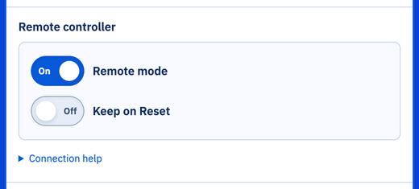

# การรันเซิร์ฟเวอร์เกมและโปรแกรมคอนโทรลเลอร์บนคอมพิวเตอร์เครื่องเดียวกัน
ก่อนอื่น ให้ลองรันเซิร์ฟเวอร์เกมและโปรแกรมคอนโทรลเลอร์ของคุณบนคอมพิวเตอร์เครื่องเดียวกัน วิธีนี้ไม่เหมือนกับการตั้งค่าที่ใช้ในการแข่งขัน แต่สะดวกสำหรับการดีบักบนเครื่องของตัวเอง

## เปิดโหมดรีโมต {#toggle-remote-mode}
เปิดโลกแล้วกด "TOGGLE REMOTE" ในหน้าต่างควบคุม ปุ่มจะเปลี่ยนเป็นสีส้มเพื่อแสดงว่าโหมดรีโมตเปิดอยู่



หากหน้าต่างควบคุมไม่แสดง ให้คลิกขวาที่ "DEF MAINSUPERVISOR Robot" ใน Scene Tree แล้วเลือก "Show Robot Window"

## รันโปรแกรมของคุณ {#execute-your-program}
เปิดเทอร์มินัลแล้วรันคำสั่งต่อไปนี้ โดยแทนที่ `<Your controller path>` ด้วยพาธของโปรแกรมคอนโทรลเลอร์ของคุณ

```bash
export WEBOTS_HOME=/usr/local/webots
"$WEBOTS_HOME/webots-controller" "<Your controller path>"
```

คำสั่งนี้สมมติว่าติดตั้ง Webots ด้วยแพ็กเกจ `.deb` ไว้ที่ `/usr/local/webots` หากคุณติดตั้งไว้ที่อื่น ให้เปลี่ยน `WEBOTS_HOME` ให้ตรงกัน

คอนโทรลเลอร์จะเชื่อมต่อกับ Webots และรอจนกว่าเกมจะเริ่ม

## เริ่มเกม {#start-the-game}
กดปุ่มเริ่มในหน้าต่างควบคุม หุ่นยนต์จะปรากฏขึ้น และโปรแกรมของคุณจะเริ่มทำงาน

## หยุดเกม {#terminate-the-game}
หากต้องการหยุดเกม ให้กด Ctrl+C ในเทอร์มินัล

เมื่อการจำลองสิ้นสุดลง ตัวจัดการเกมของ Erebus ก็จะหยุดทำงานด้วย หากต้องการรันเกมอีกครั้ง ให้โหลดโลกใหม่

# การรันเซิร์ฟเวอร์เกมบนคอมพิวเตอร์อีกเครื่องหนึ่ง
นี่คือการตั้งค่าที่ใช้ในการแข่งขันอย่างเป็นทางการ คอมพิวเตอร์ที่รันคอนโทรลเลอร์ของคุณ (ไคลเอนต์) และคอมพิวเตอร์ที่รันเกม (เซิร์ฟเวอร์) ต้องเชื่อมต่อกับเครือข่ายเดียวกัน

1. (เซิร์ฟเวอร์) เริ่ม Webots บนเซิร์ฟเวอร์ เปิดโลก แล้วเปิดโหมดรีโมตในหน้าต่างควบคุม
1. (เซิร์ฟเวอร์) หาที่อยู่ IP ของเซิร์ฟเวอร์ เช่น ด้วยคำสั่ง `ip addr`
1. (ไคลเอนต์) รันคำสั่งต่อไปนี้ โดยแทนที่ `<Your controller path>` ด้วยพาธของโปรแกรมคอนโทรลเลอร์ของคุณ และ `<Server IP address>` ด้วยที่อยู่ IP ที่หาได้ในขั้นตอนก่อนหน้า

    ```bash
    export WEBOTS_HOME=/usr/local/webots
    "$WEBOTS_HOME/webots-controller" --protocol=tcp --ip-address=<Server IP address> "<Your controller path>"
    ```
1. (เซิร์ฟเวอร์) เริ่มเกมโดยกดปุ่มเริ่ม

## การแก้ไขปัญหา {#troubleshooting}
- **คอนโทรลเลอร์เชื่อมต่อไม่ได้:** ตรวจสอบว่าคอมพิวเตอร์ทั้งสองเครื่องติดต่อกันได้ (เช่น ด้วย `ping`) ไฟร์วอลล์ของเซิร์ฟเวอร์อนุญาตพอร์ต TCP 1234 และรายการ IP ที่อนุญาตในแท็บ Network ของ Preferences ใน Webots ว่างอยู่หรือมี IP ของไคลเอนต์อยู่ด้วย
- **แสดง `No robot name provided`:** ข้อความนี้เป็นเรื่องปกติขณะที่คอนโทรลเลอร์รออยู่ หากข้อความไม่หายไป แสดงว่าโหมดรีโมตไม่ได้เปิดอยู่ ให้ตรวจสอบปุ่ม TOGGLE REMOTE
- **คอนโทรลเลอร์หาไลบรารี Python ไม่พบ:** โปรแกรมรันด้วย Python ที่ติดตั้งอยู่บนไคลเอนต์ จึงต้องติดตั้งไลบรารีไว้ที่เครื่องนั้น

# เอกสารทางการ
ดูรายละเอียดเพิ่มเติมเกี่ยวกับการตั้งค่านี้ได้ใน[คู่มือของ Webots](https://cyberbotics.com/doc/guide/running-extern-robot-controllers?version=R2023b)
