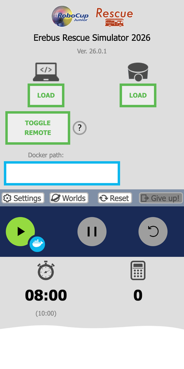
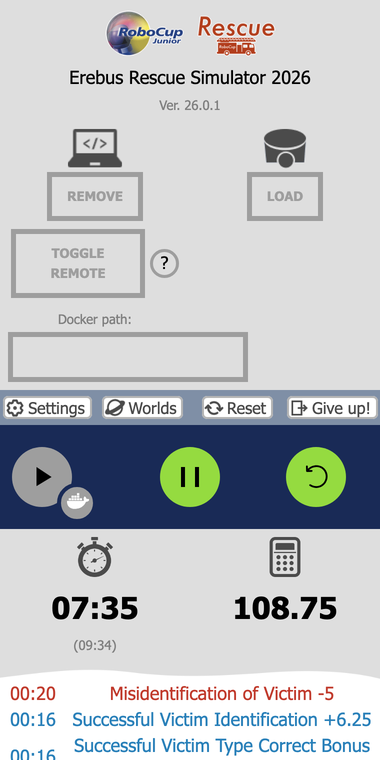
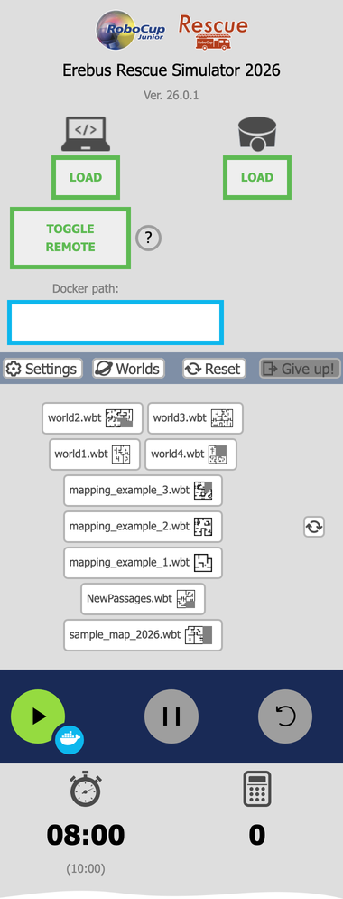
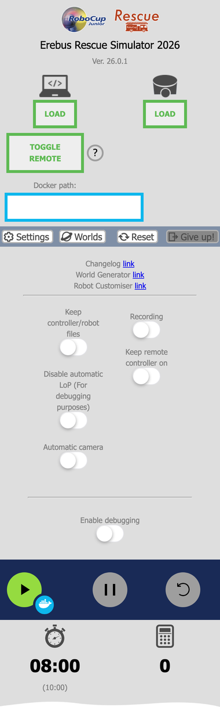
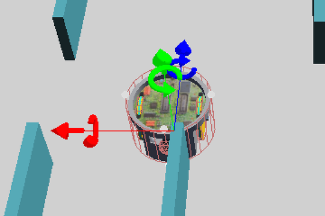

import mazeUrl from '../../../docs/getting-started/../programming/navigate-the-maze/maze.py?url';

ในหน้านี้ คุณจะรันโปรแกรมที่สมบูรณ์บนหุ่นยนต์ของคุณ และเรียนรู้การใช้หน้าต่างควบคุมของ Erebus คุณต้อง[ติดตั้ง Erebus](/docs/installation/) และมี[หุ่นยนต์ของคุณ](/docs/robot/) แล้ว

## โฟลเดอร์ Erebus \{#the-erebus-folder\}
โฟลเดอร์หลักในรีลีสที่คุณดาวน์โหลดมามีดังนี้:

| โฟลเดอร์ | เนื้อหา |
|---|---|
| `game/worlds` | โลกต่าง ๆ (ไฟล์ `.wbt`) เปิดไฟล์ใดไฟล์หนึ่งเพื่อเริ่มต้น |
| `game/logs` | บันทึกของเกม (log) ที่เขียนเมื่อจบแต่ละเกม |
| `player_controllers` | คอนโทรลเลอร์ตัวอย่าง |

## หน้าต่างควบคุม \{#the-control-window\}
1. เปิด `game/worlds/world1.wbt` ใน Webots
1. Webots จะเปิดหน้าต่างควบคุมของ Erebus (robot window ของ Main Supervisor) ในเว็บเบราว์เซอร์ของคุณ คุณใช้หน้าต่างนี้โหลดโปรแกรมและรันเกม

| ส่วน | การใช้งาน |
|---|---|
| **LOAD** ด้านซ้าย (ไอคอนแล็ปท็อป) | โหลดโปรแกรมคอนโทรลเลอร์ของหุ่นยนต์ |
| **LOAD** ด้านขวา (ไอคอนหุ่นยนต์) | โหลดหุ่นยนต์ของคุณ (ไฟล์ `.json`) |
| **TOGGLE REMOTE** | ให้โปรแกรมที่รันอยู่นอก Webots ควบคุมหุ่นยนต์ได้ ดู [Remote Controller](/docs/competition/remote-controller/) |
| **Docker path** | โฟลเดอร์ที่มี `Dockerfile` สำหรับรันคอนโทรลเลอร์ในคอนเทนเนอร์ด้วยปุ่ม Docker ข้างปุ่มเล่น ดูรีโพสิทอรี [erebus-dockerfiles](https://github.com/robocup-junior/erebus-dockerfiles) ส่วนนี้ไม่บังคับ |
| **Settings** | ลิงก์และตัวเลือกต่าง ๆ อธิบายไว้ด้านล่าง |
| **Worlds** | เปลี่ยนไปยังโลกอื่น |
| **Reset** | รีเซ็ตโปรแกรมที่โหลดไว้และเกม |
| **Give up!** | จบเกม |
| ตัวจับเวลา | เวลาของเกม และใต้ลงมาคือเวลาจริงในวงเล็บ เกมจะจบเมื่อเวลาใดเวลาหนึ่งถึง 0 |
| เครื่องคิดเลข | คะแนนปัจจุบัน |

## รันโปรแกรม \{#run-a-program\}
<a href={mazeUrl} download="maze.py">ดาวน์โหลด maze.py</a> ซึ่งเป็นโปรแกรมที่สมบูรณ์ที่ขับหุ่นยนต์ไปรอบเขาวงกต นี่คือโปรแกรมที่คุณจะเขียนเองใน[นำทางในเขาวงกต](/docs/programming/navigate-the-maze/)

1. เปิด `game/worlds/world1.wbt`
1. โหลดหุ่นยนต์ของคุณด้วย**ปุ่ม LOAD ด้านขวา** หากยังไม่ได้โหลด โลกจะโหลดใหม่พร้อมหุ่นยนต์ของคุณ
1. โหลด `maze.py` ด้วย**ปุ่ม LOAD ด้านซ้าย** เมื่อโหลดโปรแกรมแล้ว ปุ่มจะเปลี่ยนเป็นปุ่ม REMOVE สีส้ม
1. กดปุ่มเริ่ม หุ่นยนต์จะปรากฏในโลกและเริ่มเคลื่อนที่

1. หากต้องการหยุดหุ่นยนต์ชั่วคราว ให้กดปุ่มหยุดชั่วคราว

1. หากหุ่นยนต์ติดอยู่ ให้กดปุ่มเริ่มใหม่ (restart) เพื่อเรียกการไม่มีความคืบหน้า (lack of progress) ซึ่งจะย้ายหุ่นยนต์กลับไปยังจุดตรวจ (checkpoint) ล่าสุดที่ไปถึง และเสีย 5 คะแนน

1. กดปุ่ม Reset เพื่อรีเซ็ตโปรแกรมที่โหลดไว้และเกมที่กำลังดำเนินอยู่ หากต้องการรันอีกครั้งหลังจากเกมจบแล้ว ให้โหลดโลกใหม่

โปรแกรมนี้ต้องใช้ OpenCV ซึ่งคุณติดตั้งไว้แล้วพร้อมกับ[ไลบรารี Python](/docs/installation/#python-libraries) อื่น ๆ ข้อความจากโปรแกรมของคุณและข้อผิดพลาดจะแสดงในคอนโซลของ Webots

ระหว่างเกม ประวัติคะแนนจะแสดงที่ด้านล่างของหน้าต่าง ประวัตินี้บอกได้ชัดเจนว่าคุณได้หรือเสียคะแนนเพราะอะไร จึงเป็นเครื่องมือที่ดีที่สุดในการตรวจสอบโปรแกรมของคุณ

เมื่อจบเกม ข้อมูลเดียวกันนี้จะถูกบันทึกไว้ในโฟลเดอร์ `game/logs`

## การใช้โลกอื่น \{#using-other-worlds\}
กด **Worlds** เพื่อเปลี่ยนไปยังโลกอื่น แต่ละโลกมีภาพตัวอย่าง (thumbnail) และคุณยังเพิ่มโลกของคุณเองที่สร้างด้วย [World Editor](/docs/tools/world-editor/) ได้ด้วย

โลกที่มีมาให้ใน Erebus v26.1 ได้แก่:

| โลก | วัตถุประสงค์ |
|---|---|
| `world1.wbt`, `world2.wbt` | โลกตัวอย่าง `world2.wbt` มีพื้นที่ 4 |
| `world3.wbt`, `world4.wbt` | โลกตัวอย่างที่ใหญ่ขึ้น ซึ่งมี**ผู้ประสบภัยปลอม (fake victims)** ด้วย |
| `mapping_example_1.wbt` ถึง `mapping_example_3.wbt` | โลกสำหรับทดสอบการทำแผนที่ ดู[การทำแผนที่](/docs/rules/mapping/) |
| `NewPassages.wbt` | ตัวอย่างทางผ่านระหว่างพื้นที่ |

## การตั้งค่า \{#settings\}

| การตั้งค่า | การใช้งาน |
|---|---|
| Keep controller/robot files | คงโปรแกรมและหุ่นยนต์ที่โหลดไว้เมื่อโหลดโลกใหม่ |
| Disable automatic LoP | ปิดการไม่มีความคืบหน้าอัตโนมัติหลัง 20 วินาที ใช้เพื่อการดีบักเท่านั้น |
| Automatic camera | ทำให้มุมมองติดตามหุ่นยนต์ |
| Recording | บันทึกเกมเป็นวิดีโอ |
| Keep remote controller on | คง TOGGLE REMOTE ไว้เมื่อโหลดโลกใหม่ |
| Enable debugging | พิมพ์ข้อมูลเพิ่มเติมในคอนโซลของ Webots เช่น เหตุผลที่การรายงานสัญลักษณ์บนผนังถูกปฏิเสธ |

ลิงก์ด้านบนจะนำไปยังบันทึกการเปลี่ยนแปลง (changelog) และเครื่องมือสำหรับสร้างโลกและหุ่นยนต์ หากต้องการสร้างโลกตามกติกาปี 2026 ให้ใช้ [World Editor](https://world.erebus.rcj.cloud/)

## ย้ายหุ่นยนต์ไปยังตำแหน่งที่ต้องการด้วยตัวเอง \{#manually-move-the-robot-where-you-want-it-to-go\}
เมื่อคลิกที่หุ่นยนต์ในหน้าต่างการจำลอง จะมีลูกศรสีแดง เขียว และน้ำเงินปรากฏขึ้น ลากลูกศรเหล่านี้ด้วยเมาส์เพื่อย้ายหุ่นยนต์ไปยังตำแหน่งใดก็ได้ โปรดทราบว่าหุ่นยนต์จะไม่แสดงจนกว่าโปรแกรมจะเริ่มทำงาน

## ขั้นต่อไป \{#next\}
คุณได้เห็นหุ่นยนต์สำรวจเขาวงกตด้วยตัวเองแล้ว ต่อไปมาเรียนรู้การเขียนโปรแกรมเอง เริ่มที่[โปรแกรมแรกของคุณ](/docs/programming/first-program/)
