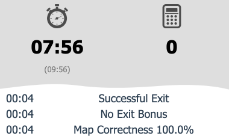

import CodeTabs from '@/components/CodeTabs.astro';

โบนัสแผนที่ (mapping bonus) คูณคะแนนของคุณได้สูงสุด 2.2 เท่า จึงมีค่ามาก วิธีรับโบนัสนี้มีดังนี้:

1. ใส่แผนที่ลงในอาร์เรย์ ตามที่อธิบายไว้ใน[กติกาการทำแผนที่](/docs/rules/mapping/)
1. ส่งขนาดของอาร์เรย์ ตามด้วยอาร์เรย์ที่แปลงเป็นมิติเดียวในรูปข้อความ UTF-8 ที่คั่นด้วยเครื่องหมายจุลภาค
1. ส่ง `M` เพื่อขอให้ประเมินแผนที่
1. จบเกม Erebus จะนำโบนัสไปคิดกับคะแนนของคุณเมื่อเกมจบ

## สิ่งที่ควรรู้ \{#things-to-know\}

- คุณส่งแผนที่ได้ทุกเมื่อระหว่างเกม แต่**แผนที่จะถูกประเมินเพียงครั้งเดียว** ข้อความ `M` ที่ส่งภายหลังจะถูกละเว้น ดังนั้นให้ส่งเมื่อแผนที่สมบูรณ์ที่สุดเท่าที่จะทำได้แล้ว
- ตรวจสอบให้แน่ใจว่ายังมีเวลาเหลือ หากเกมจบก่อนที่คุณจะส่ง `M` ก็จะไม่มีแผนที่ให้ประเมิน
- คุณไม่จำเป็นต้องส่ง `E` เพื่อรับโบนัส เพราะโบนัสจะถูกนำไปคิดด้วยเมื่อหมดเวลา แต่ `E` คือวิธีรับโบนัสออกจากสนาม (exit bonus) และโบนัสนั้นจะถูกบวกก่อนนำโบนัสแผนที่ไปคิด
- แผนที่ต้องมีช่องเริ่มต้น (`5`) ซึ่งใช้ในการจัดแนวให้ตรงกับคำตอบที่ถูกต้อง หากไม่มี ก็จะประเมินแผนที่ไม่ได้
- ผลลัพธ์จะแสดงเป็น `Map Correctness` ในประวัติของหน้าต่างควบคุม หากคุณได้ `Map scoring error` ในคอนโซลของ Webots ให้ตรวจสอบรูปแบบของคุณ

ตัวอย่างด้านล่างส่งคำตอบที่ถูกต้องของ `world1.wbt` ซึ่งมีประโยชน์ในการตรวจสอบโค้ดการสื่อสารของคุณ หากรันตอนเริ่มเกม เกมจะจบทันทีและคะแนนจะยังเป็น 0 เพราะตัวคูณไม่มีคะแนนให้คูณ

<CodeTabs file="basics" />

ตัวอย่าง `MapScorerExample.py` ในโฟลเดอร์ `player_controllers` ของรีลีส Erebus ก็ทำงานในลักษณะเดียวกัน
