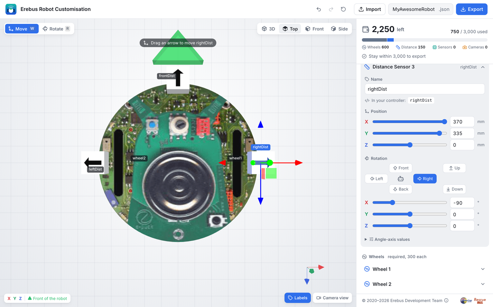

import CodeTabs from '@/components/CodeTabs.astro';

เซนเซอร์วัดระยะจะวัดระยะห่างเป็น**เมตร** ถึงวัตถุชิ้นแรกที่อยู่ด้านหน้า ได้ไกลสุด 0.8 เมตร หุ่นยนต์เริ่มต้นมีเซนเซอร์นี้สามตัว ได้แก่ `leftDist`, `frontDist` และ `rightDist` ซึ่งหันไปทางซ้าย ด้านหน้า และขวา

## การอ่านค่าเซนเซอร์ \{#reading-a-sensor\}

<CodeTabs file="read" />

## การหาผนัง \{#finding-walls\}

ช่อง (tile) หนึ่งช่องกว้าง 12 ซม. ดังนั้นเมื่อหุ่นยนต์อยู่กลางช่อง ผนังที่อยู่ด้านข้างจะห่างประมาณ 5 ซม. โปรแกรมนี้ตรวจสอบเซนเซอร์ทั้งสามตัว และพิมพ์ว่าตัวใดเห็นผนัง:

<CodeTabs file="walls" />

เซนเซอร์วัดระยะจากตำแหน่งที่ติดตั้งอยู่บนหุ่นยนต์ ไม่ใช่จากจุดกึ่งกลางของหุ่นยนต์ ลองพิมพ์ค่าออกมาเมื่ออยู่ข้างผนัง เพื่อเลือกค่าเกณฑ์ (threshold) ของคุณเอง
