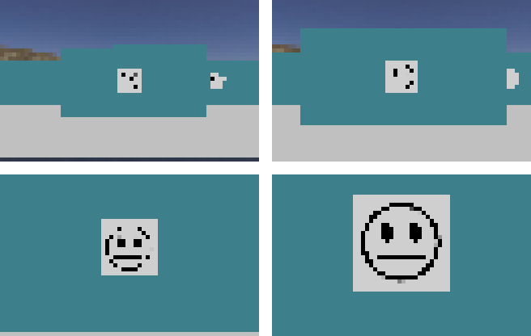
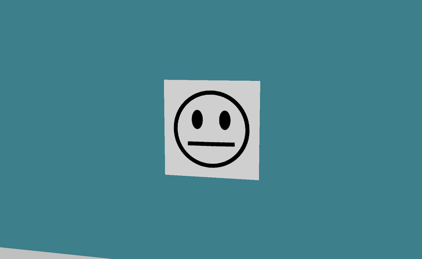
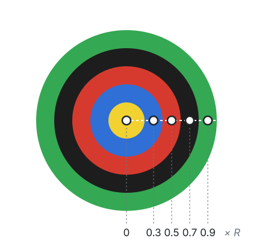
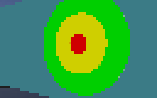
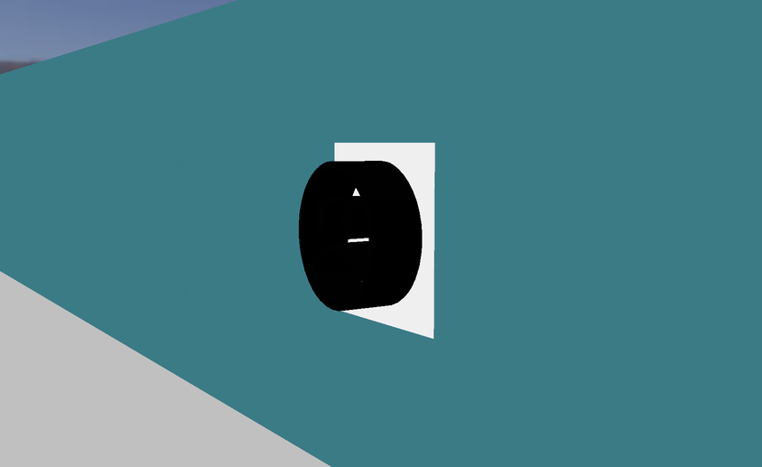

import CodeTabs from '@/components/CodeTabs.astro';

## สิ่งที่หุ่นยนต์ต้องทำ \{#what-the-robot-has-to-do\}
สัญลักษณ์บนผนัง (wall tokens) เป็นแหล่งคะแนนส่วนใหญ่ของคุณ และการรายงานผิดแต่ละครั้งเสีย 5 คะแนน ดังนั้นสำหรับสัญลักษณ์แต่ละอันที่พบ คุณต้องตัดสินใจระหว่าง:

| สิ่งนั้นคือ... | สิ่งที่ต้องทำ |
|---|---|
| ผู้ประสบภัยแบบหน้ายิ้ม (หน้าเศร้า หน้าเฉย ๆ หน้ายิ้ม) | รายงาน `H`, `S` หรือ `U` |
| ผู้ประสบภัยปลอม (ใบหน้าเดียวกัน แต่เป็นสามมิติ) | ไม่ต้องรายงาน และไม่ใส่ลงในแผนที่ |
| เป้าหมายเชิงรับรู้ที่มีผลรวม 0 ถึง 3 | รายงาน `F`, `P`, `C` หรือ `O` |
| เป้าหมายเชิงรับรู้ที่มีผลรวมเป็นค่าอื่น | เป็นของปลอม: ไม่ต้องรายงาน และไม่ใส่ในแผนที่ |

ดูคำนิยามที่แน่นอนได้ใน[กติกา](/docs/rules/#wall-tokens) และวิธีส่งรายงานใน[การสื่อสาร](/docs/programming/communication/#scoring-wall-tokens)

## สิ่งที่กล้องเห็น \{#what-the-camera-sees\}
กล้องของหุ่นยนต์เริ่มต้นมีขนาด 64 × 40 พิกเซล ที่ความละเอียดนี้ สัญลักษณ์จะมีขนาดเพียงไม่กี่พิกเซลจนกว่าหุ่นยนต์จะเข้าใกล้ จึงควรมองหาสิ่งที่น่าจะเป็นสัญลักษณ์จากระยะไกล แล้วค่อยเข้าใกล้เพื่ออ่าน อย่าลืมว่าการรายงานต้องให้หุ่นยนต์อยู่ห่างจากสัญลักษณ์ไม่เกินครึ่งช่อง และกล้องแบบกำหนดเองมีความละเอียดสูงกว่านี้ได้ แต่ต้องใช้งบประมาณมากขึ้น

ผู้ประสบภัยแบบหน้ายิ้มเป็นใบหน้าสีดำบนสี่เหลี่ยมสีขาว และอาจหมุนไปทำมุมใดก็ได้ ดังนั้นวิธีของคุณต้องไม่ขึ้นกับทิศทาง ใบหน้าทั้งสามแบบต่างกันที่รูปปาก หน้าเศร้า (`H`) ปากโค้งลง หน้าเฉย ๆ (`S`) ปากตรง และหน้ายิ้ม (`U`) ปากโค้งขึ้น

## การอ่านเป้าหมายเชิงรับรู้ \{#reading-a-cognitive-target\}
เป้าหมายเชิงรับรู้ประกอบด้วยห้าส่วนที่ซ้อนกันเป็นวงกลมร่วมศูนย์ จึงไม่จำเป็นต้องจำแนกรูปทรงของมัน เมื่อหาจุดศูนย์กลางและรัศมีด้านนอกได้แล้ว ก็อ่านค่าสีที่ตรงกลางของแต่ละส่วนได้เลย ส่วนต่าง ๆ มีรัศมี 0.5, 1, 1.5, 2 และ 2.5 ซม. ดังนั้นจุดกึ่งกลางของแต่ละส่วนอยู่ที่ 0, 0.3, 0.5, 0.7 และ 0.9 ของรัศมีด้านนอก

ฟังก์ชันด้านล่างทำเช่นนั้นด้วย OpenCV ใน Python ในการหาจุดศูนย์กลางและรัศมี คุณอาจใช้เส้นขอบ (contour) ของเป้าหมาย เหมือนใน[นำทางในเขาวงกต](/docs/programming/navigate-the-maze/)

<CodeTabs file="readRings" />

ในการรันจริง หุ่นยนต์อาจมองเห็นเป้าหมายจากมุมเอียง ซึ่งจะทำให้เป้าหมายดูเป็นวงรี การเข้าไปอยู่ด้านหน้าเป้าหมาย การใช้สีที่ดูผิดปกติเป็นสัญญาณเตือน หรือการอ่านหลายเฟรม จะทำให้ผลลัพธ์น่าเชื่อถือขึ้น

## การคำนวณชนิด \{#calculating-the-type\}
เมื่อได้สีครบทั้งห้าแล้ว รหัสที่ต้องรายงานมาจากผลรวมของค่าสีเหล่านั้น ต้องนับทั้งห้าส่วนเสมอ แม้ว่าสีที่อยู่ติดกันจะเป็นสีเดียวกัน

<CodeTabs file="targetCode" />

ตัวอย่างเช่น `['Y', 'B', 'R', 'K', 'G']` มีผลรวมเป็น 0 จึงเป็น `F` และ `['B', 'Y', 'K', 'K', 'K']` มีผลรวมเป็น -4 จึงเป็นของปลอม

## การตรวจจับผู้ประสบภัยปลอม \{#detecting-fake-victims\}
ผู้ประสบภัยปลอมแสดงใบหน้าเหมือนของจริง แต่อีโมจิเป็นสามมิติ ถ้ามองจากด้านหน้า กล้องอย่างเดียวอาจแยกไม่ออก

กติการะบุว่าความลึกตรวจจับได้ด้วยเซนเซอร์ตัวใดตัวหนึ่งที่มีใน Robot Customizer แนวทางที่น่าลอง:

- เปรียบเทียบค่าระยะที่วัดได้ตลอดแนวสัญลักษณ์ ด้วย Lidar หรือเซนเซอร์วัดระยะ เพื่อหาความแตกต่างของความสูง
- มองสัญลักษณ์จากมุมเฉียง ซึ่งส่วนนูนจะทำให้รูปทรงของใบหน้าเปลี่ยนไป

โลก `world3.wbt`, `world4.wbt` และโลก `2027_` ทั้งสี่ มีผู้ประสบภัยปลอม และ [World Editor](/docs/tools/world-editor/#victims-and-cognitive-targets) เพิ่มของปลอมลงในแผนที่ของคุณเองได้ Erebus ยังมีสคริปต์ `scripts/update_maps_with_fakes.py` ซึ่งสุ่มเปลี่ยนผู้ประสบภัยในโลกที่มีอยู่ให้เป็นของปลอม

การรายงานของปลอมจะเสีย 5 คะแนนเพราะนับเป็นการระบุผิด ขณะที่ผู้ประสบภัยจริงบนช่องเชิงเส้นมีค่า 15 คะแนนพร้อมชนิดในพื้นที่ 1 และมากกว่านั้นในพื้นที่อื่น ให้คำนึงถึงข้อนี้เมื่อตัดสินใจว่าหุ่นยนต์ต้องมั่นใจแค่ไหนก่อนรายงาน
