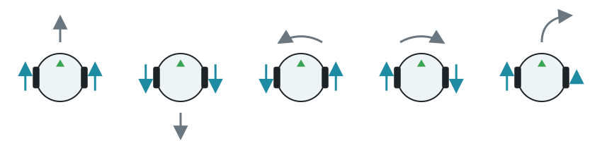

import CodeTabs from '@/components/CodeTabs.astro';

Robotun iki tekerleği vardır ve her birinin kendi motoru bulunur: [başlangıç robotunda](/docs/robot/) `left wheel motor` ve `right wheel motor`. Robotu her tekerleğin hızını ayarlayarak sürersin:

| Sol tekerlek | Sağ tekerlek | Robot... |
|---|---|---|
| İleri | İleri | İleri gider |
| Geri | Geri | Geri gider |
| Geri | İleri | Olduğu yerde sola döner |
| İleri | Geri | Olduğu yerde sağa döner |
| Hızlı | Yavaş | Sağa doğru kavis çizer |

Hızlar **radyan/saniye** cinsindendir, en fazla 6,28'dir (saniyede tekerleğin bir tam turu). Negatif hızlar tekerleği geriye döndürür.

## Sürme \{#driving\}

1. Her motoru adıyla al.
2. Sınırsız dönmesi için konumunu sonsuza ayarla.
3. Hızını ayarla.

Motorlar ayarladığın son hızı korur; bu yüzden programın başka işler yaparken robot hareket etmeye devam eder. Bu program robotu ileri ve geri sürer, sonra olduğu yerde sola döndürür; her hareket bir saniye sürer:

<CodeTabs file="drive" />

:::note
Webots'ta açılar radyan cinsindendir. Dönüştürmek için: radyan = derece × π / 180.
:::

## Tekerleğin ne kadar döndüğünü ölçme \{#measuring-how-far-a-wheel-turned\}

Her motorun, enkoder (encoder) da denen bir konum sensörü vardır. Bu sensör, tekerleğin ne kadar döndüğünü radyan cinsinden sayar ve belirli bir mesafe gitmek için kullanışlıdır. Tekerlek geriye dönünce sayı azalır.

<CodeTabs file="encoders" />

Bir hareketi süreyle kontrol etmek basittir, ama sonuç hıza göre değişir. Enkoderler hareketin kendisini ölçer, bu yüzden daha güvenilirdir. Hassas dönüşler için [jiroskop](/docs/programming/sensors/imu/) daha da iyidir.

Sırada [sensörleri](/docs/programming/sensors/) okumayı öğrenmek var.
