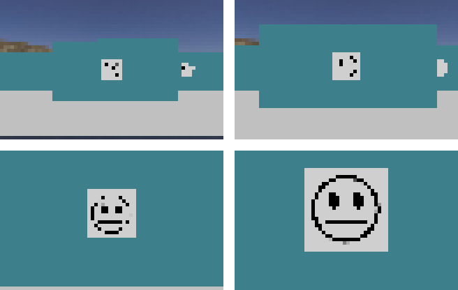
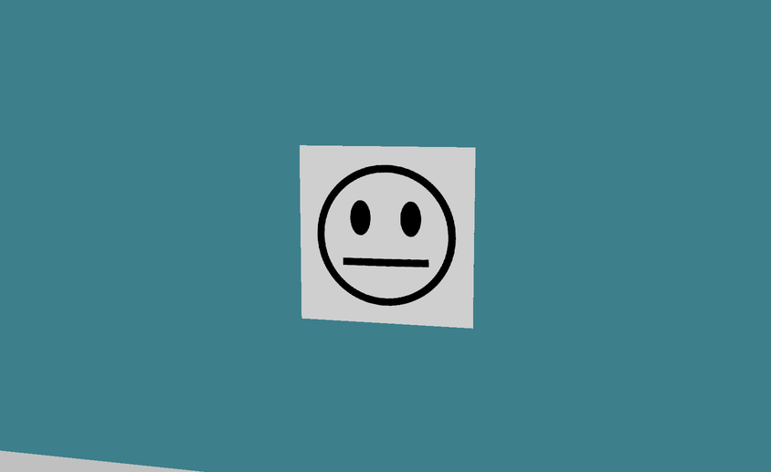
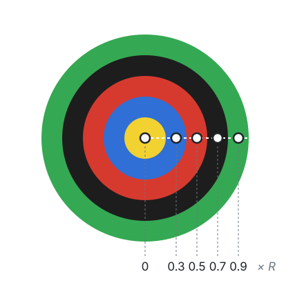
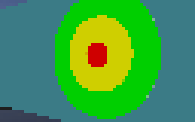
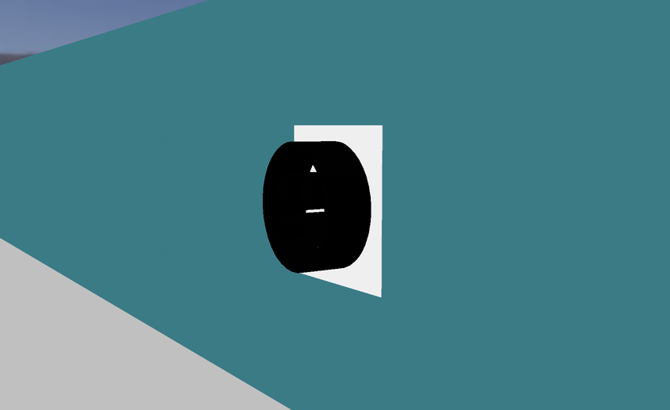

import CodeTabs from '@/components/CodeTabs.astro';

## Robotun yapması gerekenler \{#what-the-robot-has-to-do\}
Duvar işaretleri (wall tokens) puanlarının çoğunu oluşturur ve her yanlış bildirim 5 puana mal olur. Bu yüzden bulduğun her işaret için şunlar arasında karar vermelisin:

| İşaret... | Ne yapmalı |
|---|---|
| Bir gülen yüz kazazede (üzgün, nötr, mutlu) | `H`, `S` veya `U` bildir |
| Sahte bir kazazede (aynı yüzler, üç boyutlu) | Bildirme ve haritaya koyma |
| Toplamı 0 ile 3 arasında olan bir bilişsel hedef | `F`, `P`, `C` ya da `O` bildir |
| Toplamı başka bir değer olan bilişsel hedef | Sahtedir: bildirme ve haritaya ekleme |

Kesin tanımlar için [Kurallar](/docs/rules/#wall-tokens) sayfasına, bildirimin nasıl gönderileceği için [İletişim](/docs/programming/communication/#scoring-wall-tokens) sayfasına bak.

## Kameranın gördükleri \{#what-the-camera-sees\}
Başlangıç robotunun kamerası 64 × 40 pikseldir. Bu çözünürlükte bir işaret, robot yaklaşana kadar yalnızca birkaç pikselden ibarettir. Bu yüzden adayları uzaktan arayıp sonra okumak için yaklaşmak en iyisidir. Bildirim yapabilmek için robotun işarete en fazla yarım kare uzaklıkta olması gerektiğini ve özel kameraların daha yüksek çözünürlüğe sahip olabileceğini, ama bunun bir maliyeti olduğunu unutma.

Gülen yüz kazazedeler beyaz bir kare üzerindeki siyah yüzlerdir ve herhangi bir açıyla döndürülmüş olabilir, bu yüzden yöntemin yöne bağlı olmamalıdır. Üç yüz, ağzın biçimiyle ayrılır: üzgün yüzde (`H`) aşağı kıvrık, nötr yüzde (`S`) düz, mutlu yüzde (`U`) yukarı kıvrıktır.

## Bilişsel hedefi okuma \{#reading-a-cognitive-target\}
Bilişsel hedef beş eş merkezli parçadan oluşur, bu yüzden şeklini tanımana gerek yoktur: merkezini ve dış yarıçapını bulduktan sonra her parçanın ortasındaki rengi örnekleyebilirsin. Parçaların yarıçapları 0,5, 1, 1,5, 2 ve 2,5 cm'dir; bu yüzden orta noktaları dış yarıçapın 0, 0,3, 0,5, 0,7 ve 0,9'undadır.

Bu fonksiyon bunu Python'da OpenCV ile yapar. Merkezi ve yarıçapı bulmak için örneğin [Labirentte yol bul](/docs/programming/navigate-the-maze/) sayfasındaki gibi hedefin konturunu kullanabilirsin.

<CodeTabs file="readRings" />

Gerçek bir oyunda hedef eğik bir açıdan görülebilir; bu durumda elips gibi görünür. Hedefin karşısına geçmek, yanlış görünen renkleri bir uyarı işareti olarak değerlendirmek ya da birkaç görüntü karesini okumak sonucu daha güvenilir hale getirir.

## Türü hesaplama \{#calculating-the-type\}
Beş rengi elde ettikten sonra bildireceğin kod, bu renklerin toplamından çıkar. Komşu renkler aynı olsa bile beş parçanın her biri her zaman ayrı sayılır.

<CodeTabs file="targetCode" />

Örneğin `['Y', 'B', 'R', 'K', 'G']` toplamı 0 eder, yani `F`'dir; `['B', 'Y', 'K', 'K', 'K']` ise toplamı -4 eder, yani sahtedir.

## Sahte kazazedeleri tespit etme \{#detecting-fake-victims\}
Sahte kazazedeler gerçekleriyle aynı yüzleri gösterir ama emojiler üç boyutludur. Önden bakıldığında yalnızca bir kamera onları ayırt edemeyebilir:

Kurallar, derinliğin Robot Customizer'daki sensörlerden biriyle tespit edilebileceğini belirtir. Keşfedebileceğin bazı fikirler:

- Bir yükseklik farkı aramak için işaretin üzerinden boydan boya Lidar ya da mesafe sensörleriyle aldığın mesafe ölçümlerini karşılaştır.
- İşarete açılı bakmak; bir kabartma yüzün biçimini değiştirir.

`world3.wbt`, `world4.wbt` ve dört `2027_` dünyaları sahte kazazedeler içerir ve [World Editor](/docs/tools/world-editor/#victims-and-cognitive-targets) onları kendi haritalarına ekleyebilir. Erebus ayrıca mevcut dünyalardaki kazazedeleri rastgele sahteye dönüştüren `scripts/update_maps_with_fakes.py` betiğini içerir.

Bir sahteyi bildirmek yanlış tanımlama olarak 5 puana mal olur; buna karşılık doğrusal bir karedeki gerçek bir kazazede, türüyle birlikte 1. alanda 15 puan, diğer alanlarda daha fazla değerindedir. Robotunun bildirimden önce ne kadar emin olması gerektiğine karar verirken bunu aklında tut.
