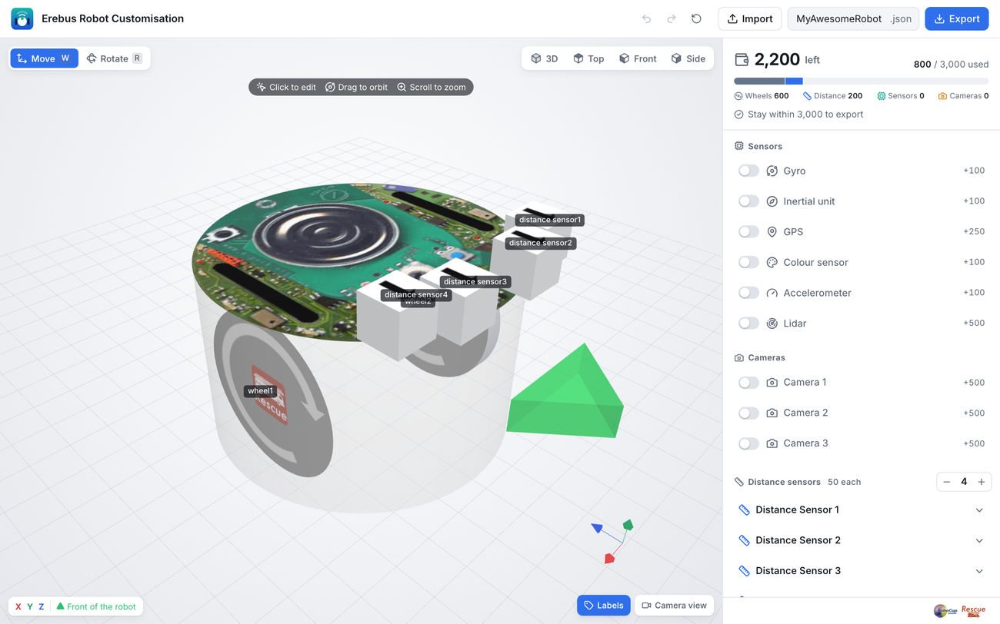
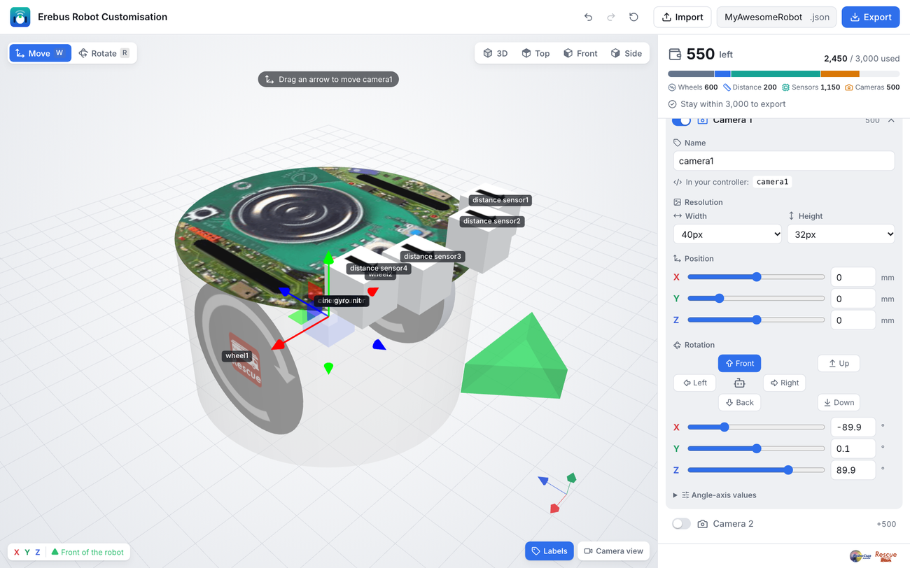

[Robot Customizer](https://robot.erebus.rcj.cloud/), robotunun sensörlerini ve nereye yerleştirileceklerini seçmeni sağlar. Tarayıcında çalışır ve Erebus'un yüklediği bir `.json` dosyası dışa aktarır.

Yeni mi başlıyorsun? Başlangıç robotunu adım adım yapan [Robotunu yap](/docs/robot/build/) sayfasıyla başla. Bu sayfa geri kalan her şeyi anlatır.

3B önizleme soldadır; bileşenler ve bütçe sağdadır.

## Ekran {#the-screen}

1. **Bileşen ekle.** İstediğin her sensörün ya da kameranın anahtarını aç ve mesafe sensörlerinin sayısını `−` ve `+` ile ayarla. Her bileşenin maliyeti yanında gösterilir.
2. **Bütçenin içinde kal.** Sağ üst köşe, 3000'lik bütçenin ne kadarının kaldığını ve bunun tekerlekler, mesafe sensörleri, sensörler ve kameralar arasında nasıl bölündüğünü gösterir. Bütçeyi aşarsan ne kadar çıkarman gerektiğini söyler: robot bütçeye sığana kadar dışa aktarılamaz.
3. **Yerleştir.** Ayarlarını açmak için listede ya da 3B görünümde bir bileşene tıkla. 3B görünümdeki okları **Move** (`W`) ya da **Rotate** (`R`) ile sürükle veya değerleri yaz. Kutularda mm yazsa da konumlar milimetrenin onda biri cinsindendir. Y konumu -100 ile 370 arasındadır. Dönüş düğmeleri bir sensörü tek tıkla öne, arkaya, sola, sağa, yukarı ya da aşağı çevirir. Yeşil ok robotun önünü gösterir.
4. **Ad ver.** Ad, **In your controller** altında gösterildiği gibi programının `getDevice()` ile kullandığı şeydir. Tekerlekler iki cihaz alır: `<name> motor` ve `<name> sensor`. Wheel 1 robotun sağ tarafında, Wheel 2 sol tarafındadır.
5. **Kamera çözünürlüğünü ayarla.** Her kameranın, maliyetini değiştiren bir genişliği ve yüksekliği vardır.
6. **Dışa aktar.** Üstte bir dosya adı gir ve **Export** düğmesine bas. Dosyayı sakla: **Import** ile ya da dosyayı sayfaya bırakarak onu geri getirip üzerinde çalışmaya devam edebilirsin.

### Kullanışlı görünümler {#useful-views}
- **3D**, **Top**, **Front** ve **Side** robotu farklı açılardan gösterir. Top, sensörleri simetrik yerleştirmek için kullanışlıdır.
- **Labels** her bileşenin adını gösterir.
- **Camera view**, kameraların Webots'ta ne göreceğine dair bir tahmin gösterir.
- Geri alma, yineleme ve sıfırlama üsttedir.

## Erebus'ta kullanma {#using-it-in-erebus}

[Kontrol penceresinin](/docs/getting-started/#the-control-window) sağdaki LOAD düğmesine bas ve `.json` dosyanı seç. [Erebus'a yükle](/docs/robot/#load-it-in-erebus) bölümüne bak. Erebus bütçeyi kontrol eder ve robotu oluşturur; Webots konsolu da her bileşeni ve maliyetini listeler.

Önce robotunu, sonra programını yükle.

## Bileşenler {#components}

| Bileşen | Maliyet | Varsayılan ad |
|---|---|---|
| Tekerlek (2, zorunlu) | Her biri 300 | `wheel1`, `wheel2` |
| Mesafe sensörü (en fazla 8) | Her biri 50 | `distance sensor1`, `distance sensor2`… |
| Jiroskop | 100 | `gyro` |
| Eylemsizlik birimi | 100 | `inertial_unit` |
| İvmeölçer | 100 | `accelerometer` |
| Renk sensörü | 100 | `colour_sensor` |
| GPS | 250 | `gps` |
| Lidar | 500 | `lidar` |
| Kamera (en fazla 3) | 500, artı çözünürlük maliyeti | `camera1`, `camera2`, `camera3` |

Bir kameranın çözünürlük maliyeti, genişliği ve yüksekliği için ayrı ayrı eklenir: 32 ya da 40 piksel 0, 64 piksel 100, 128 piksel 200 ve 256 piksel 300 tutar. Örneğin 256 × 128'lik bir kamera 500 + 300 + 200 = 1000 tutar.

Yeni kameralar 40 × 32 pikseldir. Başlangıç robotu 64 × 40 kullanır.

İki tekerlek birlikte 600 tutar, bu yüzden geri kalan her şey için bütçenin 2400'ü kalır.

## Tasarım ipuçları {#design-tips}

- **GPS:** işaretleri bildirmek için bir konuma ihtiyacın var ve bunu elde etmenin basit yolu budur.
- **Kameralar:** daha yüksek çözünürlükler işaretleri daha uzaktan okur, ama daha pahalıdır ve işlenmeleri daha yavaştır.
- **Lidar:** robotun çevresindeki her şeyi görür, bu da haritalamaya çok yardımcı olur. Onu üste yerleştir ve [başlangıç robotundaki](/docs/robot/build/) gibi X `90` dönüşüyle düz yatır; aksi halde robot onu engeller.
- **Renk sensörü:** robotun bir çukura düşmeden önce onu görmesi için tekerleklerin önüne yerleştir.

[Robotunu yap](/docs/robot/build/) eksiksiz bir örnek gösterir.
