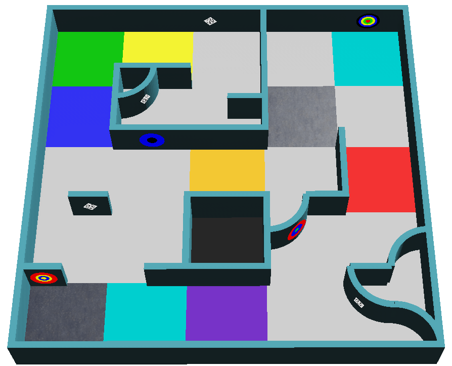

:::note
Bu sayfa başlaman için hazırlanmış bir özettir. Tek resmi kurallar [RoboCupJunior Rescue Simulation Rules 2027](https://junior.robocup.org/wp-content/uploads/2026/09/RCJRescueSimulation2027-draft.pdf) belgesidir. Bu özet, 2026-10-24 tarihinde güncellenen sürümü temel alır. Bu sayfa ile resmi kurallar farklıysa resmi kurallar geçerlidir.

Düzeltmeler ve açıklamalar [resmî RoboCupJunior Forumu](https://junior.forum.robocup.org/) üzerinde yayımlanır. Bunları kontrol etmek her takımın sorumluluğundadır.
:::

## Bir dakikada oyun {#the-game-in-one-minute}
Robotun, bilinmeyen bir labirente tek başına bırakılır. 8 dakika içinde, senden hiçbir yardım almadan şunları yapmalıdır:

1. Sıkışmadan ya da çukurlara düşmeden labirenti **keşfetmek**.
2. Duvarlardaki **duvar işaretlerini** (wall tokens), yani kazazedeleri ve bilişsel hedefleri **bulmak** ve her birinin ne olduğunu bildirmek.
3. **Bataryasını dolu tutmak**: batarya bitmeden bir temas karesinde durmak.
4. Labirentin **haritasını çıkarmak** ve haritayı sonunda göndermek.
5. Başladığı yere **dönmek**.

Aşağıdaki her şey bu beş görevi ayrıntılı olarak açıklar. Şimdi hepsini aklında tutman gerekmiyor: her bölümü programlarken buraya geri dön.

## Görev ve amaç {#mission-and-objective}

Robot, kendini tehlikeye atmadan bilinmeyen bir ortamı otonom olarak keşfetmelidir. Üç ana görev vardır:

- Sıkışmadan karmaşık bir labirentte yol bulmak
- Ortamın haritasını doğru şekilde çıkarmak
- Duvar işaretlerini bulmak ve tanımlamak: gülen yüz kazazedeler (letter victims) ve bilişsel hedefler (cognitive targets)

## Saha {#the-field}
Saha en fazla dört alandan oluşur. Alan 1 her zaman sahanın bir parçasıdır; organizatörler Alan 2-4'ü sahaya koymayabilir. Alanlar arasındaki her geçit bir standart kare genişliğindedir. Kareler fiziksel yapılar değil, sahayı oluşturmak için kullanılan bir kavramdır.

- Bir kare **12 cm × 12 cm**'dir. 2. ve 3. alanlarda her kare 6 cm × 6 cm'lik dört **çeyrek kareye** (quarter tiles) bölünür.
- Duvarlar **1 cm kalınlığında ve 6 cm yüksekliğindedir**.
- Yollar en az robot kadar geniştir ve daha geniş salonlara açılabilir.

| Alan | Duvarlar | Notlar |
|---|---|---|
| 1. alan | Her karenin kenarlarına yerleştirilebilir | Başlangıç karesi bu alandadır |
| 2. alan | Her çeyrek karenin kenarlarına yerleştirilebilir | |
| 3. alan | Her çeyrek karenin kenarlarına yerleştirilebilir | 90°'lik köşeler çeyrek daire şeklinde yuvarlatılabilir |
| 4. alan (isteğe bağlı) | Karelere dayanmaz; duvarlar ve engeller rastgele yerleştirilir | Kutu gibi nesneler içerebilir ve çapraz hareket gerektirebilir |

### Alanlar arasındaki geçitler {#passages-between-areas}
Geçitler, belirgin bir girişleri ve çıkışları olması için iki yanında duvar bulunan tek karelerdir. Zemin renkleri hangi alanları bağladıklarını gösterir:

Geçitlerin duvarlarına duvar işareti konmaz.

### Doğrusal ve yüzen kareler {#linear-and-floating-tiles}
En soldaki ya da en sağdaki duvar sürekli izlenerek başlangıç karesine götüren kareler **doğrusal karelerdir** (linear tiles). Diğerlerinin hepsi **yüzen karelerdir** (floating tiles). Yüzen karelerdeki işaretler daha fazla puan değerindedir. Burada çeyrek kareler hesaba katılmaz ve çukurlar sanal duvar sayılır.

### Kontrol noktaları {#checkpoints}
Gümüş renkli kareler kontrol noktalarıdır (checkpoints) ve sahanın herhangi bir yerinde olabilirler. 4. alanda geçitlerin hemen ardından kontrol noktaları bulunur. Bir ilerleme eksikliğinden sonra robot ziyaret ettiği son kontrol noktasından yeniden başlar.

## Bataklıklar, engeller ve çukurlar {#swamps-obstacles-and-holes}

* **Bataklıklar** (kahverengi kareler), robot üzerlerindeyken motorlar daha çok zorlandığı için bataryanın daha hızlı bitmesine yol açar. Oyun süresi etkilenmez.
* **Engeller** zemine sabitlenmiş olabilir, herhangi bir şekil ve renkte olabilir ve yolun genişliğini etkiler. 1-3. alanlarda bir engelin merkezi her zaman bir karenin üzerindedir, asla kareler arasındaki kenarda değildir ve her karede en fazla bir engel bulunur.
* **Çukurlar**, zemininde açıklık olan karelerdir. Kenarları siyahtır ve komşu karelerden 1,5 cm içeridedir. Robot birine düşerse ilerleme eksikliği oluşur.

Hiçbir kare aynı anda şunlardan birden fazlası olamaz: bataklık, çukur, kontrol noktası, temas karesi, başlangıç karesi, engelli kare veya alanlar arası geçit.

## Temas kareleri {#contact-tiles}
Temas kareleri, oyun sırasında robotun bataryasının değiştirilebildiği **camgöbeği** renkli karelerdir. Batarya değiştirilirken robot karenin üzerinde hareketsiz durmalıdır. Bkz. [Batarya](#the-battery).

## Duvar işaretleri {#wall-tokens}
İki tür duvar işareti vardır: gülen yüz kazazedeler ve bilişsel hedefler. İkisi de alanlar arası geçitlerin duvarları hariç, eğri yüzeyler dahil her duvarda bulunabilir. Gülen yüz kazazedeler ayrıca 0 ile 360 derece arasında herhangi bir açıyla döndürülmüş olabilir.

### Gülen yüz kazazedeler {#smiley-victims}
Gülen yüz kazazedeler, siyah basılmış bir gülen yüz emojisinin 2 cm × 2 cm boyutundaki görüntüleridir. Yüz ifadesi kazazedenin sağlık durumunu gösterir; kod ise bildirdiğin ve haritaya yazdığın harftir.

| Durum | Yüz | Kod |
|---|---|---|
| Yaralı | Üzgün | `H` |
| Stabil | Nötr | `S` |
| Yarasız | Mutlu | `U` |

### Sahte kazazedeler {#fake-victims}
Bazı duvar işaretleri aynı yüzleri gösterir ama emojiler **üç boyutludur**. Bunlar sahtedir: onları süpervizöre bildirmemeli ve haritaya koymamalısın. Kurallara göre bu derinlik, Robot Customizer'daki sensörlerden biriyle algılanabilir.

### Bilişsel hedefler {#cognitive-targets}
Bilişsel hedefler, tehlikeli maddeleri (hazmat) temsil eder. Bunlar, çapları 1, 2, 3, 4 ve 5 cm olan beş eş merkezli parçadan oluşan, 5 cm çapında dairelerdir. Her rengin bir değeri vardır:

| Siyah | Kırmızı | Sarı | Yeşil | Mavi |
|---|---|---|---|---|
| -2 | -1 | 0 | 1 | 2 |

Türü bulmak için beş parçanın değerlerini topla. Toplam aşağıdaki listede yoksa hedef sahte bir duvar işaretidir; bildirilmemeli ve haritaya konmamalıdır.

| Toplam | Tehlikeli madde | Kod |
|---|---|---|
| 0 | Yanıcı Gaz (Flammable Gas) | `F` |
| 1 | Zehir (Poison) | `P` |
| 2 | Aşındırıcı (Corrosive) | `C` |
| 3 | Organik Peroksit (Organic Peroxide) | `O` |

Aynı renkteki bitişik halkalar **birleştirilmez**: renkler tekrar etse bile her zaman beşini de say.

Soldaki hedef, merkezden dışa doğru sarı, mavi, kırmızı, siyah ve yeşildir: 0 + 2 - 1 - 2 + 1 = 0, yani yanıcı gazdır (`F`). Sağdaki hedef mavi, sarı, siyah, siyah ve siyahtır: 2 + 0 - 2 - 2 - 2 = -4, yani sahtedir.

[Duvar işaretleri eğitimi](/docs/programming/wall-tokens/), bir hedefin kamerayla nasıl okunacağını gösterir.

## Robot {#the-robot}
- Takımlar organizatörlerin sağladığı robot modelini kullanır ve onu **3000**'lik bir bütçe dahilinde [Robot Customizer](https://robot.erebus.rcj.cloud/) ile özelleştirebilir. [Robot](/docs/robot/) sayfasına bak.
- Robot bir GPS, bir renk sensörü, mesafe sensörleri, RGB kameralar, bir LiDAR, bir jiroskop ve bir ivmeölçer kullanabilir.
- Simüle edilen sensörlerde gerçekçi gürültü vardır. Programın buna karşı dayanıklı olmalıdır; organizatörler yarışma için gürültü seviyelerini değiştirmez.

### Batarya {#the-battery}
Robotun, motorlarının hızına bağlı olarak azalan bir bataryası vardır. Batarya seviyesi kontrol penceresinde, sayaçların üstünde gösterilir. Kurallar tam azalma hızını vermez: takımların bunu test ederek bulmaları beklenir.

- Bataryayı değiştirmek için robot, **simülasyon zamanıyla 5 saniye boyunca bir temas karesinin üzerinde hareketsiz durmalıdır**. Batarya ardından yeniden dolar.
- Bataklıklarda batarya daha hızlı azalır.
- Batarya biterse oyun sona erer.

[Batarya](/docs/programming/battery/) eğitimi, programının batarya seviyesini nasıl okuyup bataryayı nasıl değiştirebileceğini gösterir.
- Robotlar otonom olmalıdır. Her takımın sahada bir robotu vardır.
- Önceden haritalama yasaktır: bu yasak hem sahayı hem de duvar işaretlerinin konumlarını kapsar; bilinen konumlardan yola çıkan önceden tanımlanmış hareketler de buna dahildir. Önceden haritalama yapan takım o turdan derhal diskalifiye edilir.

## Bir oyun oynama {#playing-a-game}
- Bir oyun **8 dakika simülasyon zamanı** sürer. İkinci bir sayaç da gerçek zamanlı olarak, **10 dakika** sınırıyla çalışır. Sayaçlardan herhangi biri dolduğunda oyun biter.
- Robotun merkezi bir karenin içindeyse o kare ziyaret edilmiş sayılır; bunu süpervizör belirler.
- Oyun ayrıca batarya bittiğinde, robot çıkış komutunu gönderdiğinde ya da takım kaptanı oyunun bittiğini bildirdiğinde (oyunun nasıl yürütüldüğüne bağlı olarak) sona erer.
- Yarışma dünyaları oyunlardan hemen önce açıklanır ve organizatörlerin duyurduğu her turun resmi son tarihinden sonra programlar değiştirilemez.

### İlerleme eksikliği {#lack-of-progress}
İlerleme eksikliği (lack of progress, LoP) şu durumlarda olur:

- Robot bir çukura düştüğünde.
- Robot 20 saniye ya da daha uzun süre sabit bir konumda kaldığında (otomatik olarak çağrılır).
- Hakem, robotun hareketsiz olmadığına ama bir hareket döngüsünde sıkıştığına karar verdiğinde.
- Robot bunu kendisi çağırdığında.
- Diğer durumlarda takım kaptanı bunu isteyebilir ve son kararı hakem verir. Oyunun nasıl yürütüldüğüne bağlı olarak bu geçerli olmayabilir.

Robot daha sonra ziyaret ettiği son kontrol noktasına ya da hiçbirine ulaşmadıysa başlangıç karesine geri yerleştirilir. Yönü seçilemez. Erebus ayrıca robota `L` harfini gönderir, böylece programın [buna tepki verebilir](/docs/programming/communication/#lack-of-progress).

## Puanlama {#scoring}
Puanlama Erebus tarafından otomatik olarak yapılır. Ödüller tekrarlanmaz: örneğin her kontrol noktası yalnızca ilk seferde puan kazandırır.

Bir duvar işaretini tanımlamak için robot **en az 1 saniye** durmalı, sonra türü ve konumu süpervizöre [göndermelidir](/docs/programming/communication/#scoring-wall-tokens). Robotun merkezi işarete en fazla yarım kare uzaklıkta olmalıdır.

| Öğe | Puan |
|---|---|
| 1-3. alanlarda doğrusal bir karede duvar işareti tanımlama (TI) | Gülen yüz kazazede: 5, bilişsel hedef: 10 |
| 1-3. alanlarda yüzen bir karede duvar işareti tanımlama (TI) ve 4. alandaki tüm işaretler | Gülen yüz kazazede: 15, bilişsel hedef: 30 |
| TI'ya ek olarak doğru tür (TT) | Gülen yüz kazazede: 10, bilişsel hedef: 20 |
| Ziyaret edilen kontrol noktası (CN) | 10 |
| Yanlış duvar işareti tanımlama (TMI) | -5 |
| İlerleme eksikliği (LoP) | -5 |

Toplam puan sıfırın altına düşemez. Yanlış tanımlama; işarete yarım kareden daha uzak bir konum bildirmek, işaret olmayan bir yerde işaret bildirmek ya da bir gülen yüz kazazedeyi bilişsel hedef olarak bildirmek (veya tersi) anlamına gelir. Sahte bir işareti bildirmek ikinci kategoriye girer.

**Alan çarpanları (AM)**: TI, TT ve CN; 1., 2., 3. ve 4. alanlarda sırasıyla 1, 1,25, 1,5 ve 2 ile çarpılır. TMI ve LoP çarpılmaz.

**Çıkış bonusu (exit bonus, EB)**: robot en az bir duvar işaretini tanımladıysa, başlangıç karesine döner ve çıkış komutunu gönderirse puan %10 artar.

**Haritalama bonusu (mapping bonus, MB)**: robot labirentin haritasını gönderebilir. Çarpan doğruluk × 1,2 + 1'dir, yani kusursuz bir harita puanı 2,2 ile çarpar. [Haritalama](/docs/rules/mapping/) sayfasına bak.

Bir oyunun saha puanı şöyle hesaplanır:

Örneğin bu sonuçları alan bir oyun 2825,35 puan alır:

## Yarışma {#the-competition}
Nasıl hazırlanacağın, göndermen gereken belgeler, yarışma kurulumu ve final puanı [Yarışmaya hazırlanma](/docs/competition/) sayfasındadır.

## Sonraki adım {#next}
Robotunun ne yapması gerektiğini artık bildiğine göre [robotunu edin](/docs/robot/).
