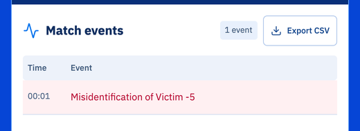

import CodeTabs from '@/components/CodeTabs.astro';

你的程序通过每个机器人都有的两个设备与比赛通信：

- **发射器**（emitter）向比赛发送消息。它不需要启用。
- **接收器**（receiver）接收来自比赛的消息。像传感器一样启用它。

下面每一节都是一个适用于[入门机器人](/docs/robot/)的完整程序。所有消息都列在[消息参考](/docs/reference/messages/)中。

## 为墙面标识得分 \{#scoring-wall-tokens\}

要为一个笑脸受害者（Letter victim）或认知目标（Cognitive target）得分，机器人必须：

1. 在标识附近**停止超过 1 秒**。如果机器人在最近一秒内移动过，Erebus 会忽略这次报告。
2. **发送标识的位置和类型**：X 和 Z 以**厘米**为单位，类型用一个字母表示。

| 墙面标识 | 类型 |
|---|---|
| 笑脸受害者，难过的脸（受伤） | `H` |
| 笑脸受害者，平静的脸（稳定） | `S` |
| 笑脸受害者，开心的脸（未受伤） | `U` |
| 认知目标，和为 0（易燃气体） | `F` |
| 认知目标，和为 1（毒性物质） | `P` |
| 认知目标，和为 2（腐蚀性物质） | `C` |
| 认知目标，和为 3（有机过氧化物） | `O` |

虽然受害者显示的是表情，但类型仍然是字母。GPS 给出的单位是米，所以要乘以 100。

<CodeTabs file="report" />

机器人必须和标识在墙的同一侧，并且机器人的中心和你发送的位置都必须在离标识半个地块（6 cm）以内。

在 `world1.wbt` 的起点运行这个程序：那里没有标识，所以控制窗口的比赛事件中会显示 `Misidentification of Victim -5`。错误的报告（包括报告假标识）会扣 5 分，并且每个标识只能得分一次。

## 缺乏进展 \{#lack-of-progress\}

当机器人被卡住时，缺乏进展（Lack of progress，LoP）会把它移回最后一个检查点，并扣 5 分。机器人 20 秒不动时会自动触发，你的程序也可以通过发送 `L` 来主动请求。每次发生时，比赛都会向机器人发送 `L`，让你的程序知道它的位置已经改变。

<CodeTabs file="lop" />

接收器可能会收到不同的消息，所以像示例中那样，在读取每条消息之前先检查它的长度。

## 比赛信息 \{#game-information\}

发送 `G` 可以获取分数、剩余时间和电池电量。比赛会回复一条 20 字节的消息：字母 `G`、分数、剩余的比赛时间和真实时间（秒），以及电池电量（百分比）。

<CodeTabs file="gameinfo" />

任意一个时间耗尽，或者电池用完时，比赛就会结束。用它们来判断何时返回起点，以及何时[更换电池](/docs/programming/battery/)。

## 结束比赛 \{#ending-the-game\}

发送 `E` 来结束比赛。如果机器人位于起始地块上，并且已经识别出至少一个墙面标识，就能获得 10% 的离场奖励（Exit bonus）。

<CodeTabs file="exit" />

:::caution
发送 `E` 时，无论机器人在哪里，比赛都会结束，机器人也无法继续。请确保它已经先回到起始地块，并且已经[提交了地图](/docs/programming/map-bonus/)。
:::

接下来，在[墙面标识](/docs/programming/wall-tokens/)中学习如何区分各种标识。
