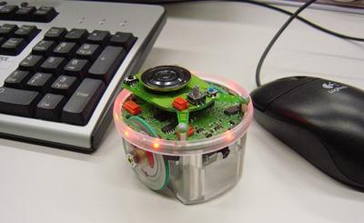

在 Erebus 中，**机器人由你来设计**：你在预算范围内选择它的传感器和安装位置。每个程序都需要一个机器人，所以第一步就是获取一个机器人，并把它加载到 Erebus 中。

这个机器人基于 [e-puck](https://cyberbotics.com/doc/guide/epuck?version=R2023b)，一种有两个车轮的小型圆形教育机器人。你用 [Robot Customizer](https://robot.erebus.rcj.cloud/) 为它添加传感器，并把设计保存为 Erebus 可以加载的 `.json` 文件。

## 入门机器人 {#the-starter-robot}
本文档在所有地方都使用同一个机器人，也就是**入门机器人**，这样每个示例都能直接运行。它拥有教程需要的所有传感器：

| 部件 | 程序中的名称 | 用途 |
|---|---|---|
| 两个车轮 | `left wheel motor`、`right wheel motor` | 移动 |
| 车轮编码器 | `left wheel sensor`、`right wheel sensor` | 测量车轮转过了多少 |
| 三个距离传感器 | `leftDist`、`frontDist`、`rightDist` | 找到左侧、前方和右侧的墙 |
| 摄像头，64 × 40 像素 | `camera` | 寻找墙上的标识 |
| 颜色传感器 | `color` | 查看地面：坑洞、沼泽和通道 |
| GPS | `gps` | 了解自己的位置，用于报告标识 |
| 陀螺仪 | `gyro` | 测量转过了多少 |
| 加速度计 | `accelerometer` | 测量加速度 |
| 激光雷达 | `lidar` | 测量四周的距离 |
| 发射器和接收器 | `emitter`、`receiver` | 与比赛通信。每个机器人都有。 |

它在 3000 的预算中花费 2400。

## 选择你的方式 {#choose-your-path}

**推荐：自己动手搭建。** 大约需要 15 分钟，你会了解机器人的每一个部分。请按照[搭建机器人](/docs/robot/build/)操作。

**赶时间的话：** 下载搭建好的机器人，继续学习教程。你随时可以回来再自己搭建。

<a href="/downloads/starter-robot.json" download>下载 starter-robot.json</a>

## 在 Erebus 中加载 {#load-it-in-erebus}
1. 打开一个世界，例如 `game/worlds/world1.wbt`。
2. 在控制窗口中，按下带有机器人图标的**右侧 LOAD 按钮**，然后选择你的 `.json` 文件。
3. 查看 Webots 控制台。Erebus 会列出每个部件及其花费，最后显示 `Your custom robot has been successfully generated!`。

:::note
Erebus v26.1 还会用红字打印 `PROTO parameter 'camera_width' has no matching IS field`。你可以忽略它：你的摄像头仍然是你选择的分辨率。
:::

在你加载另一个机器人或重置比赛之前，机器人会一直保持加载状态。接下来，[运行你的第一个程序](/docs/getting-started/)。

## 设计你自己的机器人 {#designing-your-own}
掌握基础之后，你可以修改入门机器人，或者设计一个新的机器人：更多、分辨率更高的摄像头，更多距离传感器，或者把传感器放在其他位置。[Robot Customizer 参考](/docs/robot/customizer/)列出了所有部件及其花费和限制。

如果你修改了某个部件的名称，也要在程序中同步修改。
