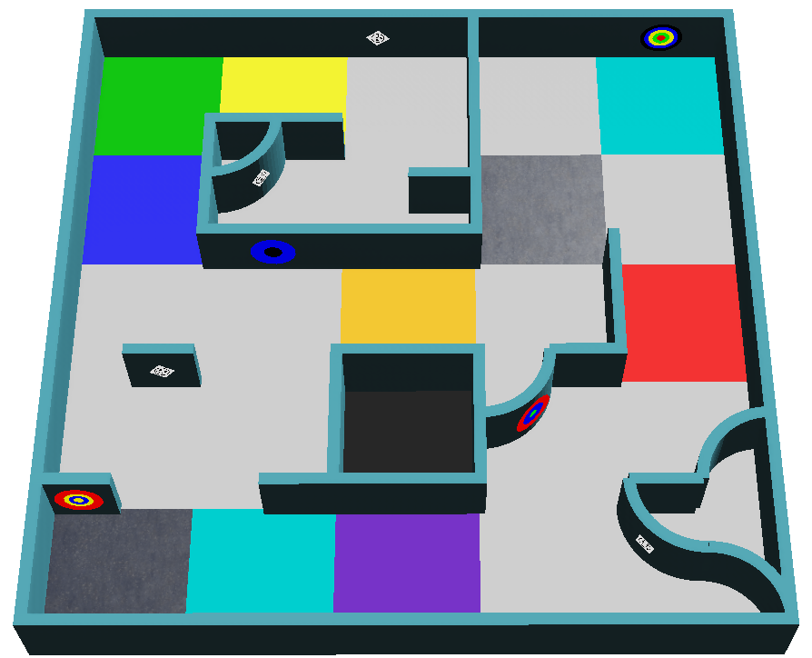

:::note
本页是帮助你入门的摘要。唯一的官方规则是 [RoboCupJunior Rescue Simulation Rules 2027](https://junior.robocup.org/wp-content/uploads/2026/09/RCJRescueSimulation2027-draft.pdf)。本摘要依据 2026-10-24 更新的版本。如果本页与官方规则不一致，以官方规则为准。

更正和规则澄清会发布在 [RoboCupJunior 官方论坛](https://junior.forum.robocup.org/)上。检查这些内容是每支队伍自己的责任。
:::

## 一分钟了解比赛 {#the-game-in-one-minute}
你的机器人会被独自放进一座未知的迷宫。在 8 分钟内，没有你的任何帮助，它必须：

1. **探索**迷宫，不被卡住，也不掉进坑洞。
2. **找到墙面标识**，也就是墙上的受害者和认知目标，并报告每一个是什么。
3. **保持电池电量**：在电池耗尽之前停在接触地块上。
4. **绘制**迷宫的地图，并在最后发送地图。
5. **返回**出发的地方。

下面会详细说明这五项任务。你现在不需要全部记住：在编写每一部分的程序时再回来查看。

## 任务和目标 {#mission-and-objective}

机器人必须自主探索一个未知的环境，同时避免陷入麻烦。主要有三项任务：

- 在复杂的迷宫中导航而不被卡住
- 准确地绘制环境地图
- 找到并识别墙面标识：笑脸受害者（Letter victims）和认知目标（Cognitive targets）

## 场地 {#the-field}
场地最多由四个区域组成。区域 1 一定是场地的一部分，组织者可以省略区域 2 到 4。区域之间的每条通道宽度为一个标准地块。地块是用来生成场地的概念，而不是实际的结构。

- 地块的大小是 **12 cm × 12 cm**。在区域 2 和 3 中，每个地块又被细分为四个 6 cm × 6 cm 的**四分之一地块**。
- 墙壁**厚 1 cm，高 6 cm**。
- 通道至少和机器人一样宽，并且可能通向更宽的门厅。

| 区域 | 墙壁 | 说明 |
|---|---|---|
| 区域 1 | 可以放在每个地块的边上 | 起始地块位于这个区域 |
| 区域 2 | 可以放在每个四分之一地块的边上 | |
| 区域 3 | 可以放在每个四分之一地块的边上 | 90° 的拐角可以被做成四分之一圆的弧形 |
| 区域 4（可选） | 不基于地块；墙壁和障碍物可以任意放置 | 可能包含箱子等物体，并且可能需要斜向移动 |

### 区域之间的通道 {#passages-between-areas}
通道是两侧有墙的单个地块，因此它的入口和出口都很明确。通道地面的颜色告诉你它连接的是哪两个区域：

通道的墙上不会放置墙面标识。

### 线性地块和浮动地块 {#linear-and-floating-tiles}
始终沿着最左侧或最右侧的墙走就能通到起始地块的地块，称为**线性地块**（linear tiles）。其他所有地块都是**浮动地块**（floating tiles）。浮动地块上的标识分值更高。这里不考虑四分之一地块，而坑洞被视为虚拟的墙。

### 检查点 {#checkpoints}
银色的地块是检查点（Checkpoint），可能位于场地上的任何位置。区域 4 中，紧接着通道之后就有检查点。发生缺乏进展后，机器人会从它最后经过的检查点重新开始。

## 沼泽、障碍物和坑洞 {#swamps-obstacles-and-holes}

* 当机器人位于**沼泽**（棕色地块）上时，由于电机需要更费力，电池会消耗得更快。比赛时间不受影响。
* **障碍物**可能固定在地面上，可以是任何形状和颜色，并且会影响通道的宽度。在区域 1 到 3 中，障碍物的中心总是位于地块上，而不会位于地块之间的边上，并且每个地块上最多只有一个障碍物。
* **坑洞**是地面上有开口的地块。它的边缘是黑色的，离相邻地块 1.5 cm。如果机器人掉进去，就会发生缺乏进展。

没有任何地块会同时属于以下多种：沼泽、坑洞、检查点、接触地块、起始地块、有障碍物的地块或区域之间的通道。

## 接触地块 {#contact-tiles}
接触地块是**青色**的地块，比赛中可以在这里更换机器人的电池。更换电池时，机器人必须在地块上保持静止。参见[电池](#the-battery)。

## 墙面标识 {#wall-tokens}
墙面标识有两种：笑脸受害者和认知目标。两者都可能出现在任何墙上，包括曲面，但不会出现在区域之间通道的墙上。笑脸受害者还可能旋转到 0 到 360 度之间的任意角度。

### 笑脸受害者 {#smiley-victims}
笑脸受害者是 2 cm × 2 cm 的图片，内容是用黑色印刷的笑脸表情符号。表情代表受害者的健康状态，代码是你要报告并写在地图上的字母。

| 状态 | 表情 | 代码 |
|---|---|---|
| 受伤 | 难过 | `H` |
| 稳定 | 平静 | `S` |
| 未受伤 | 开心 | `U` |

### 假受害者 {#fake-victims}
有些墙面标识显示相同的表情，但表情符号是**立体的**。它们是假的：你不能把它们报告给监督程序，也不能写进地图。规则指出，这种深度可以用机器人定制器中提供的某个传感器检测到。

### 认知目标 {#cognitive-targets}
认知目标（Cognitive targets）代表危险品（hazmat）。它们是直径 5 cm 的圆形，由五个同心部分组成，直径分别为 1、2、3、4 和 5 cm。每种颜色都有一个数值：

| 黑 | 红 | 黄 | 绿 | 蓝 |
|---|---|---|---|---|
| -2 | -1 | 0 | 1 | 2 |

把五个部分的值加起来就得到类型。如果总和不在下面的列表中，这个目标就是假的墙面标识，不能报告，也不能写进地图。

| 和 | 危险品 | 代码 |
|---|---|---|
| 0 | 易燃气体（Flammable Gas） | `F` |
| 1 | 毒性物质（Poison） | `P` |
| 2 | 腐蚀性物质（Corrosive） | `C` |
| 3 | 有机过氧化物（Organic Peroxide） | `O` |

相邻的同色圆环**不会**被合并：即使颜色重复，也总是要把五个部分都算上。

左边的目标从中心向外依次是黄、蓝、红、黑、绿：0 + 2 - 1 - 2 + 1 = 0，所以它是易燃气体（`F`）。右边的目标是蓝、黄、黑、黑、黑：2 + 0 - 2 - 2 - 2 = -4，所以它是假的。

[墙面标识教程](/docs/programming/wall-tokens/)介绍了如何用摄像头读取目标。

## 机器人 {#the-robot}
- 各队使用组织者提供的机器人模型，并可以在 **3000** 的预算内用 [Robot Customizer](https://robot.erebus.rcj.cloud/) 对它进行定制。请参阅[获取机器人](/docs/robot/)。
- 机器人可以使用 GPS、颜色传感器、距离传感器、RGB 摄像头、激光雷达（LiDAR）、陀螺仪和加速度计。
- 仿真的传感器带有真实的噪声。你的程序必须能够应对噪声，而且组织者在比赛中不会改变噪声水平。

### 电池 {#the-battery}
机器人有一块电池，它会根据电机的速度消耗。电池电量显示在控制窗口中计时器的上方。规则没有给出确切的消耗速度：各队需要通过测试来了解它的特性。

- 要更换电池，机器人必须**在接触地块上静止 5 秒**（仿真时间）。之后电池会重新充满。
- 在沼泽中，电池消耗得更快。
- 电池耗尽时，比赛结束。

[电池](/docs/programming/battery/)教程介绍了程序如何读取电池电量并更换电池。
- 机器人必须是自主的。每支队伍在场地上只有一个机器人。
- 禁止事先绘制地图（pre-mapping）：这既包括场地，也包括墙面标识的位置，还包括根据已知位置预先设定的动作。违反者会被立即取消该轮比赛的资格。

## 进行一场比赛 {#playing-a-game}
- 一场比赛持续 **8 分钟仿真时间**。另一个计时器按真实时间计时，上限为 **10 分钟**。任意一个计时器到时，比赛就结束。
- 当机器人的中心位于某个地块内时，该地块就算已访问，由监督程序判定。
- 当电池耗尽、机器人发送离场命令，或者队长宣布结束比赛（取决于比赛的进行方式）时，比赛也会结束。
- 比赛用的世界会在比赛开始前才公布，在组织者公布的每轮正式截止时间之后，就不能再修改程序。

### 缺乏进展 {#lack-of-progress}
以下情况会发生缺乏进展（Lack of progress，LoP）：

- 机器人掉进了坑洞。
- 机器人在同一位置停留 20 秒或更长时间（自动触发）。
- 裁判判定机器人虽然没有静止，但陷入了重复的动作中无法脱身。
- 机器人自主请求。
- 在其他情况下，队长可以提出请求，由裁判做出最终决定。根据比赛的执行方式，这一条可能不适用。

之后，机器人会被放回它最后经过的检查点；如果它从未到达过检查点，就放回起始地块。机器人的朝向不能选择。Erebus 还会向机器人发送字母 `L`，以便你的程序[做出反应](/docs/programming/communication/#lack-of-progress)。

## 计分 {#scoring}
计分由 Erebus 自动完成。奖励不会重复计算：例如，每个检查点只有第一次经过时才得分。

要识别一个墙面标识，机器人必须停止**至少 1 秒**，然后把类型和位置[发送](/docs/programming/communication/#scoring-wall-tokens)给监督程序。机器人的中心与标识的距离不能超过半个地块。

| 项目 | 分数 |
|---|---|
| 在区域 1 到 3 的线性地块上识别墙面标识（TI） | 笑脸受害者：5，认知目标：10 |
| 在区域 1 到 3 的浮动地块上识别墙面标识（TI），以及区域 4 中的所有标识 | 笑脸受害者：15，认知目标：30 |
| 类型正确（TT），在 TI 之外额外得分 | 笑脸受害者：10，认知目标：20 |
| 经过检查点（CN） | 10 |
| 墙面标识误判（TMI） | -5 |
| 缺乏进展（LoP） | -5 |

总分不会低于零。误判是指：报告的位置距离标识超过半个地块、在没有标识的地方报告了标识，或者把笑脸受害者报告成认知目标（反之亦然）。报告假标识属于第二种情况。

**区域乘数（Area multipliers，AM）**：在区域 1、2、3、4 中，TI、TT 和 CN 分别乘以 1、1.25、1.5 和 2。TMI 和 LoP 不乘以乘数。

**离场奖励（Exit bonus，EB）**：如果机器人已经识别出至少一个墙面标识，回到起始地块并发送退出命令，得分会增加 10%。

**地图奖励（Mapping bonus，MB）**：机器人可以提交迷宫的地图。乘数为正确率 × 1.2 + 1，所以一张完美的地图能让得分乘以 2.2。请参阅[地图规则](/docs/rules/mapping/)。

一场比赛的场地得分按如下方式计算：

例如，取得以下成绩的一轮比赛得分为 2825.35 分：

## 比赛 {#the-competition}
如何准备、需要提交的文档材料、比赛设置和最终得分，请参阅[赛前准备](/docs/competition/)。

## 下一步 {#next}
现在你已经知道你的机器人需要做什么了，接下来[获取你的机器人](/docs/robot/)。
