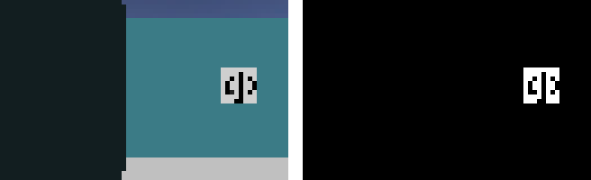

import CodeTabs from '@/components/CodeTabs.astro';

攝影機會提供它前方的影像。你需要用它來找到並辨識[牆上的標記](/docs/programming/wall-tokens/)。入門機器人有一台攝影機，名稱是 `camera`，解析度為 64 × 40 像素。

## 讀取像素 \{#reading-pixels\}

影像是由像素組成的網格。每個像素都有紅、綠、藍三個數值，範圍從 0 到 255，其中 (0, 0, 0) 是黑色，(255, 255, 255) 是白色。

<CodeTabs file="read" />

## 使用 OpenCV \{#using-opencv\}

[OpenCV](https://opencv.org/) 是一個處理影像的函式庫：可以找出形狀、比較顏色等等。Webots 的影像每個像素有 4 個數值，順序為 BGRA，OpenCV 可以直接使用。這個程式會在兩個視窗中分別顯示影像和其中明亮的部分：

<CodeTabs file="opencv" />

左邊是入門機器人在字母受害者前方拍到的攝影機影像，右邊是這個程式找出的影像中明亮的部分。

:::note
如果使用 Python，OpenCV 會和其他 [Python 函式庫](/docs/installation/#python-libraries)一起安裝。如果使用 C++，你需要自行安裝 OpenCV，並[在編譯時加入它](/docs/programming/cpp/#compiling)。C++ 範例已用 OpenCV 4 測試過。
:::

這類視窗是在家測試用的：比賽時請把它們關掉。

## 解析度 \{#resolution\}

解析度越高，就能從越遠的地方看到標記，但成本越高，處理時間也越長。你可以在 [Robot Customizer](/docs/robot/customizer/#components) 中選擇每台攝影機的解析度。
