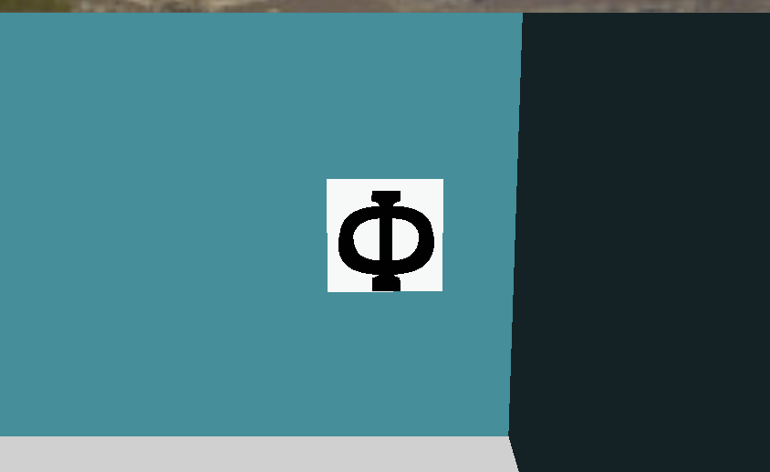

import CodeTabs from '@/components/CodeTabs.astro';

## 機器人要做什麼 \{#what-the-robot-has-to-do\}
牆上的標記（Wall tokens）佔了你大部分的分數，而每次錯誤的回報都會扣 5 分。所以對於找到的每個標記，你都必須判斷：

| 它是…… | 該怎麼做 |
|---|---|
| 字母受害者（Letter victim，Φ、Ψ、Ω） | 回報 `H`、`S` 或 `U` |
| 假受害者（Fake victim，相同的符號，但是立體的） | 不要回報，也不要畫進地圖 |
| 總和為 0 到 3 的認知目標（Cognitive target） | 回報 `F`、`P`、`C` 或 `O` |
| 總和為其他數值的認知目標 | 它是假目標：不要回報，也不要畫進地圖 |

確切的定義請參閱[規則](/docs/rules/#wall-tokens)，如何傳送回報請參閱[通訊](/docs/programming/communication/#scoring-wall-tokens)。

## 攝影機看到的畫面 \{#what-the-camera-sees\}
入門機器人的攝影機是 64 × 40 像素。在這個解析度下，除非機器人靠得很近，否則標記只有幾個像素大，所以最好先從遠處尋找可能的標記，再靠近辨識。請記住，回報時機器人必須在距離標記半個地塊以內；另外，自訂攝影機可以有更高的解析度，但需要花費更多預算。

字母受害者是白色方塊上的黑色符號，而且可能被旋轉成任何角度，所以你的方法不能依賴方向。

## 讀取認知目標 \{#reading-a-cognitive-target\}
認知目標由五個同心的部分組成，所以不需要辨識它的形狀：一旦找到它的中心和外半徑，就可以在每個部分的中間取樣顏色。各部分的半徑分別是 0.5、1、1.5、2 和 2.5 cm，所以它們的中間點分別位於外半徑的 0、0.3、0.5、0.7 和 0.9 處。

這個函式用 Python 和 OpenCV 做到這一點。要找出中心和半徑，例如可以像[迷宮導航](/docs/programming/navigate-the-maze/)那樣使用目標的輪廓。

<CodeTabs file="readRings" />

實際執行時，可能會從斜角看到目標，這時它看起來會像橢圓形。移動到目標正前方、把看起來不對的顏色當作警訊，或讀取多個畫面，都能讓結果更可靠。

## 計算類型 \{#calculating-the-type\}
取得五個顏色之後，要回報的代碼就由它們的總和決定。五個部分每一個都要計算，即使相鄰的顏色相同也一樣。

<CodeTabs file="targetCode" />

例如，`['Y', 'B', 'R', 'K', 'G']` 的總和是 0，所以是 `F`；`['B', 'Y', 'K', 'K', 'K']` 的總和是 -4，所以是假目標。

## 偵測假受害者 \{#detecting-fake-victims\}
假受害者顯示的符號和真的受害者相同，但字母是立體的。從正面看，光靠攝影機可能無法分辨它們：

規則指出，可以用 Robot Customizer 中提供的其中一種感測器偵測到深度。以下是一些可以嘗試的思路：

- 用光達或距離感測器在標記上橫向取得多個距離測量值並比較，尋找高度差異。
- 從斜角觀察標記，立體的浮雕會改變符號的形狀。

`world3.wbt` 和 `world4.wbt` 這兩個世界包含假受害者，[World Editor](/docs/tools/world-editor/#victims-and-cognitive-targets) 也可以把它們加入你自己的地圖。Erebus 還包含 `scripts/update_maps_with_fakes.py` 腳本，可以把現有世界中的受害者隨機轉換成假受害者。

回報假目標會被視為誤判而扣 5 分，而區域 1 中線性地塊上的真受害者連同類型可得 15 分，其他區域的分數更高。在決定機器人要有多大把握才回報時，請把這一點列入考量。
